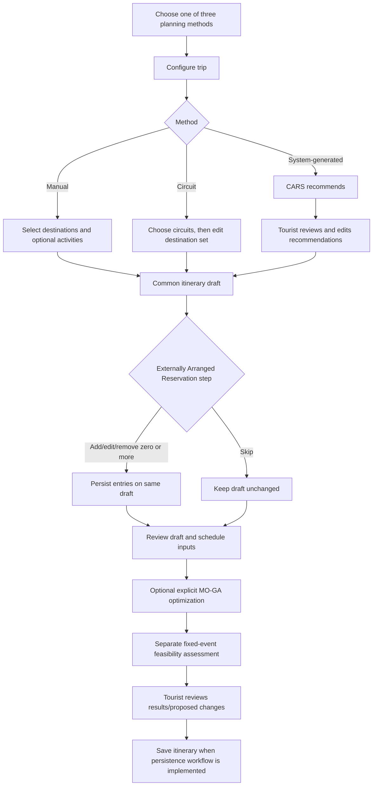

# Task 09B-E — Reservation/Event Technical Contract and Persistence/RLS Specification

**Document status:** Design specification only. No application or database implementation is authorized by this document.

**Policy authority:** [Task 09B-D — Approved Reservation and Activity Policy Baseline](TASK_09B_D_APPROVED_RESERVATION_ACTIVITY_POLICY_BASELINE.md). Its 26 approved policies remain authoritative and are not reopened here.

## A. Executive summary and scope

This specification translates the approved reservation/activity policies into versioned domain contracts, a proposed persistence relationship, authorization intent, scheduling semantics, and acceptance cases. It covers the optional **Externally Arranged Reservation** step shared by Manual Selection, Circuit-Based Planning, and System-Generated Planning. It also defines a separate publisher-owned activity/event directory and tourist reference/notification contracts.

An **externally arranged reservation** is information a tourist enters about an arrangement made independently. SAMAL NAV does not book, confirm, verify, modify, or cancel that arrangement. A reservation-information record is not the same thing as a SAMAL NAV establishment booking. Activity/event listings are publisher-owned directory records; they are distinct from reservation entries and do not constitute registration or a secured place.

The recommended persistence design uses a stable, server-persisted planning draft and a reservation-event child relation that can be atomically associated with either the draft or the saved itinerary during promotion. This supports entries before itinerary save and cross-device continuation while preserving event IDs. It is a proposal requiring deployed-schema and RLS verification, not a verified production capability. Hive currently stores local snapshots; it does not implement cross-device persistence or synchronization. Offline synchronization remains separate future work.

The repository currently has an in-memory `ItineraryDraft`, a manual workflow/adapter, and an establishment-side `ReservationRecord` and service. No end-to-end reservation entry, server draft persistence, activity/event directory, tourist notification center, event-aware scheduling, or Dynamic Self-Healing was found. Local migrations declare objects such as `events`, `notifications`, and `reservations`, but those declarations are not proof of deployed structures. Owner-supplied production evidence reports `public.reservations` as the establishment-side workflow, `itineraries` and `itinerary_stops` with the stated references, and `UNIQUE(establishments.owner_id)`; it does not provide a complete inventory for this proposed architecture.

**Readiness:** the domain and security intent are specified, but implementation is **not ready** until the deployed catalog/RLS evidence and owner decisions in Section O are addressed. No SQL in this document has been executed.

## B. Shared planning workflow integration

The reservation step is optional and shared. It follows destination selection or recommendation review and precedes the explicit optimization action. It does not create a fourth method. All three methods produce/update the same draft contract.

### Method-specific behavior

| Method | Existing selection source | Reservation step behavior | CARS/MO-GA boundary |
|---|---|---|---|
| Manual Selection | Tourist selects destinations/activities and may assign destinations to days. | Continue the same draft to the optional reservation step; add zero or more entries, edit/remove entries, or skip. | CARS is not invoked. If the tourist explicitly requests optimization, pass the destination draft to the existing MO-GA boundary; fixed-event feasibility is a separate layer not yet implemented. |
| Circuit-Based Planning | Tourist selects one or more official geographical groupings, then edits the destination set; circuit membership is not visit order. | Same step and draft relation. Preserve selected circuit IDs and destination-to-circuit provenance while reservation entries are added. | CARS is not invoked. Do not derive visit order from circuit membership. |
| System-Generated Planning | CARS recommends destinations using its six approved criteria; tourist reviews/adds/removes/modifies selections. | Only after tourist review, attach zero or more reservation entries to the same draft; the step can be skipped. | CARS remains exclusive to this method and does not save a plan. The existing MO-GA objectives remain exactly distance, stops reached within daily limit, and visit-plus-travel time variation. |

### Draft lifecycle and step transitions

Recommended lifecycle extension (names are proposal, not existing persisted statuses):

`methodSelected → configuring → selecting/recommendationReview → draftReview → reservationInformation (optional) → readyForOptimization → optimizing → optimizationResults → itineraryReview → saved`.

Returning to earlier steps updates the same server `draft_id` and increments its version. Adding/removing reservation entries does not silently rerun CARS or MO-GA. Skipping creates no placeholder reservation record. Multiple entries have stable event IDs and are independently editable. If the tourist changes devices, the authenticated session loads the same server draft and event children by stable IDs/version; this capability does not exist until persistence and authorization are implemented.



### Required interface statement

The step and each saved entry must be labeled **Externally Arranged Reservation** and display a clear statement such as: “You entered this information about an arrangement made outside SAMAL NAV. SAMAL NAV did not book, confirm, verify, modify, or cancel it.” Do not imply that `Reservation Required` activity classification causes SAMAL NAV to make a reservation.

The draft proceeds to MO-GA through the existing explicit optimize action. The optimizer still receives destination data and day assignments under its existing contract. Fixed events are checked by a future scheduling/constraint layer; they are not added as ordinary genes and do not change the objectives.

## C. Versioned domain contracts

All contract names below are proposed version `v1`. Serialization should use stable UUIDs, explicit enums, nullable optional values, timezone-aware instants in ISO-8601 form, and date-only strings (`YYYY-MM-DD`) for accommodation dates. Unknown values remain null plus an explicit completeness/provenance state; do not serialize them as zero, a fabricated UUID, a default time, or a successful verification. A record `version` is an optimistic concurrency token, not a schema version; retain a separate `contractVersion` for payload evolution.

| Contract | Proposed fields and types | Required/validation | Ownership, source, serialization, version/lifecycle |
|---|---|---|---|
| `ItineraryDraftV1` | `draftId: UUID`; `touristUserId: UUID` (server-derived); `planningMethod: enum`; `stage: enum`; `trip: TripConfiguration`; `version: integer`; `contractVersion: integer`; `createdAt/updatedAt: timestamptz`; optional `promotedItineraryId: UUID`; stops/circuits/CARS reference as supported by method. | Stable ID; only existing three methods; day numbers within trip duration; unique included destination IDs; method-specific provenance. | Authenticated tourist owns it. Server generates ID/time/version; updates require expected version. Cross-device read/write uses same ID. Promotion changes lifecycle once, transactionally. |
| `DraftReservationEventV1` | `eventId: UUID`; exactly-one parent (`draftId` or `itineraryId`); optional `establishmentId: UUID`; `eventType`; conditional `otherDescription`; optional title/name/location snapshots; `timeInput: AppointmentTimeInputV1?`; `stay: AccommodationStayV1?`; optional notes; location/provenance; verification label; `displayOrder: integer`; `version`, contract version and timestamps. | Parent required; event type in closed four-value set; Other description nonblank; Accommodation uses stay fields, not an ordinary appointment interval; non-accommodation may use appointment input. Do not require a location to preserve record. | Owner derived from the parent; service must not accept owner ID as authority. `eventId` survives parent transition during promotion. Writes use idempotency key and expected version. Deletion follows parent lifecycle/retention decision. |
| `EstablishmentReferenceV1` | `establishmentId: UUID`; current `name`, optional address/location/coordinates, verification and source snapshot. | UUID must resolve to an authorized/current catalog record at selection; nullable coordinates remain unavailable, not guessed. | Reference to catalog; store needed display snapshot to keep draft understandable if catalog data changes. No owner access to tourist reservation details follows from this reference. |
| `OffDirectoryEstablishmentSnapshotV1` | `enteredName: string`; optional `enteredLocation: string`; optional coordinate pair; `locationSource`; optional entered contact/details only if explicitly approved. | Name required for an off-directory establishment; coordinate pair both absent or both present and valid by a future approved policy. No establishment/destination UUID. | Tourist-owned snapshot, marked `touristEntered/notExternallyVerified`; serialize raw user input safely; later linking to a catalog record must be explicit and preserve snapshot history. |
| `AppointmentTimeInputV1` | `startsAt: timestamptz`; optional `endsAt: timestamptz`; optional `durationSeconds` (or agreed duration unit); `suppliedForm: startOnly/endTime/duration`; `timezone: Asia/Manila`; optional `derivedCounterpart` metadata. | Start required for a timed appointment. Start-only is valid stored input but incomplete for full scheduling feasibility. End/duration counterpart may be derived only when the other is supplied; end must follow start. | Tourist supplied value is immutable provenance for that version; calculated counterpart explicitly marked. Persist instants without device-zone reinterpretation. Duration precision/range remains open. |
| `AccommodationStayV1` | `checkInDate: date`; `checkOutDate: date`; optional `checkInTime/checkOutTime: local time or zoned timestamp under chosen contract`; optional overnight location snapshot/reference. | Both dates required; check-out after check-in. Times optional and never defaulted. Exactly one continuous stay. | Tourist-entered or selected establishment source; date-only values stay date-only through serialization. Changes append extension history and trigger affected-day review. |
| `LocationProvenanceV1` | Optional `label`; optional `latitude/longitude`; `source: catalog/touristEntered/approvedGeocoder/unknown`; optional `capturedAt`; `verificationState`. | Coordinates absent together or present together; finite/geographic-range validation after policy approval; no coordinate without provenance. | Keep name/location even without coordinates; route assessment is Unknown if endpoints/route evidence are insufficient. Never invent a route metric. |
| `ReservationExtensionV1` | `extensionId: UUID`; `eventId`; `kind: planned/actual`; original and revised end/duration; `reportedAt`; `reportedBy`; `verification: touristReportedNotExternallyVerified`; optional note; `version`. | Append-only history; each revised interval validated relative to original; no overwrite of original. | Child of event; tourist owner only. Reassessment creates proposal, not direct stop edits. Retention remains unresolved. |
| `FeasibilityAssessmentV1` | `assessmentId`; `draftId/version`; optional day; exact status enum `Feasible/Partially Feasible/Infeasible/Unknown`; `evaluatedAt`; input version references; list of issues with affected event/stop IDs, reason, severity and evidence; supported travel estimate references. | Unknown inputs cannot produce Feasible. Known hard conflict vs missing evidence must be distinguishable. Aggregation rules in J. | Read result scoped to owner draft; versioned against evaluated inputs; stale when draft/event inputs change; no credentials/provider secrets in explanations. |
| `ProposedScheduleRevisionV1` | `proposalId`; draft/version; source assessment/event version; proposed day/stop assignments; unchanged fixed event IDs; preserved completed stop IDs; explanation; created time; state `pending/accepted/rejected/superseded`; tourist decision time. | Does not modify active plan until explicit accept; proposal must not edit/cancel external commitments or completed stops. | Owner-only; version check on acceptance; reject/supersede stale proposal if inputs change. Audit decision without copying private notes unnecessarily. |
| `ActivityEventListingV1` | `listingId`; `publisherType`; `publisherUserId`/`establishmentId`; title/description; broad activity taxonomy; organizer; location/provenance; schedule; eligibility; optional fee/currency/basis if sourced; exact participation classification; source/evidence; verification/freshness; lifecycle `Scheduled/Ended/Cancelled/Postponed`; record version and timestamps. | Publisher role/ownership required. Missing fees or coordinates remain unknown. Use no unsupported availability claims. | Publisher-owned; Tourism Office official entries, verified establishment owner own entries; external source only with evidence/source. Authorized edits append history. Exact schema needs deployed review. |
| `TouristActivityReferenceV1` | `referenceId`; `touristUserId` derived; `listingId`; optional `draftId/itineraryId`; action `saved/dismissed/added`; listing snapshot/version; timestamps. | Parent and listing must be valid; no booking/registration state. | Tourist-private reference. Snapshot supports history after listing changes/ends. Cross-device only after persistence. |
| `NotificationV1` | `notificationId`; recipient user; category; source listing/event ID and version; optional draft/itinerary link; title/body; `createdAt`; `readAt?`; `dedupeKey`; expiry; delivery state. | Recipient from server context; dedupe on source version + recipient + notification kind. Body must not disclose reservation notes. | Tourist-owned; in-app is baseline. Push endpoint/subscription data, if added, requires separate privacy/security design. Retry/expiry remain policy/config decisions. |
| `AuditEventV1` | `auditId`; actor ID/role; action; target type/ID; timestamp; purpose for exceptional access; minimal metadata; request/correlation ID. | Server-authored for privileged access; reject client-forged actor/role; no unnecessary private notes, tokens, or secret payloads. | Append-only, restricted readers; retention and tamper evidence unresolved. Existing generic audit service is not proof this contract is met. |

### Serialization and compatibility

1. Use JSON object keys aligned with canonical contract fields and explicit `contract_version`; reject unsupported future major versions with a safe error rather than silently dropping reservation data.
2. Serialize enum wire values as stable snake-case identifiers; UI labels are presentation-only. Define the exact wire mapping in the later implementation contract.
3. Serialize instants with offset/UTC information. Serialize accommodation dates as date-only values without `DateTime` timezone conversion. Do not infer user timezone from device on read.
4. Preserve nullable numeric amounts and provenance; no price/currency assumption is introduced by this specification.
5. Use optimistic integer versions and `If-Match`/expected-version semantics at the service boundary. Server updates increment the version atomically.

## D. Reservation event types and validation

The closed set is **Accommodation**, **Activity**, **Dining**, and **Other**. No other values are accepted by a v1 client or server contract.

| Type | Conditional contract | Entry validation and schedule behavior |
|---|---|---|
| Accommodation | Requires `AccommodationStayV1`; may reference a directory establishment or off-directory snapshot. | Continuous check-in/check-out date interval; no default times. Not an ordinary all-day visit or MO-GA gene. Missing times mean full feasibility cannot be claimed. |
| Activity | May include an appointment time and optional description/details. | Start-only may be stored. Full schedule assessment needs a known end/duration and route feasibility. Does not imply participation registration. |
| Dining | May include an appointment time and optional name/details. | Same timing semantics as appointment. No assumed meal duration. |
| Other | `otherDescription` required and nonblank; may include appointment timing. | Same timing semantics if timed. Description is distinct from optional private note. |

One draft can contain zero or multiple entries. Assign a server-stable UUID to each entry; ordering is a display order only, never identity. Editing one entry changes only that entry and draft version. Removal requires confirmation where it affects a saved itinerary; removal does not cancel an external booking. Off-directory identity uses a snapshot and no fabricated UUID.

An appointment interval is half-open `[start,end)`. Two appointments where `first.end == second.start` do not overlap, but their travel feasibility is separate. A start-only entry is valid persisted information, yet its time-conflict and route feasibility cannot be fully established. If the tourist supplies an end time, store that supplied value and optionally derive duration; if they supply duration, retain it and derive end. Store which input was supplied. Do not provide a default duration, buffer, setup time, grace period, parking allowance, or early-arrival time.

## E. Accommodation contract

An accommodation is one continuous stay with required date-only check-in/check-out dates and optional times. The accommodation is the overnight location during that stay. It is not converted to a sequence of ordinary destination visits and does not count as an optimizer stop unless a future separately approved design explicitly defines such behavior.

- Preserve the dates as Asia/Manila calendar dates. `checkOutDate` must be later than `checkInDate`; exact same-day stay validity requires a policy decision.
- Optional check-in/check-out times remain null unless supplied or verified. Never invent common hotel times.
- For each itinerary day within the stay, treat the accommodation as the overnight location. Activities and destinations outside it remain allowed; route continuity to/from accommodation must be assessed using supported locations and travel estimates.
- Missing check-in/out time prevents a full feasibility claim when the schedule requires that boundary. The exact overall classification (Unknown vs Partially Feasible) is OQ-13/OQ-19.
- Extensions append original/revised dates or end/duration to extension history. Reassess affected days and remaining flexible stops; preserve completed stops and external commitments. A proposed revision requires tourist review and acceptance.
- Multiple accommodation entries require chronology/overlap analysis; the policy requires each accommodation stay be continuous but does not settle whether separate sequential stays are permitted. Preserve entries and report conflict/unknown rather than merging them silently.

## F. Persistence architecture

### Alternatives

| Alternative | Benefits | Costs and risks |
|---|---|---|
| 1. Reservation rows only as children of a server draft | Directly supports pre-itinerary entry, stable draft identity and cross-device continuation; simple owner path. | On save, must preserve or transfer children to saved itinerary/history; transaction and retention design needed. A draft-only FK cannot express saved history by itself. |
| 2. Reservation rows only against a saved itinerary | Simple history relation after save and direct alignment with itinerary stops. | Fails the approved requirement that reservation information exists before itinerary save and supports draft continuation. Not sufficient alone. |
| 3. One event table with exactly one parent (`draft_id` XOR `itinerary_id`) | Keeps stable event IDs and allows atomic re-parenting at promotion; supports both pre-save drafts and saved itinerary. Composite ownership constraints and RLS can cover both parents. | Polymorphic lifecycle and two parent paths complicate constraints, RLS, queries, deletion, and integrity tests. Requires careful `CHECK`, composite FKs, and transactional update. |

**Recommendation:** alternative 3, with a server-persisted `itinerary_drafts` parent and one `itinerary_reservation_events` child table whose rows reference exactly one of draft or saved itinerary. Add composite owner keys/FKs where supported so child owner and parent owner cannot diverge. Promotion runs in a single trusted transaction: create itinerary and stops, update each child’s parent from draft to itinerary while preserving event UUID/version/history, mark the draft promoted, and return the saved itinerary. The operation is idempotent by a stable promotion request key. If deployed platform constraints prevent safe composite constraints or transactional promotion through the client API, use a narrowly scoped reviewed database operation rather than a multi-request client sequence.

This recommendation must be confirmed against actual deployed schema and owner approval for lifecycle/conflict UX. It is not an instruction to create these tables or an RPC now.

### Identity, ownership, concurrency and retry

- Draft UUID is generated by the trusted service/database at first creation and returned to client; subsequent devices load it only after authenticated owner check. A provisional client ID may be used for retries only if server idempotency is explicitly designed; it is not authority.
- `tourist_user_id` is set from the authenticated session/server context, never accepted as authoritative request input.
- Parent row owns all children. Prefer composite uniqueness `(id, tourist_user_id)` and child composite foreign keys `(draft_id, tourist_user_id)` or `(itinerary_id, tourist_user_id)` plus XOR check. RLS independently checks `auth.uid()` against parent owner.
- Every mutation supplies expected version. A mismatch returns a conflict with safe latest version/record for owner review. Do not silently last-write-wins external commitments. The exact conflict screen is owner approval item OQ-07.
- Create/update retry uses an idempotency key scoped to authenticated user and operation; same key/same payload returns original result; same key/different payload fails. Unique event IDs plus expected version protect duplicate taps/retries.
- Draft states need explicit allowed transitions: `active`, `promoting`, `promoted`, `abandoned/deleted` are proposed labels only. Promotion must be one atomic operation; no partial itinerary with stranded children. A crash/retry returns the same result.

### Promotion and deletion

Promotion preserves every event ID and immutable source/time input, associates it with the saved itinerary, and changes only parent/lifecycle/version metadata transactionally. The operation must verify all parents belong to the same authenticated tourist. On failure, no partial child re-parenting is visible.

Deleting an unfinished draft deletes associated reservation rows per approved policy. Deleting saved/completed itinerary data requires warning and confirmation and applies approved history-retention choice; it never cancels an external booking. If history is retained, keep the corresponding event information under the approved retention contract. Event listing history is a separate publisher-owned lifecycle and is not deleted just because an itinerary is deleted.

### Hive distinction

Hive snapshot storage is device-local and may support offline display. It does not establish server draft identity, cross-device continuation, pending edit synchronization, conflict detection, or idempotent replay. Do not write pending offline edits into production until a separate synchronization design defines these behaviors.

## G. Proposed Supabase schema (conceptual, not deployed)

All names/columns below are proposals. Confirm actual production objects and migration history first. Avoid adding duplicate structures if a compatible deployed contract is proven.

### G.1 `itinerary_drafts`

| Property | Proposed design |
|---|---|
| Purpose | Server-side shared planning draft for all three methods before itinerary save. |
| PK/FK | `id uuid PK`; `tourist_user_id uuid NOT NULL REFERENCES profiles(id)`; optional unique `promoted_itinerary_id uuid REFERENCES itineraries(id)` after compatibility review. |
| Important columns | `planning_method text`, `stage text`, `trip_config jsonb` or normalized fields (must choose after query/model review), `version bigint`, `contract_version integer`, `created_at/updated_at timestamptz`, optional `deleted_at` only if soft deletion approved. |
| Constraints | Check only the three methods; positive version/contract version; lifecycle values; unique `(id,tourist_user_id)` for child composite references. Method-specific state invariants need constraints/service validation. |
| Indexes | Owner + updated timestamp; owner + lifecycle; unique promotion link. Add only from query patterns after review. |
| Delete/RLS | Tourist CRUD only on own active draft; delete cascades draft-owned event/reference rows when policy calls for deletion. Super/Admin do not get broad default SELECT. |

### G.2 `itinerary_reservation_events`

| Property | Proposed design |
|---|---|
| Purpose | Tourist-entered external arrangement information before/after itinerary save. Not the establishment booking table. |
| PK/FK | `id uuid PK`; `draft_id uuid NULL`; `itinerary_id uuid NULL`; `tourist_user_id uuid NOT NULL`; optional `establishment_id uuid REFERENCES establishments(id)`; composite owner FKs to draft/itinerary. |
| Important columns | `event_type text`; `other_description text NULL`; `establishment_name_snapshot text`; `location_snapshot text NULL`; `latitude/longitude double precision NULL`; `location_source text`; appointment start/end/timing provenance and duration; accommodation date/time columns; `notes text NULL`; `verification_state text`; `display_order integer`; `version bigint`; `contract_version integer`; timestamps; optional idempotency key scoped to owner. |
| Constraints | Exactly one parent is non-null; event type in four approved values; Other iff description nonblank; accommodation fields apply only to Accommodation; coordinate pair both null or both present and valid; start/end ordering; positive duration; unique `(id,tourist_user_id)`; parent-owner composite FK. Exact validation maxima remain unapproved. |
| Indexes | `(draft_id, display_order)`, `(itinerary_id, display_order)`, `(tourist_user_id, updated_at)`, parent and event indexes; unique idempotency key by owner/operation. Avoid unnecessary note indexes. |
| Delete/RLS | Select/insert/update/delete by owning tourist via parent and matching `auth.uid()`. Draft delete cascades draft children. Itinerary delete follows approved retention and warning semantics; avoid an automatic cascade that contradicts retained history. |

### G.3 `reservation_extension_history`

| Property | Proposed design |
|---|---|
| Purpose | Append-only planned/actual extension history. |
| PK/FK | `id uuid PK`; `reservation_event_id uuid NOT NULL REFERENCES itinerary_reservation_events(id)` with owner-preserving FK. |
| Columns/constraints | `kind`, original/revised time/date/duration values, `reported_at`, `reported_by`, verification label, optional minimal note, `contract_version`. Check planned/actual enum and preserve original values; no update/delete to ordinary client. |
| Index/delete/RLS | Index event+reported time. Owner can read own history and append permitted changes; changes go through service/transaction; retention tracks event/parent deletion policy. |

### G.4 `activity_event_listings`

| Property | Proposed design |
|---|---|
| Purpose | Official, verified-establishment, and evidence-backed external activity/event directory. |
| PK/FK | `id uuid PK`; `publisher_user_id uuid REFERENCES profiles(id)`; optional `establishment_id uuid REFERENCES establishments(id)`. |
| Columns | Title/description, broad activity taxonomy, organizer, location snapshot/coordinates/provenance, timed or date-only schedule, eligibility, optional price/currency/basis and source, participation class, source evidence, verification/freshness, lifecycle status, version and timestamps. |
| Constraints | Exact participation values; lifecycle values; publisher identity rules; valid schedule shape; external source requires source evidence; missing info remains nullable. Do not invent verification threshold or fees. |
| Indexes | status/schedule, publisher, establishment, relevant category, location if approved spatial extension exists. Don't assume extension availability. |
| Delete/RLS | Public/anonymous read scope is a product decision; recommendation: only currently published public listing fields readable, no private moderation data. Publisher updates own establishment entries; Tourism Office manages official/verification fields; Super Admin moderation requires restricted actions and audit. Expiration marks Ended; no date-based deletion. |

### G.5 `tourist_activity_event_references`

| Property | Proposed design |
|---|---|
| Purpose | Tourist saves/dismisses/adds a listing and links it to draft/itinerary without implying booking. |
| PK/FK | UUID PK; tourist FK; listing FK; optional draft or itinerary parent with exactly-one rule where needed. |
| Constraints/indexes | Unique active `(tourist_user_id, listing_id, parent)` according to approved re-save semantics; index parent and tourist. Snapshot listing version. |
| RLS/delete | Tourist-only. Parent deletion behavior should preserve references only when history retention requires it. |

### G.6 `tourist_notification_preferences`

One row per authenticated tourist, unique `tourist_user_id`, fields for overall enabled state and approved categories/interests/nearby/schedule-compatible selectors, version/timestamps. Enforce owner-only read/write. Directory access is not conditioned on this preference. Exact category IDs and nearby radius are not approved here; do not invent them.

### G.7 `in_app_notifications`

UUID PK, recipient profile FK, category, source listing/version, optional safe draft/itinerary link, title/body, created/read/expiry timestamps, dedupe key, delivery state. Unique recipient+dedupe key. Owner-only read/update read state; server-only creation via trusted operation. Avoid putting private reservation notes in body. Push subscription tokens, if any, require a separately reviewed private table and lifecycle.

### G.8 `reservation_access_audit` (or separately constrained audit event)

Purpose: record exceptional access to reservation content and security-sensitive publisher/admin actions. Store actor, action, target type/ID, purpose/reason, time and correlation ID; do not copy notes or credentials. Writes should be server-authored and append-only. A generic client-writable `audit_logs` policy is not sufficient proof of tamper-resistant access auditing. Exact retention and privilege boundary require owner/security approval.

### Why `public.reservations` is excluded

Owner-supplied production evidence identifies `public.reservations` as the current establishment-side reservation workflow (`eta`, `pax_count`, `reservation_status`, `service_name`) and its policies do not provide the approved private tourist-owned lifecycle. It represents a different domain: establishment bookings/requests. Reusing it would expose or conflate tourist-entered external arrangements with a booking that the app/establishment processes. Keep it unchanged; do not rename, extend, or delete it in this design.

## H. RLS and security specification

RLS intent is not an executable policy definition. Actual role values, grants, schema ownership, helper functions and permissive policies must be inspected. PostgreSQL permissive policies combine with **OR**, so one broad `USING (true)` or `WITH CHECK (true)` can defeat a narrower policy. Grants and RLS both apply: neither substitutes for the other.

| Table / data class | Anonymous visitor | Tourist | Establishment owner | Tourism Office Admin | Super Admin |
|---|---|---|---|---|---|
| `itinerary_drafts` | No access | SELECT/INSERT/UPDATE own; DELETE own active draft subject to confirmation/lifecycle | No access by establishment role | No default private access | No ordinary browse; exceptional controlled access only if approved and audited |
| `itinerary_reservation_events` | No access | SELECT/INSERT/UPDATE/DELETE only own event whose parent belongs to `auth.uid()` | No access, even if event references their establishment | No default access | Restricted justified support/security path only, audited |
| Extension history | No access | Read own; append through validated owner operation; no arbitrary rewrite | No access | No default access | Restricted audited exception only |
| Activity/event listings | Read only fields explicitly published public (whether anonymous access is allowed must be verified/approved) | Read published; save/dismiss/reference; cannot publish official | Read published; CRUD own verified-establishment activities only; no verification self-grant | CRUD official events/public activities and verification/moderation duties | Moderation/permissions and security oversight; not unrestricted private reservation access |
| Tourist listing references | No access | Own CRUD | No access | No default access to tourist saved-interest history | Restricted support only if approved |
| Notification preferences | No access | Own SELECT/INSERT/UPDATE/DELETE | No access | No access | No ordinary access |
| In-app notifications | No access | Own SELECT and read-state UPDATE; no arbitrary INSERT/DELETE | No access | No access to private recipient stream | Restricted audited technical access only |
| Audit/access events | No access | No direct UPDATE/DELETE; own access visibility only if approved | No broad access | Restricted relevant publisher audit, not private reservation content | Security-only controlled read; insert server-side and append-only |
| Establishments (existing) | Based on verified deployed public listing policy | Read published catalog | CRUD only rows with own owner ID; multiple rows must work after separate migration | Verify/moderate according to approved role | Oversight, least privilege |
| `public.reservations` (existing) | Existing policy must be checked | No new access granted by this design | Existing establishment workflow permissions only | Existing verified grants/policies only | Existing verified policy only |

### Parent/child enforcement

Use layered enforcement:

1. Parent RLS: `itinerary_drafts.tourist_user_id = auth.uid()` for tourist operations; saved itinerary owner from verified itinerary owner relation.
2. Child RLS: `tourist_user_id = auth.uid()` **and** an `EXISTS` parent predicate matching both parent ID and owner. Do not rely solely on a child-supplied owner UUID.
3. Composite foreign keys: require `(parent_id,tourist_user_id)` to reference a unique `(id,tourist_user_id)` parent key. This prevents a child from claiming another owner while pointing at a parent.
4. Exactly-one-parent check for the shared event relation. Parent ID/type changes only through a transactional promotion path.
5. INSERT `WITH CHECK` and UPDATE `USING` plus `WITH CHECK` must both enforce owner and parent relation. DELETE uses owner relation. Column grants/RPC may restrict immutable owner, parent, verification, publisher, or lifecycle columns.
6. If using `SECURITY DEFINER` for atomic promotion, fix `search_path`, qualify objects, validate `auth.uid()`, reject caller-supplied owner authority, restrict EXECUTE grants, and test all branches. Prefer invoker rights unless an atomic operation cannot otherwise be safely expressed.

Avoid policies such as generic admin `FOR ALL` or `USING(true)` on private tables. Because permissive policies OR together, adding a narrow owner policy does not narrow an existing broad policy. Before release, inspect all policies for every target table and role, plus inherited grants/role memberships. Do not copy policies from local migrations.

## I. Deployed schema evidence and inspection plan

### Known evidence

**Owner-supplied deployed facts carried forward from Task 09B-D:**

- `public.reservations` exists and supports the establishment-side workflow, including `eta`, `pax_count`, `reservation_status`, and `service_name`. Do not reuse it.
- `itineraries.tourist_id` references profiles; `itinerary_stops.itinerary_id` references itineraries and `destination_id` references destinations.
- The deployed itinerary contract has not been fully verified for draft promotion, reservation events, activity references, versioning, or current lifecycle requirements.
- `establishments.owner_id` is UNIQUE and establishment coordinates are nullable. This conflicts with the approved one-owner-to-many-establishments requirement; resolve through a separate reviewed migration preserving rows/ownership.
- RLS is enabled on inspected tables. Supplied reservation policies do not authorize ordinary tourist updates; no DELETE policy was returned. That does not prove every effective grant/policy detail is known.
- A permissive destination read policy was supplied. It does not authorize private reservation data.
- No complete deployed circuit relation, tourist notification center contract, or reservation/event route-segment contract was established by the supplied inventory.

**Verified repository findings (not production facts):**

- `lib/models/itinerary_draft.dart` defines the three planning methods, trip configuration, stable destination IDs/day assignment/provenance and optimization result, but is in-memory and has no reservation child/persistence/version.
- `lib/algorithms/manual_selection_workflow.dart` and `manual_selection_moga_adapter.dart` implement manual draft assembly and UUID-to-MO-GA mapping; no event scheduling.
- `lib/models/reservation_record.dart` is the establishment-facing reservation record. `lib/services/establishment_service.dart` queries and updates `reservations` for that workflow.
- `lib/models/establishment.dart` lacks coordinates; supplied production metadata says the table has nullable lat/lng. `EstablishmentService.getMyEstablishment` uses `maybeSingle()` by `owner_id`, which assumes one row until changed.
- `lib/algorithms/moga_engine.dart` uses destination permutations and exactly three existing objectives. It has no fixed-event schedule windows, accommodation continuity, or Dynamic Self-Healing.
- Local migrations `002_rbac_dashboard_tables.sql` and `004_full_schema_from_spec.sql` declare overlapping/inconsistent objects and cannot be taken as deployed baseline. `004` declares `events`, `notifications`, and a different `reservations` contract; that is repository-only evidence.
- `lib/services/administrator_service.dart` reads `events`; `lib/services/audit_service.dart` writes/reads `audit_logs`; this does not establish a tourist activity directory, secure access-audit behavior, or deployed table definitions.
- Hive snapshot utility has no verified pending-change synchronization/conflict loop.

### Information still required before migration design

Obtain current deployed definitions for `profiles`/role resolution, `establishments`, `activities`, `events`, `itineraries`, `itinerary_stops`, `reservations`, `audit_logs`, notification-related objects, and any relevant circuits. Include columns, null/defaults/generated definitions, all PK/FK/unique/check constraints, indexes, RLS enabled/forced, all policies and role targets, table/schema/sequence/function grants, functions and complete definitions, triggers, enums/domains/extensions, sequences/identity, and migration history. No tourist/profile row data is needed for this metadata collection.

### Owner-run SELECT-only catalog query pack (UNEXECUTED)

Run manually in Supabase SQL Editor. These queries inspect metadata only and are not executed as part of this task. Catalog visibility can be permission-limited; an empty result is not proof that an object does not exist. Do not share credentials or private row data. Review function definitions for accidental literal secrets before circulating output.

**I-1. Tables/views/materialized views in relevant schemas**

```sql
SELECT n.nspname AS schema_name, c.relname AS object_name,
       c.relkind, c.relpersistence,
       pg_get_userbyid(c.relowner) AS owner,
       c.relrowsecurity AS rls_enabled, c.relforcerowsecurity AS rls_forced
FROM pg_class c JOIN pg_namespace n ON n.oid = c.relnamespace
WHERE n.nspname IN ('public')
  AND c.relkind IN ('r','p','v','m','f')
ORDER BY n.nspname, c.relkind, c.relname;
```

Returns ordinary/partitioned tables, views, materialized views, foreign tables and RLS flags. This supplements the partial supplied inventory; it does not show row data.

**I-2. Columns, types, defaults, nullability, identity/generated definitions**

```sql
SELECT table_schema, table_name, ordinal_position, column_name,
       data_type, udt_schema, udt_name, is_nullable, column_default,
       is_identity, identity_generation, is_generated, generation_expression
FROM information_schema.columns
WHERE table_schema = 'public'
  AND table_name IN ('profiles','establishments','activities','events',
    'itineraries','itinerary_stops','reservations','audit_logs',
    'notifications','itinerary_drafts','itinerary_reservation_events',
    'tourist_activity_event_references')
ORDER BY table_name, ordinal_position;
```

Lists current matching objects only; absent proposed names are not proof they are absent if access is restricted. Supplied metadata is partial, so this completes current definitions.

**I-3. Constraint definitions and columns (PK/FK/unique/check/exclusion)**

```sql
SELECT n.nspname AS schema_name, t.relname AS table_name,
       con.conname, con.contype, con.convalidated, con.condeferrable,
       con.condeferred, pg_get_constraintdef(con.oid, true) AS definition
FROM pg_constraint con
JOIN pg_class t ON t.oid = con.conrelid
JOIN pg_namespace n ON n.oid = t.relnamespace
WHERE n.nspname = 'public'
  AND t.relname IN ('profiles','establishments','activities','events',
    'itineraries','itinerary_stops','reservations','audit_logs','notifications')
ORDER BY t.relname, con.contype, con.conname;
```

Returns complete constraint expressions including FK targets and delete actions. Needed to verify owner links, existing unique owner restriction, and safe parent-child design.

**I-4. Index definitions including predicates and expressions**

```sql
SELECT schemaname, tablename, indexname, tablespace, indexdef
FROM pg_indexes
WHERE schemaname = 'public'
  AND tablename IN ('profiles','establishments','activities','events',
    'itineraries','itinerary_stops','reservations','audit_logs','notifications')
ORDER BY tablename, indexname;
```

`indexdef` includes uniqueness, expression, and partial predicate where visible. Needed for owner lookups, RLS predicates, idempotency, and query performance.

**I-5. RLS policies for relevant tables**

```sql
SELECT schemaname, tablename, policyname, permissive, roles, cmd,
       qual AS using_expression, with_check AS with_check_expression
FROM pg_policies
WHERE schemaname = 'public'
  AND tablename IN ('profiles','establishments','activities','events',
    'itineraries','itinerary_stops','reservations','audit_logs','notifications')
ORDER BY tablename, policyname;
```

Shows policy expressions and whether policies are permissive/restrictive. Combine permissive policies by OR when assessing effective access.

**I-6. Table, schema, and column privileges**

```sql
SELECT table_schema, table_name, grantee, privilege_type, is_grantable
FROM information_schema.table_privileges
WHERE table_schema IN ('public')
  AND table_name IN ('profiles','establishments','activities','events',
    'itineraries','itinerary_stops','reservations','audit_logs','notifications')
ORDER BY table_name, grantee, privilege_type;
```

```sql
SELECT table_schema, table_name, column_name, grantee, privilege_type, is_grantable
FROM information_schema.column_privileges
WHERE table_schema = 'public'
  AND table_name IN ('profiles','establishments','activities','events',
    'itineraries','itinerary_stops','reservations','audit_logs','notifications')
ORDER BY table_name, column_name, grantee, privilege_type;
```

```sql
SELECT n.nspname AS schema_name, r.rolname AS grantee,
       has_schema_privilege(r.oid, n.oid, 'USAGE') AS can_use,
       has_schema_privilege(r.oid, n.oid, 'CREATE') AS can_create
FROM pg_namespace n CROSS JOIN pg_roles r
WHERE n.nspname IN ('public','auth')
  AND r.rolname IN ('anon','authenticated','service_role','postgres')
ORDER BY n.nspname, r.rolname;
```

These report visible grants/effective schema privilege checks. `service_role`/`postgres` rows may not be visible to every SQL Editor role; do not request or expose credentials. Add relevant custom roles if known.

**I-7. Functions, signatures, security-definer, configuration/search path, definitions**

```sql
SELECT n.nspname AS schema_name, p.proname AS function_name,
       pg_get_function_identity_arguments(p.oid) AS identity_arguments,
       pg_get_function_result(p.oid) AS result_type,
       p.prokind, p.prosecdef AS security_definer,
       p.proconfig AS function_settings,
       pg_get_userbyid(p.proowner) AS owner,
       pg_get_functiondef(p.oid) AS definition
FROM pg_proc p JOIN pg_namespace n ON n.oid = p.pronamespace
WHERE n.nspname IN ('public')
ORDER BY p.proname, identity_arguments;
```

Returns functions/procedures in public, including body and configured search path when explicitly set. Function bodies may include sensitive literals or implementation details; owner should sanitize before sharing. Catalog visibility may omit inaccessible objects.

**I-8. Triggers and associated function definitions**

```sql
SELECT n.nspname AS schema_name, c.relname AS table_name, t.tgname,
       t.tgenabled, pg_get_triggerdef(t.oid, true) AS trigger_definition,
       pn.nspname AS function_schema, p.proname AS function_name,
       pg_get_function_identity_arguments(p.oid) AS function_arguments
FROM pg_trigger t
JOIN pg_class c ON c.oid = t.tgrelid
JOIN pg_namespace n ON n.oid = c.relnamespace
JOIN pg_proc p ON p.oid = t.tgfoid
JOIN pg_namespace pn ON pn.oid = p.pronamespace
WHERE NOT t.tgisinternal AND n.nspname = 'public'
ORDER BY c.relname, t.tgname;
```

Shows non-internal triggers, timing/events in definition, enabled state, and target function. Needed for hidden mutation/audit/updated-at behavior.

**I-9. Sequences and ownership/dependencies**

```sql
SELECT schemaname, sequencename, sequenceowner, data_type,
       start_value, min_value, max_value, increment_by, cycle
FROM pg_sequences
WHERE schemaname = 'public'
ORDER BY sequencename;
```

```sql
SELECT sn.nspname AS sequence_schema, s.relname AS sequence_name,
       tn.nspname AS table_schema, t.relname AS table_name,
       a.attname AS column_name, d.deptype
FROM pg_class s
JOIN pg_namespace sn ON sn.oid = s.relnamespace
JOIN pg_depend d ON d.objid = s.oid AND d.classid = 'pg_class'::regclass
JOIN pg_class t ON t.oid = d.refobjid
JOIN pg_namespace tn ON tn.oid = t.relnamespace
JOIN pg_attribute a ON a.attrelid = t.oid AND a.attnum = d.refobjsubid
WHERE s.relkind = 'S' AND sn.nspname = 'public'
ORDER BY s.relname;
```

Shows sequence settings and owned-column dependencies. Sequence values are not queried. Some sequence metadata can be privilege-limited.

**I-10. Enums, domains, and extensions**

```sql
SELECT n.nspname AS type_schema, t.typname AS type_name,
       t.typtype, e.enumsortorder, e.enumlabel,
       format_type(t.typbasetype, t.typtypmod) AS domain_base_type,
       t.typnotnull AS domain_not_null, pg_get_constraintdef(c.oid, true) AS domain_check
FROM pg_type t
JOIN pg_namespace n ON n.oid = t.typnamespace
LEFT JOIN pg_enum e ON e.enumtypid = t.oid
LEFT JOIN pg_constraint c ON c.contypid = t.oid
WHERE n.nspname IN ('public') AND t.typtype IN ('e','d')
ORDER BY t.typname, e.enumsortorder;
```

```sql
SELECT e.extname, e.extversion, n.nspname AS extension_schema
FROM pg_extension e JOIN pg_namespace n ON n.oid = e.extnamespace
ORDER BY e.extname;
```

Identifies deployed enums/domains and installed extensions; relevant to UUID, spatial, or enum assumptions. Does not authorize installing any extension.

**I-11. Views/materialized views and definitions**

```sql
SELECT schemaname, viewname, definition FROM pg_views
WHERE schemaname = 'public' ORDER BY viewname;
```

```sql
SELECT schemaname, matviewname, definition, ispopulated
FROM pg_matviews WHERE schemaname = 'public' ORDER BY matviewname;
```

Shows view dependencies that could expose columns or affect API behavior. Definitions may need sanitizing before sharing.

**I-12. Migration history table metadata/content**

```sql
SELECT to_regclass('supabase_migrations.schema_migrations') AS history_table;
```

If the result is non-null, inspect only migration identifiers/timestamps (not arbitrary row data):

```sql
SELECT version, name, statements, created_by, created_at
FROM supabase_migrations.schema_migrations
ORDER BY version;
```

Column names vary by Supabase CLI/version; first inspect its columns using `information_schema.columns`. If the metadata table or columns are unavailable, report that result rather than creating/repairing history. An empty history table does not mean production is empty and is not authorization to replay legacy migrations.

## J. Scheduling and feasibility contract

### Inputs and assessment layers

Assessments should be produced per event/day and then aggregated at draft level. Inputs include appointment start/end/duration provenance, accommodation date/time interval, trip day boundaries and available hours, completed-stop state, destination/event coordinates with provenance, and supported route estimates with source/time. Missing inputs produce issues and `Unknown` where material; they are never replaced with zero duration, zero travel, or an arbitrary buffer.

### Exact four overall classifications

Use exactly `Feasible`, `Partially Feasible`, `Infeasible`, and `Unknown` as the overall status labels.

Recommended aggregation (technical recommendation needing approval for user-visible boundary):

1. **Infeasible** when at least one evaluated, known hard constraint is violated (overlapping fixed intervals, impossible fixed interval ordering, or proven daily-time limit violation). Report the exact conflicting objects and times.
2. Otherwise **Unknown** when a missing/unreliable input prevents a material check and no definite infeasibility is established for the assessed scope.
3. Otherwise **Partially Feasible** when some explicitly assessed days/events are feasible but one or more other known portions are excluded, incomplete, or not satisfiable; list each affected portion. Do not use this merely as a synonym for missing data; OQ-19 needs owner-approved aggregation examples.
4. **Feasible** only when every required event/day/route constraint was evaluated with sufficient supported inputs and passed. No unknown critical route or time may be hidden under Feasible.

When both a known violation and unknown inputs exist, classify `Infeasible` and preserve the unknown issues too. This precedence is a technical recommendation; owner confirmation is required because it is user-visible.

### Required mechanics and examples

| Case | Expected outcome |
|---|---|
| A 10:00–11:00 event followed by an 11:00–12:00 event | No interval overlap under `[start,end)`. Travel between locations remains separately checked; if route time/location is unknown, overall cannot be Feasible. |
| Two appointments 10:00–11:00 and 10:30–11:30 | Known overlap; `Infeasible` for that fixed schedule unless the tourist edits an external arrangement. Offer alternatives only for flexible stops; do not edit either commitment. |
| Appointment has start but no end/duration | Entry is valid. Full duration/overlap feasibility is incomplete; `Unknown` if it blocks material assessment. |
| Valid times but missing one event's coordinates | Preserve record; route leg is unknown, no fabricated distance/time; overall at least `Unknown` unless a separate known hard conflict makes it Infeasible. |
| Coordinates present but unverified or route service has no supported result | Mark route assessment unknown. Coordinates alone do not prove road distance/travel duration. |
| Accommodation spans several dates with missing check-in/out times | Preserve continuous date interval/overnight location; do not assume clock times. Assess unaffected known portions, but no full Feasible claim; classify per approved aggregation rule. |
| One day is feasible and another has a known daily-time overrun | `Infeasible` under the recommended hard-conflict precedence, with violating day/stops identified. |
| One day is feasible and another cannot be evaluated due to unavailable route data | `Unknown` under the recommendation unless another hard conflict exists. |
| A completed stop conflicts with an extension | Preserve completed stop; report known conflict, do not move it or alter external commitment; proposal may address only remaining flexible stops. |
| Extension changes a fixed event interval | Append change history, re-evaluate affected days, mark old assessment stale, issue proposal; never auto-apply it. |

Overlaps, travel and daily time are distinct: half-open overlap tests compare fixed intervals; route feasibility checks supported route/time between sequential commitments; daily time limit checks the approved day window and available hours. No buffer is added without supplied or verified evidence. The policy does not yet define whether reservation duration consumes available tourist hours in every event type; owner/researcher acceptance must define this before scoring/scheduling implementation.

## K. MO-GA integration boundary

| Approach | Description | Trade-offs |
|---|---|---|
| 1. Scheduling/constraint layer around existing destination permutation | MO-GA returns destination order/day groups under current model; a separate scheduler attempts to place flexible stops into windows around fixed events and evaluates travel/schedule feasibility. | Keeps engine isolated and objectives unchanged; can clearly report no feasible placement. But a post-optimizer scheduler may miss a different Pareto candidate that fits the event windows unless it evaluates the Pareto set. |
| 2. Constraint-aware adapter evaluates candidate permutations | Adapter evaluates each existing MO-GA Pareto candidate against fixed-event schedules/day segments, preserving candidate objective triples and adding feasibility metadata outside objectives. | Can select/display feasible candidates across Pareto set and keep genes as destinations; requires candidate/front access and robust day segmentation. No new weighted score/objective is allowed. |

**Recommended research direction:** approach 2 as a separate adapter/constraint evaluator over the full Pareto candidate set, with a scheduler that inserts fixed blocks as immutable calendar constraints and assigns flexible stops to the existing day segments. Keep feasibility/status outside the objective vector. If no candidate satisfies the constraints, return the candidate set and explicit infeasibility/unknown issues rather than alter MO-GA's fitness formula. Research should establish whether this is compatible with current result types and runtime before implementation.

Reservation entries are not destination genes. One-day plans use one requested day segment; multi-day plans preserve each requested day assignment and do not spill to extra days. The fixed-event layer must associate events to local calendar dates in Asia/Manila and respect overnight accommodation continuity. CARS criteria/weights and MO-GA's three objectives remain unchanged. Current `MogaEngine` has no support for these constraints; this section is future architecture only.

## L. Activity and event discovery contract

### Listing and reference separation

`ActivityEventListingV1` is a publisher-controlled directory record; `TouristActivityReferenceV1` is a tourist's save/dismiss/add relation. `DraftReservationEventV1` is information about an externally arranged appointment/stay. These are different records with separate ownership and lifecycle.

Listings support official Tourism Office events/public activities; verified establishment-owner activities, including access for non-guests; and external suggestions only with source evidence. Scope is broad: sports, pickleball, recreation, cultural activities, dining, nature and community activities, plus other supported categories. Do not reduce the directory to water recreation.

Fields shown when available: organizer, location and provenance, schedule, participation eligibility, fees and their source/basis, description/details, participation class, verification state, and freshness. Missing values remain visibly missing. Use exactly these participation values:

1. Open Participation
2. Registration Required
3. Reservation Required
4. Not Verified

“Add to itinerary” means add a reference/selection only. It does not register, book, confirm, or secure a slot. Activity inclusion triggers separate interval and route feasibility checks; it does not add a CARS criterion. The six CARS criteria and weights remain unchanged.

Lifecycle states are Scheduled, Ended, Cancelled, and Postponed. Past schedule moves an event to Ended under the approved policy; cancellation and postponement remain distinct, and past records are retained when referenced by itineraries. A reference stores listing version/snapshot for history. Publishers can edit only authorized records; Tourism Office controls official records and verification; establishment owners control their own verified-establishment listings; Super Admin oversees moderation/permissions. Tourist reports are unverified until authorized review.

No current repository end-to-end tourist directory or publisher workflow was verified. `events` declarations in local migrations are not production evidence and current administrator event access is not this contract.

## M. Notifications and event updates

### In-app notification contract

Notification category is one of approved user-controlled groups: interests, official events, establishment activities, nearby, or schedule-compatible, with a global enable/disable setting. A notification has stable ID, recipient, category, source listing/event version, optional itinerary reference, read timestamp, dedupe key, created/expiry time, and delivery state. The server derives recipient; clients cannot create notifications for other users.

Use source-version-based deduplication so retrying an event update does not create repeated messages. Retry policy, expiry interval, and read semantics remain open. In-app is the baseline; optional PWA push is only attempted on compatible browser/device after explicit permission. If unsupported or denied, in-app still works. Do not assert universal push/background delivery.

### Event change handling

When an authorized publisher changes, postpones, or cancels a listing, identify tourists who saved/added the affected listing and relevant itinerary references, generate one deduplicated in-app notice per relevant event version, mark the reference/assessment stale, and reassess. For changed itinerary schedules, create a proposal and require tourist approval before applying. Do not silently rearrange flexible items, and do not imply the app controls external organizers. Exact definition of affected users and historical draft states is OQ-21.

## N. Extension and Dynamic Self-Healing contract

Extension history is append-only and distinguishes **planned** from **actual** extension. Preserve original event details, each revised end/duration/date, report time/actor, and `Tourist-Reported/Not Externally Verified` status. A new extension invalidates prior feasibility assessments and any schedule proposal based on older event/draft versions.

The self-healing workflow is:

1. Receive explicit tourist-reported extension or verified publisher event update.
2. Preserve completed stops and fixed external commitments.
3. Reassess affected day segments with supported time/location/route inputs.
4. Produce issues and a proposed schedule revision for flexible, uncompleted stops only.
5. Show what changes, what remains fixed, unknowns, and feasibility result.
6. Apply only after the tourist accepts against the expected draft version; reject stale proposal on concurrent change.

This applies identically to Manual, Circuit-Based, and System-Generated drafts. The method-specific provenance remains intact; CARS is not rerun outside System-Generated Planning and no extension changes CARS/MO-GA objectives. No Dynamic Self-Healing code was found; a migration declaration/log table does not establish implementation.

## O. Open decisions and owner-approval register

The policies in AP-01–AP-26 are approved. The following detailed questions from Task 09B-D remain classified here; a technical recommendation is not an approval.

| OQ | Status | Required evidence/approval and disposition |
|---|---|---|
| OQ-01 Retention periods | Requires explicit owner/privacy approval | Set periods by drafts, events, completed itineraries, listings, notifications and audit. Do not ship indefinite retention. Legal/institutional requirements need research. |
| OQ-02 Soft/hard deletion and audit exceptions | Requires owner/privacy approval | Choose per record class and backup/audit behavior; align AP-21/AP-26. Technical schema can follow only after decision. |
| OQ-03 Privileged support access | Requires owner/security approval | Decide whether content access exists; if so define purpose, authorization, time limit, audit and review. Recommendation is least-privilege break-glass, not approved policy. |
| OQ-04 Timed vs date-only event contract | Resolved directionally; exact all-day conversion needs owner/product confirmation | Use timezone-aware instants for timed appointments and date-only stay/listing dates. Decide all-day event boundaries and display semantics with examples. |
| OQ-05 Draft identity/lifecycle | Requires technical contract and owner approval of lifecycle semantics | Server-generated stable UUID; define expiry, active/promoting/promoted/deleted and recovery semantics. |
| OQ-06 Atomic promotion | Requires deployed schema/platform evidence; technical direction recommended | Prefer one transaction/RPC or equivalent. Verify itinerary IDs, constraints and Supabase transaction path; owner approval for save semantics. |
| OQ-07 Concurrent edits | Requires owner approval for UX; implementation task deferred | Recommend optimistic version conflict and explicit reload/resolve; no last-write-wins for commitments. Define user-visible recovery. |
| OQ-08 Parent/child ownership | Resolved as a security requirement; exact DB enforcement requires evidence/review | Parent-derived ownership, composite FK and RLS checks recommended. Review deployed auth/profile key relationship and test policies. |
| OQ-09 Location validation/geocoding | Requires external research and owner approval | Decide manual text vs approved geocoder/API, coordinate validation, source/freshness, privacy and update behavior. No provider assumed. |
| OQ-10 External source verification/freshness | Requires external research and owner approval | Define acceptable evidence, source terms, freshness cadence/labels, and verification authority. |
| OQ-11 Activity/event ingestion | Requires production evidence and owner approval | Decide authorized manual publishing, provider API, or both; confirm existing `activities`/`events` contracts and permitted sources. |
| OQ-12 Notification dedupe/read/retry/expiry | Technical design resolved directionally; exact policy/config deferred for approval | Source-version dedupe recommended; determine retry limits, expiry, unread semantics and push behavior. |
| OQ-13 Accommodation missing-time classification | Requires owner/researcher approval | Retain stay, no default times; agree Unknown vs Partially Feasible cases. |
| OQ-14 Fixed-event MO-GA integration | Requires algorithm research and researcher/owner approval | Adapter over Pareto candidates recommended for study. Prove objective vector unchanged and day groups preserved. |
| OQ-15 Extension after completed/missed stops | Resolved by approved principle; edge acceptance cases deferred | Preserve completed/fixed items, reassess only remaining flexible stops; define missed-event status and tests. |
| OQ-16 Listing history retention | Requires owner/privacy approval and schema evidence | Recommend minimal immutable snapshot plus live reference; decide snapshot fields and retention duration. |
| OQ-17 Multiple-establishment owner constraint | Requires separate reviewed migration and owner/database approval | Verify production constraint and dependent code; preserve rows/owner IDs; remove uniqueness only through a distinct approved migration. |
| OQ-18 Existing RLS/grants | Requires production metadata | Obtain complete deployed policies/grants/functions/triggers and evaluate OR-combination, role resolution and parent-child isolation before any implementation. |
| OQ-19 Feasibility aggregation | Requires researcher/product approval | Proposed precedence in J is not approved. Agree per-event/day/itinerary aggregation and mixed known/unknown cases. |
| OQ-20 Duration precision/max | Requires product/researcher approval | Decide units/precision/rounding/ranges from workflow evidence. No arbitrary maximum or appointment duration supplied here. |
| OQ-21 Affected users/event update impact | Requires technical evidence and owner approval | Define saved/dismissed/added references, draft stages, itinerary statuses, cancellation/postponement notification scope and dedupe. |

### Owner approval items before implementation

At minimum: OQ-01/02 retention/deletion, OQ-03 privileged access, OQ-05 lifecycle/expiry, OQ-07 conflict UX, OQ-09 location/geocoding, OQ-10/11 source and ingestion policy, OQ-13 feasibility for missing stay times, OQ-16 history snapshots/retention, OQ-19 classification aggregation, OQ-20 appointment duration rules, OQ-21 impacted-user scope. OQ-17 requires a separately approved migration. Recommendations in this document are not silently promoted to decisions.

## P. Implementation dependency and phased plan

Keep these as separate, reviewable tasks; tests and security review run throughout.

1. **Production metadata completion:** run reviewed SELECT-only inventory for all objects in I; reconcile production, old migration files, and supplied facts. No migration replay.
2. **Policy/contract closure:** obtain decisions in O; define lifecycle, timing wire format, version conflicts, retention, activity sources, and feasibility acceptance examples.
3. **Establishment ownership/directory design:** verify tourist-visible catalog and nullable coordinates; separately design migration for `UNIQUE(owner_id)` preserving data.
4. **Server draft and RLS design:** parent/child ownership, composite constraints, grants, versioning, idempotency and atomic promotion; security threat model and negative-access tests.
5. **Draft persistence implementation:** authenticated cross-device read/write without offline sync claims.
6. **Reservation event model/service/UI:** four event types, off-directory snapshot, timing provenance, accommodation, extension history, edit/remove/skip, clear “Externally Arranged Reservation” label/disclaimer.
7. **Shared integration:** attach same draft/events to all three methods; preserve circuit provenance and system-generated tourist review. No fourth method; CARS only system-generated.
8. **Scheduling assessment:** implement interval/route/day feasibility separately and test four classifications before optimizer integration.
9. **MO-GA integration research then adapter:** evaluate Pareto candidates with fixed windows; retain existing objectives, permutation representation and day counts. This needs separate research/approval.
10. **Dynamic Self-Healing:** extension/update proposal, stale-state handling, tourist approval; all three methods.
11. **Activity/event schema and publishing permissions:** verified deployed contract, official/establishment/external evidence, moderation, lifecycle and audit.
12. **Activity/event discovery:** shared directory, Home, contextual planner, and references; separate from CARS and reservation entries.
13. **In-app notifications:** preferences, dedupe, read/retry/expiry, event update impact; optional push only after compatibility/security review.
14. **Retention/deletion/audit:** implement approved retention and parent-child delete semantics, minimal access audit, warnings; no implication of external cancellation.
15. **Offline sync, separately approved:** only after server persistence; define outbox, idempotency, version conflict UI, reconnect behavior and privacy.

## Q. Test and acceptance specification

These are proposed tests, not executed tests. “Integration” may use a local mock transport; “security” against deployed RLS requires an authorized test project/account and must never use another real user's data.

| ID | Type | Preconditions and action | Expected result |
|---|---|---|---|
| T-01 Four event types | Unit | Construct Accommodation, Activity, Dining, Other; try unsupported value. | Four accepted; unsupported rejected; Other without description rejected. |
| T-02 Multiple independent entries | Unit | Add several events to one draft, edit/remove one. | Stable IDs remain; only targeted entry changes; order is not identity; other entries preserved. |
| T-03 Directory establishment | Unit/integration | Select verified directory UUID with missing coordinates. | UUID/name snapshot retained; location remains unknown; no fake coordinates. |
| T-04 Off-directory establishment | Unit/widget | Enter name/location without catalog record. | Snapshot persists, FK stays null, clear tourist-entered/unverified provenance. |
| T-05 Missing establishment/location | Unit | Save event with no catalog ID/coordinates. | Event remains; route feasibility is Unknown; no fabricated distance/time. |
| T-06 Other description | Unit/widget | Submit blank and nonblank Other. | Blank rejected; valid description saved independently from notes. |
| T-07 Start-only appointment | Unit | Save start only and request assessment. | Entry accepted; full feasibility not claimed; relevant result Unknown/incomplete. |
| T-08 End-time provenance | Unit | Supply start and end; serialize/parse. | Supplied end retained; derived duration marked calculated; round-trip stable. |
| T-09 Duration provenance | Unit | Supply start and duration; serialize/parse. | Supplied duration retained; calculated end marked derived; no invented buffer. |
| T-10 Half-open adjacent intervals | Unit | Event A ends exactly when B starts. | No overlap; travel check still independently evaluated. |
| T-11 Time overlap | Unit | Intervals overlap by positive duration. | Known conflict reported with both IDs/time; no external commitment changed. |
| T-12 Asia/Manila instant | Unit | Serialize known local event from a device configured in another timezone, reload. | Same intended Philippine instant/display; no device-zone shift. |
| T-13 Date-only accommodation | Unit | Round-trip check-in/check-out dates across timezone settings. | Calendar dates unchanged; no UTC conversion shifts date. |
| T-14 Accommodation continuity | Unit | Stay spans multiple itinerary days with outside destinations. | One continuous stay; overnight location carried across nights; outside stops allowed and route checked. |
| T-15 Missing stay times | Unit | Provide dates without check-in/out times. | No defaults; preserve dates; no full Feasible result; status follows approved aggregation. |
| T-16 Extension history | Unit | Append planned then actual extension. | Original and both changes retained; tourist-reported label present; old assessment stale. |
| T-17 Multi-day event assignment | Unit | Events span days with explicit Asia/Manila dates. | Day segmentation correct; no overflow beyond requested days. |
| T-18 Fixed-event conflict | Unit | Fixed appointment conflicts with a selected stop/completed stop. | Identify issue; preserve commitment and completed stop; propose only flexible changes. |
| T-19 Feasible classification | Unit | All required times, route evidence and day limits supported and pass. | Feasible only when every material check passes. |
| T-20 Partially Feasible | Unit | Acceptance fixture with a clearly bounded feasible subset and unsatisfied portion. | Partially Feasible and exact affected portion; fixture approved under OQ-19. |
| T-21 Infeasible | Unit | Known hard overlap or proven daily limit overrun. | Infeasible with exact constraint and affected IDs. |
| T-22 Unknown | Unit | Missing material duration/location/route input without known hard failure. | Unknown; never Feasible. |
| T-23 Parent-child owner integrity | Database integration/security | Insert child under own draft; attempt mismatched owner/parent pair. | Valid insert accepted; mismatch rejected by constraint/RLS/operation. |
| T-24 Cross-tourist access | Security | Authenticated test users A/B; B requests A draft/event by UUID. | No record disclosure or mutation; safe denial/not-found behavior. Use isolated test accounts only. |
| T-25 Establishment owner isolation | Security | Owner requests a tourist's off-platform reservation referencing own establishment. | Denied; no private notes/details disclosed. |
| T-26 Privileged audit | Security | Approved support path invoked with and without required purpose. | Unauthorized denied; authorized access narrowly scoped and auditable; no unnecessary note payload. |
| T-27 Draft promotion | Integration | Promote draft containing stops and multiple event types; retry same idempotency key. | One itinerary, same event IDs re-parented once, no orphan/duplicate children; retry returns same result. |
| T-28 Concurrent edits | Integration | Two sessions load same version; first updates, second submits stale version. | Second receives conflict; no silent overwrite; external commitment remains unchanged. |
| T-29 Idempotent create/update retry | Integration | Repeat request with same key/payload, then same key/different payload. | First retry returns same record; different payload rejected. |
| T-30 Draft deletion | Integration/security | Delete own unfinished draft. | Child event rows deleted per policy; other owners unaffected; no external cancellation claim. |
| T-31 Itinerary deletion/history | Acceptance/integration | Delete saved/completed itinerary after confirmation under selected retention policy. | Warning shown; events deleted or retained exactly per approved choice; external booking unaffected. |
| T-32 Manual method | Acceptance | Manual select/edit, add two events, skip or continue, optimize explicitly. | Same draft/event IDs throughout; no CARS invocation; objectives unchanged. |
| T-33 Circuit method | Acceptance | Select multiple circuits and a destination belonging to multiple circuits; add event. | No duplicate destination; circuit provenance retained; no circuit-imposed order. |
| T-34 System-generated method | Acceptance | Generate CARS recommendations, tourist edits selection, add event. | Tourist review precedes event step/optimization; CARS only this method; no auto-save/auto-optimize. |
| T-35 CARS/MO-GA invariants | Regression | Inspect criterion and objective contract before/after integration. | Six CARS criteria/weights unchanged; MO-GA objective formulas/order unchanged. |
| T-36 Publisher permissions | Security/integration | Tourist, owner A/B, Tourism Office, Super Admin attempt permitted/prohibited listing operations. | Role and ownership rules enforced server-side; owner cannot modify another owner's listing; tourist cannot publish official listing. |
| T-37 Activity participation | Unit/widget | Render each of four classification values; add listing. | Exact labels; adding does not claim registration, booking, or secured slot. |
| T-38 Event updates/cancellation | Integration/acceptance | Update, postpone, cancel a saved listing referenced by tourists. | Distinct lifecycle, affected references stale, one notification per source version, proposal requires tourist approval. |
| T-39 Notification deduplication | Integration | Deliver/retry same source version to a tourist. | One in-app notification; read state persists; no push assumption. |
| T-40 Historical listing reference | Integration | End/cancel listing after itinerary references it. | Listing not deleted; itinerary snapshot/reference remains understandable and correctly labeled. |

## R. Final architecture readiness assessment

### Technically defined

- Shared optional reservation-information step for all three existing planning methods; skip and multiple-entry behavior.
- Distinction between tourist-entered external arrangement information, establishment booking workflow, and activity/event listing/reference.
- Versioned conceptual draft, event, establishment snapshot, timing, accommodation, provenance, extension, feasibility, revision, listing, notification, and audit contracts.
- Recommended draft-first persistence with a shared event relation and atomic promotion; server-derived ownership, optimistic concurrency and idempotent retries.
- RLS intent and layered parent-child enforcement, including the permissive-policy OR risk.
- Activity/event separation from CARS; MO-GA objective invariance; fixed-event constraints remain outside destination genes.
- Read-only, unexecuted metadata inspection plan and test acceptance catalog.

### Still unresolved

- OQ-01/02 retention/deletion; OQ-03 privileged access; OQ-05 draft expiry/status; OQ-07 conflict UX; OQ-09 location/geocoding; OQ-10/11 source evidence/ingestion; OQ-13 accommodation missing-time classification; OQ-16 historical snapshots/retention; OQ-19 aggregation semantics; OQ-20 duration limits; OQ-21 impacted-user scope.
- OQ-17 requires its own reviewed production migration for multiple establishments per owner.
- OQ-04 all-day/time conversion details, OQ-06 transaction implementation, OQ-08 concrete DB enforcement, OQ-12 notification delivery rules, OQ-14 fixed-event adapter research and OQ-15 recovery acceptance cases remain to be verified/tested.

### Production evidence still required

Current deployed columns, constraints, indexes, grants, all RLS policies, forced-RLS flags, triggers, functions/security-definer/search paths, custom types/extensions, views, sequences, and relevant migration history for profiles/roles, establishments, activities, events, itineraries, itinerary stops, existing reservations, audit, notifications, and circuits. Confirm actual owner uniqueness and existing row/relationship counts without exposing personal records. Catalog query outputs are required before specifying executable migrations or policies.

### Conflicts and implementation readiness

- **Approved rule vs supplied deployed schema:** one owner may manage multiple establishments, but deployed `establishments.owner_id` is UNIQUE. A separately reviewed migration is required; none is created here.
- **Approved draft persistence vs repository:** current `ItineraryDraft` is in-memory; there is no verified cross-device draft persistence or offline synchronization.
- **Reservation domain mismatch:** current `ReservationRecord`/`public.reservations` is establishment-side; it must not be reused for tourist-entered data.
- **Scheduling capability gap:** current MO-GA has no fixed-event constraints/accommodation continuity and must not be described as reservation-aware.
- **Activity/event gap:** local migration declarations and administrator event reads do not prove a deployed, verified tourist directory/publisher/notification architecture.

**Can implementation safely begin?** Not for production persistence, RLS, event scheduling, notification delivery, or Dynamic Self-Healing. It is safe to begin a follow-up design/metadata reconciliation task using the unexecuted queries and to close the explicit approval register. No deployment or code task should claim readiness before those gates.

**Recommended next task:** Task 09B-F — Production Metadata Reconciliation and Reservation/Event Contract Closure. The owner should run the read-only query pack, return sanitized catalog output, and decide the listed privacy/retention/time/conflict policies. Then prepare a separately reviewable additive-schema/RLS proposal. Keep the establishment-owner uniqueness correction as its own migration design. Do not implement until that design is approved.

This document records design only. No source code, migration, SQL statement, Supabase object, production record, or policy was modified or executed.
