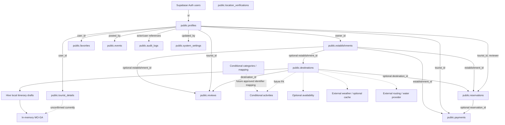

# Task 21 — SamalNav Canonical Database Schema and Application Contract Mapping

**Project:** SamalNav  
**Repository branch:** `secondtemppush`  
**Assessment date:** 2026-11-19 (Asia/Manila)  
**Status:** Repository-derived application contract and proposed schema manifest. No deployed schema was inspected.  
**Authorization:** Design only; this document does not authorize SQL, migration creation, database initialization, or production deployment.

## 1. Executive assessment

Task 20 found that the checked-in backup and seven migration files do not form a safe, unambiguous initializer. This task inspected application database access and the schema artifacts to determine the current application contract rather than selecting the largest schema.

The current Flutter runtime directly queries twelve `public` relations: `profiles`, `destinations`, `establishments`, `location_verifications`, `tourist_details`, `favorites`, `reservations`, `payments`, `reviews`, `events`, `audit_logs`, and `system_settings`. Authentication also depends on Supabase-managed Auth (`auth.users` and Auth APIs). This is the **current runtime relation set**, not proof that every feature is operational against the owner-reported empty non-production database.

Several checked-in models and schema objects are not used by a current Supabase data-access path. In particular, tourist itinerary drafts are persisted locally through Hive; MO-GA runs over application data; the CARS production recommendation provider remains unavailable; and no runtime service loads `activities`, `categories`, `destination_availability`, or `weather_cache`. `bookings`/`transactions`, `establishment_reviews`, and `tourist_profiles` are competing or unused variants, while current code reads `reservations`/`payments`, `reviews`, and `tourist_details`.

**Canonical schema decision:** still unresolved. The runtime mapping supplies a minimum application contract, but source-level conflicts and unapproved data/security decisions prevent a final canonical DDL manifest. Exact SQL types below are labeled as application wire expectations or local-artifact proposals; they are not deployed facts. Owner approval is still required for the role vocabulary, AP-24 ownership cardinality, profile/MFA fields, audit/payment authorization, and future CARS data sources.

## 2. Evidence scope and interpretation

Reviewed Tasks 17–20; all seven `supabase/migrations/*.sql` files; `supabase/backup/schema.sql`; the table-name/column-list metadata in `supabase/backup/data.sql` without reading row payloads; non-production README/scaffold and evidence README; all Supabase `.from(...)` call sites; related services, models, authentication screens, local draft storage, CARS provider/preparer, and MO-GA/travel/weather/budget boundaries.

The owner reports the target as `SamalNav-NonProduction` (`iwzyasdanesaaxxjujxr`, `ap-southeast-2`) with no expected app relations in inspected schemas and a NULL result for `to_regclass('supabase_migrations.schema_migrations')`. This is treated as **owner-supplied, not independently verified**. Task 18 has no returned query outputs in the repository. No Supabase connection or SQL execution occurred.

Evidence labels in this report:

- **Runtime-confirmed:** a current Dart call site reads or writes the named relation/field.
- **Model expectation:** a Dart parser/serializer expects a value or type shape; exact PostgreSQL type/nullability is not thereby proven.
- **Local-only:** a declaration in a backup or migration; not evidence of deployment.
- **Proposed:** a design requirement, not an existing or approved database object.
- **Unresolved:** source code or approved requirements conflict or do not determine the contract.

## 3. Application database dependency inventory

### 3.1 Current direct Supabase dependencies

| Relation / service | Current application use | Classification |
|---|---|---|
| `auth.users` / Supabase Auth APIs | Sign-up, email/password sign-in, OAuth, current user, sign-out, password update, identity linking/unlinking and OTP verification. Auth is platform-managed; do not create a shadow Auth table. | **Required platform service** |
| `profiles` | Registration upsert; role lookup/upsert; login by username-to-email; profile read/update; MFA email flag update; administrator/super-admin user and role queries; profile embeds from reservations, payments, reviews and events; audit role lookup. | **Required runtime** |
| `destinations` | Tourist/admin list reads; active filtering and category filtering; status updates; verification approval insert; CARS review requires database-sourced active verified destinations. `DestinationService` falls back to bundled entries when database reads fail/are empty. | **Required runtime** |
| `establishments` | Owner service reads records by `owner_id`; admin overview reads verification flags; reservation/payment profile embeds and policy ownership require relationship. | **Required for establishment and admin workflows** |
| `location_verifications` | Admin reads pending records and updates status/reviewer/timestamp. Approval also inserts a destination. | **Required for verification workflow** |
| `tourist_details` | Authenticated tourist profile fetch, create-if-missing insert by `user_id`, and validated update. Preferences are always treated as unconfirmed. | **Required for saved tourist planning preferences** |
| `favorites` | Tourist loads rows for current `user_id`, deletes by row `id`, and inserts an undo record. | **Required for saved favorites** |
| `reservations` | Establishment dashboard lists reservations, arrival alerts and updates `reservation_status`; admin counts reservations. | **Required for current reservation dashboard** |
| `payments` | Establishment dashboard lists payments and updates payment status/time; overview aggregates pending amounts. | **Required for current payment dashboard** |
| `reviews` | Establishment dashboard lists and averages rows filtered by `establishment_id`; relation embeds `profiles(display_name)`. | **Required for current establishment review display** |
| `events` | Administrator counts/list reads events and embeds `profiles(display_name)`. No current event write method was found in the inspected service. | **Required for current admin event listing** |
| `audit_logs` | Client-side audit insert; super-admin fetches recent rows/counts. | **Required by current audit UI integration, but write design is unsafe/unresolved** |
| `system_settings` | Super-admin reads/upserts JSON maintenance setting. | **Required for current super-admin maintenance control** |

The list is based on every direct `.from(...)` in `lib/`. `profiles` plus the relationships referenced by PostgREST embedded selects must exist and be visible to the calling role. `select()` calls without a column list make the wire contract broad; the manifest below names fields read or written by model/service code rather than authorizing exposure of every column.

### 3.2 Authentication, profile, and role path

1. `register_page.dart` calls Auth `signUp` with display name and a client metadata role of `tourist`.
2. If a user is returned, `RoleService.ensureTouristProfile` upserts `profiles(id,email,display_name,role)` using the Auth user ID.
3. Login by username first queries `profiles.email` for the username, then authenticates with Supabase Auth. Email login bypasses that lookup.
4. `RoleService.fetchCurrentUserRole` reads `profiles.role`; if missing/error, the UI also falls back to Auth metadata and then `tourist`. This fallback is a route/UI behavior, not trusted authorization.
5. `SuperAdminService` can update `profiles.role`; that must be restricted to a trusted role-management path and enforced by database RLS/grants, never by client-supplied metadata.

The local `001_add_role_to_profiles.sql` and `002_rbac_dashboard_tables.sql` signup trigger copy `raw_user_meta_data->>'role'` into `profiles.role` under SECURITY DEFINER. That is a privilege-boundary hazard: user-editable sign-up metadata must not be the authority for staff roles. A safe canonical schema must choose a reviewed server-authored profile creation mechanism and ensure privileged role assignment is exclusively controlled. Avoid duplicate trigger-plus-client profile creation unless both are deliberately idempotent and tested.

### 3.3 Application-to-database mapping

Types below distinguish parser/wire expectations from guaranteed SQL types. `UUID` is supported by local backups for identifiers, but deployed types remain unverified. `NULL/default` describes what the application can accept or omits, not a database default to install.

| Table and referencing Dart files | Runtime column contract (expected shape) | Keys/relationships required by current calls | Insert/update behavior and auth/RLS contract |
|---|---|---|---|
| **`profiles`** — `role_service.dart`, `audit_service.dart`, `super_admin_service.dart`, `profile_page.dart`, `login_page.dart`, `register_page.dart`; also PostgREST embeds | `id` UUID/string required; `email`, `display_name`, `username`, `phone`, `role` text; `mfa_email_enabled` boolean is read/updated by profile page. `id`, `display_name`, `role` are parsed as required/fallback values by profile/role models. `email`, `username`, phone and MFA may be nullable at read time, though username login requires an email match. | PK `id`; FK `id → auth.users.id` with lifecycle policy approved. `username` must be unique if username login is to use `maybeSingle`. FKs from user-owned records to this profile support embedded profile reads. | Upsert after registration/profile save; role read/update by super-admin; own profile update/read. RLS: self-bound access, narrowly authorized staff administration, no unconditional public profile SELECT. Exclude sensitive columns from ordinary client reads; reviewed embedded display-name access only. Decide whether MFA state belongs in Auth rather than this table. |
| **`destinations`** — `destination_service.dart`, `administrator_service.dart`, `destination_record.dart`, CARS review/preparer | `id` UUID/string; `name`, `location`, `category`, `status` text; `lat/lng` finite numeric values; `is_active/is_verified` booleans; nullable `description`, `image_url`, `owner_id`, `establishment_id`, `category_id`; optional arrays `image_urls`; `operating_hours` map/JSON; `average_stay_minutes` integer; `rating`/`rating_average` numeric but provenance metadata is separately required before public rating use; `entrance_fee` currently raw/untyped amount with no currency semantics. Parser accepts aliases/fallbacks, which must not be used to fabricate verified data. | PK `id`; optional FKs `owner_id → profiles.id`, `establishment_id → establishments.id`; optional category FK only if a canonical category table/mapping is approved. Owner relation must allow AP-24 one-to-many. Name uniqueness in local dump is not established as application identity requirement. | Read list and full rows; administrator toggles active/status and inserts approved destination. RLS: public/guest catalog visibility only for approved published fields; privileged/admin writes; owner edits only own records under approved verification rules. CARS review rejects fallback-source records. |
| **`establishments`** — `establishment_service.dart`, `administrator_service.dart`, embedded ownership policies | `id`, `owner_id`, `name` expected UUID/text non-null; `address` text nullable; `category` text; `is_verified` boolean. Other fields may be selected by `*`, but current `Establishment` model consumes the fields listed. | PK `id`; FK `owner_id → profiles.id`. Do **not** impose `UNIQUE(owner_id)`: approved AP-24 requires multiple establishments per owner. | Current service reads by owner with `.maybeSingle()`; this contradicts AP-24 if more than one row exists and requires a future app/service contract change or a documented single-active-establishment rule. Admin reads verification state. RLS: owner-scoped rows and authorized tourism-office/admin verification; public read only for explicitly approved listing fields. |
| **`location_verifications`** — `administrator_service.dart`, `location_verification.dart` | `id` UUID/string; `name`, `address`, `category`, `status` text; `lat/lng` numeric; `created_at` timestamp. Updates use `reviewed_by` UUID and `reviewed_at` timestamp. `submitted_by`, destination/establishment links are required if submissions/linkage are supported. | PK `id`; optional FKs `submitted_by/reviewed_by → profiles.id`, `destination_id → destinations.id`, `establishment_id → establishments.id`, with deletion semantics separately approved. | Current client reads pending rows and updates decision fields; approval then separately inserts a destination (not atomic). RLS: submitter can see own submissions; reviewer/authorized admin can review; prevent submitter from self-approving. Require a transaction/RPC or server operation before claiming approval and destination insertion are atomic. |
| **`tourist_details`** — `tourist_planning_profile_service.dart`, `tourist_planning_profile.dart` | `id`, `user_id` UUID/string; `budget_min/max` finite numeric; `available_hours_per_day`, `trip_duration_days` integer; `preferred_categories` nullable text array; `current_lat/lng` nullable numeric pair; `travel_mode` text; `created_at` timestamp; optional nullable integers `number_of_tourists`, `children_count`, `elders_count`. | PK `id`; unique `user_id` for one profile per Auth user; FK `user_id → profiles.id` or `auth.users.id` must be chosen consistently with the app's profile identity. | `createIfMissing` inserts only `user_id`, then parses all required profile fields; therefore omitted non-null fields must have approved defaults or the insert contract must be redesigned. Update writes planning fields only and filters by authenticated `user_id`. RLS must bind every read/write to session identity. No confirmation column is consumed; stored preferences remain unconfirmed. |
| **`favorites`** — `favorite_page.dart` | `id`, `user_id` UUID/string; `place_name` text; `location` and `category` nullable text; `rating` nullable numeric; `rating_is_verified` is read optionally; `created_at` timestamp. The undo insert omits `id`, timestamp and verification marker. | PK `id`; user FK should bind to `profiles.id` or `auth.users.id` consistently. Optional `destination_id` is in the backup but not written/read by current UI. | Select by user, order by timestamp, delete by id, insert undo row. RLS must bind row ownership to `auth.uid()` for SELECT/INSERT/DELETE. A unique key on `(user_id, place_name)` is a policy choice, not proven by code. No favorite rating should be treated as CARS rating evidence. |
| **`reservations`** — `establishment_service.dart`, `administrator_service.dart`, `reservation_record.dart` | `id`, `establishment_id`, `tourist_id` UUID/string; nullable `destination_id`, `service_name`; `pax_count` integer; `reservation_status` text; `eta`, `created_at` timestamps. Embedded read requires `profiles(display_name)`. | PK `id`; FKs to establishments, profiles, optional destinations; optional itinerary FK only if server itinerary persistence is separately accepted. Profiles relationship and FK metadata must be available to PostgREST embedding. | Current UI selects, filters, orders and updates status. Tourist insertion is not in the current service path. RLS: tourist sees own reservations; establishment sees reservations for its own establishment(s); status changes restricted to authorized establishment owner/staff/admin. Do not conflate with locally stored tourist-arranged commitments. |
| **`payments`** — `establishment_service.dart`, `payment_record.dart` | `id`, `establishment_id`, `tourist_id` UUID/string; `amount` numeric; `status` text; nullable `reservation_id`, `payment_method`, `paymongo_reference`, `paid_at`; `created_at`; embedded `profiles(display_name)`. | PK `id`; FKs to profiles/establishments and optional reservation. Any provider reference uniqueness and currency representation require explicit payment contract. | Current dashboard selects and updates status/paid time (`markPaymentPaid`). That client update must not itself establish settlement; payment state must be verified by a trusted payment-provider/server path. RLS restricts visibility and updates; never expose provider secrets. |
| **`reviews`** — `establishment_service.dart`, `review_record.dart` | `id`, `tourist_id`, `destination_id` UUID/string; nullable `establishment_id`; `stars` integer; nullable `review_text`; `created_at`; embedded `profiles(display_name)`. | PK `id`; FKs to profile, destination and optional establishment. FK relationship to profiles required for PostgREST embed. | Current service reads by establishment and computes an establishment-specific average, returning zero for no reviews. It does not implement a destination-public-rating aggregate. RLS/published status/moderation and reviewer write behavior require approval; avoid exposing review text or identity beyond approved UI. |
| **`events`** — `administrator_service.dart` | `id`, `title`, `category` text; `description` nullable text; `event_date` timestamp/date-compatible; `posted_by` UUID/string; embedded `profiles(display_name)`. | PK `id`; FK `posted_by → profiles.id` for embedding, if this is the intended publisher relation. | Current code lists/counts only; no app insert/update was found in the inspected service. RLS should expose only approved published events and restrict management to authorized publishers/admins. |
| **`audit_logs`** — `audit_service.dart`, `super_admin_service.dart`, `audit_log_record.dart` | `id` UUID/string, `created_at` timestamp; nullable `user_id`, `actor_id`, `role`, `target_id`; `action`/`action_type`, `description` text; optional `metadata` JSON. App inserts both action aliases and both actor aliases to span schema variants. | PK `id`; optional actor/user FKs to profiles. | Client inserts user/role/action/description directly; super-admin reads logs. This permits spoofed audit fields if allowed as-is. Canonical design must select one event schema and use a trusted server-side audit writer or tightly constrained operation; read access is privileged. No `WITH CHECK (true)` design is accepted by this proposal. |
| **`system_settings`** — `super_admin_service.dart` | `key` text; `value` JSON object/map; nullable `updated_by` UUID/string; `updated_at` timestamp. | PK `key`; optional FK `updated_by → profiles.id`. | Read/upsert maintenance mode; RLS restricts reads/writes to approved administration roles. Do not store secrets in this table or return arbitrary settings to ordinary clients. |

`profiles.mfa_email_enabled`, favorite `rating_is_verified`, and destination rating provenance fields are referenced by application code but are absent from the checked-in backup definition. Their type/source/ownership must be resolved before deciding whether to add columns, use Auth APIs, or remove stale code paths. No schema change is authorized here.

### 3.4 Query operations not represented by current Supabase adapters

No current `lib/` service query was found for `activities`, `categories`, `destination_availability`, `weather_cache`, `itineraries`, `itinerary_stops`, `moga_results`, `self_healing_logs`, or remote `notifications`. No server draft save/reopen, activity CRUD/catalog, availability reader, weather-cache reader, route provider, or CARS database evidence source adapter was found. Their models or backup declarations are not runtime integration.

## 4. Schema version comparison

| Schema version/artifact | What it contains | Contract conflicts / decision |
|---|---|---|
| `supabase/backup/schema.sql` | Broad 26-relation local dump with roles/categories, both profile models, activities, destinations, itinerary/MO-GA, weather/availability, reviews, reservations/payments, functions/triggers/RLS. | Historical backup only. It declares profile role values including `owner`, while Dart `AppRole` writes `establishment`; `profiles` lacks `mfa_email_enabled`; `favorites` lacks `rating_is_verified`; rating provenance fields are absent; `UNIQUE(establishments.owner_id)` conflicts with AP-24. Not canonical or safe to restore without reconciliation. |
| `001_add_role_to_profiles.sql` | Role column/check and Auth signup trigger. | Assumes `profiles`; metadata-driven role assignment in SECURITY DEFINER trigger is unsafe. It is not a full baseline. |
| `002_fix_current_user_role.sql` | “Quick fix” function definitions and policy replacement. | Assumes many existing relations; destructive `DROP POLICY`/recreate; second file with `002_` prefix. Not a bootstrap. |
| `002_rbac_dashboard_tables.sql` | `profiles` role alteration; establishments/destinations/bookings/transactions/establishment_reviews/location_verifications/audit/settings, helpers/triggers/RLS and seed rows. | Header requires `profiles` and `favorites`; domain model differs from runtime reservations/payments/reviews; conflicts with AP-24 owner uniqueness; unapproved demo data and broad sample policies. |
| `003_seed_dashboard_sample_data.sql` | Sample establishment, booking, transaction, review and audit writes keyed by literal example email lookups. | Fixture-only and unsafe as generic initialization; depends on specific accounts and schema. |
| `004_full_schema_from_spec.sql` | Tourist profile, destination availability, itinerary/stops, MO-GA/self-healing, weather, reservations/payments, notifications, events, reviews and audit; functions/RLS/policies and sample event write. | Requires existing `profiles`, `establishments`, Auth; does not create categories/roles/favorites; `IF NOT EXISTS` does not reconcile existing shapes; duplicates destination schema, profiles/functions/policies. Not a standalone canonical schema. |
| `005_seed_sample_reservations.sql` | Sample reservation/payment/review/audit data with email-address lookups. | Fixture-only, requires chosen reservation schema and sample accounts; exclude from generic initialization. |
| `006_seed_all_samal_places.sql` | Hard-coded destination and optional verification records with rating, price, duration and verification values. | Seed values are not established as current verified source data; overlaps names with `002` seed but differs in data. Must not provide CARS evidence. |
| `supabase/backup/data.sql` | COPY data blocks for local backup relations (metadata inspected; row payload not reviewed). | Not an approved synthetic fixture set or seed plan; do not import as part of canonical initialization. |
| `supabase/config.toml` / `remote_schema_baseline.sql` | No config file; remote baseline is empty (0 bytes). | No checked-in local CLI project configuration or remote schema baseline from which to derive migration history. |
| `supabase/non_production/001_current_behavior_reproduction.sql` | Comment-only reproduction scaffold. | Explicitly not initialization DDL. |

### Explicit competitor resolutions

- **`bookings` vs `reservations`:** runtime service uses `reservations`; `BookingRecord` and `bookings` are not used by a current database service. Treat `bookings` as legacy/unused unless a separately approved feature identifies a consumer. Do not create both merely because both appear in historical SQL.
- **`transactions` vs `payments`:** runtime uses `payments`; `TransactionRecord`/`transactions` are not used by a current database service. Treat `transactions` as legacy/unused. Payment settlement remains a server/provider security decision.
- **`establishment_reviews` vs `reviews`:** runtime reads `reviews` filtered by `establishment_id`; `EstablishmentReviewRecord` and migration `establishment_reviews` are unused by current data access. Keep one canonical review contract after deciding destination vs establishment rating semantics; do not duplicate data tables without a migration plan.
- **`tourist_details` vs `tourist_profiles`:** runtime service uses `tourist_details`; `tourist_profiles` is unused by current app queries. Prefer `tourist_details` for current runtime compatibility only if owner approves; do not assume historical `tourist_profiles` is deployed.
- **`roles` and category catalogs:** App role behavior uses Dart `AppRole` values and `profiles.role`; there is no runtime `roles` query. Destination filtering currently reads the text `category`; no category service/catalog is used. A normalized role/category table is conditional on a future approved contract. Reconcile role vocabularies before any profile role FK.
- **Destination rating/pricing:** destination model can parse `rating` or `rating_average`, but public display requires explicit verification/source/retrieval/freshness metadata. Local amount fields have no confirmed currency/unit/source; neither raw price nor zero default is a CARS cost. No CARS score follows from either field.
- **Establishment ownership:** local `UNIQUE(owner_id)` conflicts with AP-24; application `getMyEstablishment().maybeSingle()` itself cannot represent multiple rows. Canonical schema must use one-to-many as approved and the app query contract must be corrected in a separately authorized code task.
- **Activities and destinations:** no activity reader/model exists at runtime. Local backup FK `activities.destination_id → destinations.id` is local-only; any CARS adapter requires confirmed deployed relationship, stable activity/category identity, completeness, and owner-approved mapping.

## 5. Minimal complete application schema proposal

This section is a **proposed contract manifest**, not final DDL. “Required” means necessary for the current code path to operate against a remote database; it does not imply permission to create the object. PostgreSQL types listed are candidate mappings from Dart/model and local artifacts and require validation against Task 18 owner output.

### 5.1 Current runtime schema manifest

| Object | Minimum columns / candidate SQL types | Keys and relationships | Status / requirement |
|---|---|---|---|
| Supabase Auth `auth.users` | Platform-managed identity UUID and Auth attributes; exact provider schema is outside app DDL. | Platform-owned identity. `profiles.id` maps to Auth user UUID. | **Required platform dependency; never create/replace.** |
| `public.profiles` | `id uuid`; `email text`; `display_name text`; `username text`; `phone text`; `role text`; possible `mfa_email_enabled boolean`. Optional image/profile metadata only if retained. | `PRIMARY KEY(id)`; FK to `auth.users(id)` with cascade only after platform lifecycle review; unique `username` if login uses one-row lookup. | **Required.** Role source/vocabulary and MFA field are unresolved. Ordinary client cannot self-assign privileged role. |
| `public.destinations` | `id uuid`; `name/location/category/status text`; `lat/lng double precision` or approved numeric; `is_active/is_verified boolean`; optional `description/image_url text`, `image_urls text[]`, `operating_hours jsonb`, `average_stay_minutes integer`, `rating/rating_average numeric`, rating provenance fields, `entrance_fee numeric` with separately defined currency/unit. | `PRIMARY KEY(id)`; nullable owner/establishment FKs if ownership is supported; category FK only after taxonomy decision. Indexes for actual filters/order/FKs after query-plan review; no invented unique name rule. | **Required.** Publish/verification semantics, rating provenance, amount metadata and owner relationships need decisions. |
| `public.establishments` | `id uuid`; `owner_id uuid`; `name text`; nullable `address text`; `category text`; `is_verified boolean`; additional fields only where product code consumes them. | PK `id`; FK `owner_id → profiles.id`; **no unique owner_id** under AP-24. Index `owner_id` for owner queries. | **Required for establishment/admin workflows.** App `.maybeSingle()` must be reconciled with one-to-many. |
| `public.location_verifications` | `id uuid`; `name/address/category/status text`; `lat/lng double precision`; `created_at timestamptz`; nullable reviewer/submission IDs and review time as needed. | PK; FKs for submitter/reviewer to profiles and optional destination/establishment links after lifecycle decisions. Index `status`/`created_at` for pending queue if data volume justifies. | **Feature-required.** Approval-and-destination creation must be atomic in a trusted operation. |
| `public.tourist_details` | `id uuid`; `user_id uuid`; `budget_min/max numeric`; `available_hours_per_day/trip_duration_days integer`; `preferred_categories text[]`; nullable `current_lat/current_lng double precision`; `travel_mode text`; `created_at timestamptz`; optional group count integers. | PK; unique `user_id`; FK to chosen profile identity. | **Feature-required.** `createIfMissing` needs defaults or revised insert contract. Preference confirmation is not represented. |
| `public.favorites` | `id uuid`; `user_id uuid`; `place_name text`; optional `location/category text`, `rating numeric`, `rating_is_verified boolean`, `created_at timestamptz`; optional destination FK if chosen. | PK; FK user to profile/Auth; optional FK destination. Owner index; uniqueness policy for duplicates unresolved. | **Feature-required.** Verify marker is read but not supplied by current insert; never trust favorite rating as CARS rating. |
| `public.reservations` | `id uuid`; `tourist_id/establishment_id uuid`; nullable `destination_id uuid`; `pax_count integer`; `reservation_status/service_name text`; `eta/created_at timestamptz`; optional itinerary reference only if approved. | PK; FKs to profile, establishment, optional destination; relation to profile needed for embedded display name. Index establishment/eta and tourist scope. | **Feature-required.** Exact lifecycle/status and tourist entry contract not fully represented in current service. |
| `public.payments` | `id uuid`; `tourist_id/establishment_id uuid`; `amount numeric`; `status text`; nullable reservation ID, provider method/reference, `paid_at`; `created_at timestamptz`; currency required by a complete financial contract but absent from current record model. | PK; FKs to profile/establishment/optional reservation; provider reference uniqueness only if provider contract says so. | **Feature-required.** Currency and trusted payment settlement source are unresolved; client “mark paid” is not authoritative. |
| `public.reviews` | `id uuid`; `tourist_id/destination_id uuid`; nullable `establishment_id uuid`; `stars integer`; nullable `review_text text`; `created_at timestamptz`; optional helpful counts. | PK; FKs to profiles/destinations/establishments; profile embed relationship required. | **Feature-required.** Publication/moderation/uniqueness/aggregate policy unresolved; current average is establishment-filtered only. |
| `public.events` | `id uuid`; `title/category text`; nullable `description text`; `event_date date/timestamptz` per approved time-zone semantics; `posted_by uuid`; `created_at timestamptz`. | PK; `posted_by → profiles.id` for embed. | **Feature-required for admin event list only.** Publishing/write flow unresolved. |
| `public.audit_logs` | `id uuid`; `created_at timestamptz`; nullable `user_id/actor_id/target_id uuid`; `action/action_type/description/role text`; optional `metadata jsonb`. | PK; optional profile FKs. Index timestamp for admin listing. | **Required by current UI integration but redesign required.** Server-authored immutable event contract; exact duplicate aliases must be resolved. |
| `public.system_settings` | `key text`; `value jsonb`; nullable `updated_by uuid`; `updated_at timestamptz`. | PK `key`; optional FK updated_by to profile. | **Feature-required for maintenance control.** Restrict to authorized admin/superadmin. |

For all `NOT NULL`, defaults, checks, deletion actions, indexes, and policy expressions not explicitly mandated by the runtime above, final values remain for the canonical schema review. Do not translate a Dart fallback into a database default unless the behavior is deliberately approved.

### 5.2 Conditional/future schema additions

| Relation/feature | Current status | Conditional requirement before it enters canonical CARS/server schema |
|---|---|---|
| `activities` | Not read by app; no Activity Dart model/service. | If CARS activity evidence is approved: stable activity key; FK to destination; active/completeness semantics; category identifier from authoritative taxonomy; source/update metadata; duration and cost fields with units/applicability. Do not infer from local free-text `category`. |
| `categories` / preference mapping | No runtime query; tourist preference strings and destination text are not a proven shared ID system. | Owner-approved versioned mapping between confirmed tourist preference IDs and activity category IDs; coverage/completeness and unknown-state behavior. Exact schema shape is unresolved. |
| Destination rating evidence | Parser supports optional provenance keys, but local backup lacks them and current application does not query a public rating source. | Approved public rating source/aggregation, scale, actual-zero semantics, source/verification/freshness contract; rating metadata fields only after source design. |
| Weather | Raw OpenWeatherMap HTTP service is injectable and separate from database; no cache query. | Approved provider contract, destination/visit interval coverage, activity weather requirements/classifier. `weather_cache.multiplier` is not an approved score. Persist only if freshness/cache policy is approved. |
| Pricing/group costs | Trip profile supplies budget bounds and group counts; destination parser carries raw entrance amount; no verified source/currency/unit contract. | Verified price items, currency, unit, group applicability, package inclusions, source/freshness and candidate allocation policy. Do not treat defaults as verified zero. |
| Travel/routing | Origin/coordinates and assessment interfaces exist; no configured routing source or water connection database. | Provider contract by transport mode, route/straight-line distinction, retrieval time, ferry/transfer evidence and owner-approved normalization. No fabricated roads or schedules. |
| Availability | Local backup/migration declares `destination_availability`; no reader. | Define date/time zone, source/steward, coverage and stale/missing semantics before adding an operational read path. |
| Server itineraries/MO-GA | Current drafts use Hive; MO-GA is local engine. No PostgREST itinerary persistence call found. | Separate approved persistence feature with itinerary owner, stops/order/day assignments, transaction/promotion contract and RLS. Do not add only because the backup has tables. |
| Notifications/self-healing/MO-GA results | No current Supabase service for these models/tables. | Include only after the corresponding server workflow and acceptance requirements are approved. |

### 5.3 Supporting objects, constraints, indexes, functions, and reference data

This is the supporting-object portion of the proposed manifest. It deliberately describes required behavior rather than executable policy SQL: exact expressions and defaults depend on the unresolved role, ownership, publication, and payment decisions, and no deployed catalog output was supplied.

| Object class | Proposed canonical contract | Application requirement / status |
|---|---|---|
| Primary keys | Stable primary key on each runtime relation; use UUID only where the Auth identity or current local application contract requires UUID-compatible IDs. `system_settings.key` is the natural key. | Needed for row updates/deletes and PostgREST relationships. Exact existing types remain unverified. |
| Identity and uniqueness | `profiles.id` maps one-to-one to the Auth user; `tourist_details.user_id` has at most one row per tourist; username is unique only if username login remains supported. Do not make `establishments.owner_id` unique (AP-24). | Profile and login query behavior; AP-24 is an approved requirement. Username null/normalization behavior needs a contract. |
| Foreign keys | Auth identity to profile; establishment owner to profile; tourist profile/favorites/reservation/payment/review actors to the selected profile identity; destination links from reservations/reviews; reservation link from payment; event publisher to profile; reviewer/submitter links for verification. Nullable links remain nullable only where current models allow them and product lifecycle approves it. | Required for integrity and PostgREST embedded profile selects. Deletion actions must be chosen per retention/lifecycle policy; none are inferred here. |
| Check constraints | Validate numeric/coordinate domains and finite values where PostgreSQL types permit; constrain role/status/mode vocabularies only after canonical values are approved; enforce rating and monetary domains only after their scale/unit contracts are approved. | Proposed integrity controls. Exact ranges and enumerations are intentionally not invented. |
| Indexes | Index identity and FK lookup columns used by the listed filters/joins; candidate access paths include `tourist_details.user_id`, favorite `user_id`, reservation `establishment_id`/`tourist_id`, payment participant and reservation IDs, review `establishment_id`, verification `status`, and relevant timestamp ordering. Add uniqueness indexes only for approved uniqueness rules. | Candidate list from current query predicates, not a claim that each index is necessary or present. Confirm with query plans and expected data volume during implementation design. |
| Triggers | No trigger is required by a current Dart `.from(...)` call itself. A timestamp-maintenance trigger may be adopted consistently if the owner chooses database-managed `updated_at`. Auth profile provisioning must be designed as a trusted, idempotent lifecycle and must not copy a user-controlled role claim into privileged state. | Backup triggers such as `handle_new_user` and `set_updated_at` are local-only examples, not selected canonical objects. Do not install the metadata-trusting role trigger. |
| Database functions / RPC | No application RPC call was found in the reviewed current data-access paths. Trusted server operations may be needed for profile provisioning, atomic verification approval plus destination creation, payment settlement, and audit logging; their exact API and authorization boundary are separate design decisions. | None of the backup's SECURITY DEFINER helpers is required merely to satisfy the existing `.from(...)` calls. Review owner, `search_path`, grants, and caller checks before any function is proposed. |
| RLS and grants | Enable RLS for user, financial, audit, and administrative relations; grant only the relation/column operations needed by anon/authenticated clients; then express self, participant, owner, reviewer, and administrator access separately for each command. Public catalog reads must be limited to approved published rows/fields. | Required security behavior; detailed invariants are in Section 8. Exact policy SQL and grants are not established by this proposal. Never treat UI route guards as authorization. |
| Reference data | No production-like destination, rating, price, account, or review fixture is required to define the schema. Role seed rows are deferred until the role table/vocabulary choice; category/mapping rows are deferred until authoritative taxonomy approval. Local sample migrations and `backup/data.sql` are not approved seed data. | Seed values require a separate synthetic/reference-data manifest and owner approval. Do not load historical sample data as live evidence. |

The schema-only minimum therefore does not imply every proposed index, trigger, RPC, or seed row should be created. Each must trace to an approved runtime contract and pass local validation before any separately authorized non-production migration.

## 6. CARS-specific data relationship requirements

The current CARS architecture prepares typed evidence, but the production provider remains deliberately unavailable without valid source evidence and approved numeric policy. Database initialization alone cannot activate scoring.

| Criterion | Current application evidence boundary | Required source/relationship | Current blocker |
|---|---|---|---|
| Interest and Activity Match | Confirmed/unconfirmed tourist preference adapter; matcher accepts authoritative mapping and activity evidence. | Authenticated profile preference IDs → approved mapping catalog → active destination activities with stable category IDs and complete destination relationship. | No activity reader/model or authoritative mapping; profile values are not confirmed by persisted data. |
| Public Destination Rating | `DestinationRecord` parses rating values and provenance fields and only exposes a rating when valid/current/verified/database-sourced. | Public destination rating source or approved destination-review aggregate; stable destination identity; scale, verification, source, retrieval/freshness fields. | No public rating adapter/aggregation. Local default-zero rating fields are ambiguous; no numeric CARS rating policy approval. |
| Weather Suitability | Injectable raw OpenWeatherMap provider; preparer retains evidence and refuses score without policy. | Date/location-specific forecast for visit window plus activity requirements and approved classifier/aggregation. Could remain external; a database cache is optional. | No weather classifier or thresholds; provider horizon/source coverage and production configuration remain unverified. |
| Budget Compatibility | Typed budget assessment boundary distinguishes basis/group/currency/units/provenance and insufficient data. | Verified price components and candidate allocation tied to group size, currency, pricing basis and package inclusions. | Local raw zero-default amounts lack price provenance; no complete cost source or approved allocation/formula. |
| Travel Distance | Origin-aware assessment with geometry distinction and injectable route provider. | Valid tourist-selected origin + destination coordinates; external route service or explicitly labeled geometry; mode/date and separate water-transfer evidence. | No configured route provider/verified water data or approved mode-specific rule. |
| Available Travel Time | Profile/trip available time plus destination/activity duration fields can be represented; travel assessor supplies route evidence when a provider exists. | Candidate allowance + visit duration + mode-specific travel + transfer/return semantics with source/freshness. | No verified complete duration source, no candidate allocation, no approved score rule. |

None of these dependencies justifies creating scores, inserting synthetic values as production facts, or selecting category/rating/price fields by name alone.

## 7. Dependency diagram

The diagram distinguishes current runtime relationships from conditional future relations. It is a proposed contract view, not a deployed database diagram.

## 8. RLS, grants, roles and security requirements

The exact SQL policies are not chosen here because Task 18 deployed output is absent, current migration policies conflict, and several workflow decisions need security review. The following are required access invariants for a proposed design:

| Data area | Required access invariant |
|---|---|
| Auth/profile | Auth session is the identity root. Profile self-service cannot alter staff role. Role assignment is restricted to an independently authorized admin path. Never trust `user_metadata.role` for database privilege. Protect email, phone, username and MFA state from public reads. |
| Destination catalog | Guest/manual catalog behavior must be intentional. Public/anon read may include only approved published fields; administrator and owner writes must be role/ownership bound. Do not treat fallback records as database evidence. |
| Establishments | Owner sees/manages only owned establishments; staff review privileges are explicit. Ownership is one-to-many per AP-24, and queries must support that cardinality. |
| Verification | Submitter cannot self-approve; reviewer identity and transitions are controlled; approval and destination creation are atomic. |
| Tourist profile/preferences/favorites | Every operation is bound to `auth.uid()`; no cross-user reads. A missing or saved-but-unconfirmed preference remains distinct. |
| Reservations | Tourist and establishment visibility is bounded by their own IDs and authorized staff. Owners can update only allowed reservation fields/statuses. |
| Payments | Financial rows are private to participants and authorized staff. Settlement status is written only from a trusted payment verification path; client update is insufficient proof of payment. |
| Reviews | Published/public status, author identity exposure and moderation rules are explicit; public destination aggregate is not inferred from establishment query. |
| Events/settings | Published event read scope is explicit; maintenance setting access is admin-only. |
| Audit | Client cannot forge actor, role, timestamp, or arbitrary high-privilege event. Prefer trusted server-side logging; protect log read access and avoid secret/personal data in descriptions. |
| All exposed relations | Review schema `USAGE`, table/column grants, sequences, function EXECUTE, RLS enabled/forced, policy command/role expressions and embedded-select relationships together. SQL privilege booleans do not prove RLS/PostgREST behavior. Avoid blanket grants and unrestricted `WITH CHECK (true)`. |

The application’s user-facing route guards are not security boundaries. Enforce authorization in database policies and trusted server operations, then test with synthetic non-production identities only under separate approval.

## 9. Legacy, duplicate, and unused schema identification

| Object/model | Current runtime status | Recommendation for canonical manifest |
|---|---|---|
| `bookings`, `BookingRecord` | No direct Supabase service call found; legacy dashboard migration/model. | Exclude unless an active product contract identifies a consumer. |
| `transactions`, `TransactionRecord` | No direct Supabase service call found. | Exclude in favor of current `payments` contract unless an approved use is demonstrated. |
| `establishment_reviews`, `EstablishmentReviewRecord` | Migration/model only; service queries `reviews`. | Exclude or formally migrate to a single canonical review relation after rating semantics approval. |
| `tourist_profiles` | Backup and migration object; no current service query. | Do not create alongside `tourist_details` without a reviewed consolidation/compatibility plan. |
| `reviews_legacy` | Backup legacy relation; no runtime query found. | Legacy only. |
| `roles`, `role_descriptions` | No runtime relation reads. App uses `AppRole` and `profiles.role`. | Optional normalization decision; reconcile role vocabulary before FK. |
| `categories` | No runtime query; destination screen filters text category. | Conditional future CARS taxonomy, not current runtime requirement. |
| `activities` | Local schema/model artifact only; no app model/service query. | Conditional future CARS source; requires authoritative ID/data contract. |
| `destination_availability`, `weather_cache` | No app read path. | Optional until sources/contracts are approved. |
| `itineraries`, `itinerary_stops`, `moga_results`, `self_healing_logs`, `notifications` | Local schema/model concept; no server data-access path found for itinerary generation/results/self-healing. | Future server feature only; current draft/MO-GA workflow is local/in-memory. |
| `destination_gallery` | Not queried; destination record uses image fields on destination object. | Optional until a gallery service is implemented. |

## 10. Canonical schema decision register

| Decision | Required owner/reviewer decision | Current status |
|---|---|---|
| Canonical object scope | Approve the 12 directly queried public relations plus platform Auth dependency as current runtime minimum, or identify exclusions/added current feature requirements. | Proposed; not approved. |
| Role source/vocabulary | Resolve `establishment` vs backup `owner`; decide normalized `roles` table vs constrained profile role and trusted role assignment. | Blocked; security review required. |
| Auth profile lifecycle | Choose trusted profile creation mechanism for email/OAuth; eliminate metadata-based privilege assignment and decide whether trigger/client writes are both needed. | Blocked; backend/security approval required. |
| Profile fields/MFA | Resolve `mfa_email_enabled` absent from backup; decide Auth-owned MFA state vs app profile field and define protected access. | Unresolved. |
| Establishment cardinality | Honor AP-24 one-owner-to-many; reconcile `.maybeSingle()` service behavior and remove local unique constraint only through separate reviewed migration. | Requirement approved; app/schema change not authorized here. |
| Current reservation/payment domain | Confirm `reservations` and `payments` as canonical current service contracts; define status transitions, currency, payment verification and RLS. | Runtime evidence supports table names; business/security contract incomplete. |
| Review semantics | Select one `reviews` vs `establishment_reviews` source; specify destination/publication aggregation and personal-data exposure. | Runtime query uses `reviews`; public rating policy unresolved. |
| Tourist profile | Confirm `tourist_details` as runtime source; decide defaults required by create-if-missing and explicit preference confirmation semantics. | Runtime source confirmed from code; deployed state unverified. |
| Destination contract | Define canonical `status`/`is_active`, verified publication, category, coordinates, rating provenance and price units. | Runtime parser contract known; types/provenance and deployed fields unresolved. |
| Audit integrity | Replace client-authored flexible log contract or approve constrained server operation; resolve `action` vs `action_type` and actor identity. | Security blocker. |
| CARS taxonomy and evidence | Approve category IDs/mapping and source contracts for activities, ratings, weather, costs, routing and time. | No complete source is established; scoring provider unavailable. |
| Server itinerary persistence | Decide if/when local Hive drafts become synchronized server records; define ownership, promotion and MO-GA result schema. | Not current runtime requirement; separate product decision. |
| Migration/seed architecture | Choose timestamped unique migration versioning, runner, transaction boundaries, seed separation, repeatability and recovery process. | Blocked by Task 20 findings; no `config.toml`. |

## 11. Recommended migration architecture

This describes how to organize future work, not an executable migration sequence.

1. **Freeze and approve a contract manifest.** Assign every relation, column, key, index, FK action, default, function, trigger, grant, policy and reference row an application requirement and owner.
2. **Separate platform prerequisites.** Treat Supabase Auth, `auth.uid()` and managed roles as platform dependencies. Do not create them or modify platform settings through a copied schema dump.
3. **Use unique, ordered migration versions.** Replace ambiguous duplicate prefixes in a separately authorized migration-design task. Each migration gets a unique version, prerequisites, explicit transaction/failure behavior and postcondition checks.
4. **Separate schema from seed data.** Keep test fixtures and reference-data seed scripts out of schema migrations. Use synthetic identities and explicit seed manifests; exclude `backup/data.sql` and demo account/financial/review scripts by default.
5. **Split by dependency and security boundaries.** Foundation/profile, catalog/ownership, workflow data, functions/triggers, grants/RLS, then separately controlled reference fixtures. Apply parent tables before FK dependents and helper functions before policies/triggers that call them.
6. **Test clean install and schema diff locally first.** Use an isolated PostgreSQL/Supabase-compatible environment, test only approved synthetic data, inspect repeated-run behavior, validate all PostgREST embeds, and compare resulting catalog state against the approved manifest.
7. **Gate any non-production execution.** Require target confirmation, backups/recovery plan, exact reviewed file hashes, named operator/time window, explicit non-production implementation approval, stop conditions, and post-run verification. Production deployment remains a separate approval.

Do not reorder or execute the existing `001`–`006` files as a guessed chain. Do not treat the historical schema dump as canonical or run it to bypass migration ambiguity.

## 12. Remaining blockers and owner approvals

1. Obtain and retain Task 18 owner-run schema outputs for the confirmed non-production project; Task 19 has no outputs to reconcile. Confirm exact column types, keys, constraints, indexes, RLS and grants before adapting the contract.
2. Approve a single canonical role vocabulary/table strategy; fix the security issue of client metadata role assignment and confirm profile creation for all Auth methods.
3. Resolve `mfa_email_enabled`, profile nullable/default requirements, and the `tourist_details.createIfMissing` default contract.
4. Reconcile AP-24 one-to-many establishment ownership with the current `.maybeSingle()` client method.
5. Decide canonical review, reservation/payment models and trusted payment/audit write mechanisms.
6. Decide destination status/category/rating/price contracts; do not count local seed records as authoritative or verified.
7. For CARS, obtain the approved taxonomy and source/data contracts plus mathematical policies; no numeric scoring is authorized by this document.
8. Decide whether itinerary drafts remain device-only or become server-persisted; if server sync is approved, design independent RLS and transaction/promotion contracts.
9. Approve the canonical schema manifest, migration version strategy, isolated validation, synthetic seed policy, backup/restore and explicit non-production execution authorization.
10. Obtain production deployment approval separately after implementation and security acceptance.

## 13. Final determination

- **Current runtime contract mapped:** Yes, at repository source/wire level for twelve queried `public` relations and Supabase Auth.
- **Single canonical schema selected:** No. The migration set, backup, and active source contain unresolved conflicts; no deployed results were supplied.
- **Minimal runtime schema proposal:** Provided in Section 5.1, subject to role, security, AP-24 and field-contract decisions.
- **Future CARS/server schema:** Conditional requirements are identified; missing data and authority are not invented.
- **Implementation/migration authorization:** Not granted.
- **Database initialization readiness:** Blocked pending owner decisions, Task 18 results, security review and a separately reviewed migration design.
- **Production activation:** Not authorized.

## 14. Validation and closeout

- Enumerated Supabase files and SQL migrations; confirmed `supabase/config.toml` is absent and `supabase/remote_schema_baseline.sql` is empty.
- Searched every Dart `Supabase.from(...)` call and reviewed associated service/model/auth call sites. Database data access found in code is limited to the tables listed above; no Activity/CARS source or server itinerary repository was found.
- Compared application use against migration/backups and Task 17–20 conclusions. Backup data COPY table/column headers were inspected as metadata only; no row payload was copied into this report.
- **Created:** `docs/TASK_21_SAMALNAV_CANONICAL_DATABASE_SCHEMA_AND_APPLICATION_CONTRACT_MAPPING.md` only.
- No application code, migrations, SQL, configuration, credentials, Supabase project, or database objects were changed or accessed. No SQL was executed.
