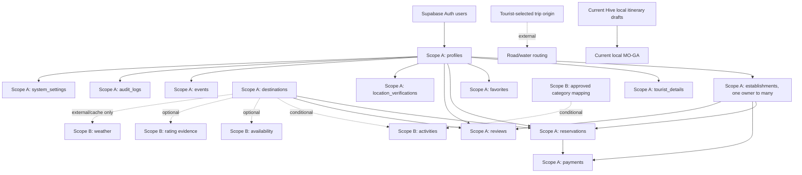

# Task 25 — SamalNav CARS Canonical Database Schema Reconciliation and Readiness Plan

**Project scope:** SamalNav application and conditional CARS data integration  
**Evidence target reported by owner:** SamalNav-NonProduction (`iwzyasdanesaaxxjujxr`, `ap-southeast-2`)  
**Assessment date:** 2026-11-19 (Asia/Manila)  
**Status:** Repository architecture proposal and owner-evidence reconciliation; no live database access or SQL execution occurred.  
**Authorization:** Documentation/design only. Database implementation, initialization, and deployment are not authorized.

## 1. Executive summary

The application source identifies twelve current Supabase `public` runtime relations: `profiles`, `destinations`, `establishments`, `location_verifications`, `tourist_details`, `favorites`, `reservations`, `payments`, `reviews`, `events`, `audit_logs`, and `system_settings`. Supabase Auth is a managed platform dependency, not an application table to recreate. Tourist itinerary drafts currently use Hive/device storage; MO-GA runs locally; current manual/circuit planning must not be coupled to CARS. The default CARS recommendation provider remains unavailable.

The supplied evidence summaries report that seventeen inspected application/candidate relations are absent: the eleven targets in Task 23 and the six runtime relations covered by Task 24. This is **owner-supplied summary evidence**, not raw output and not independently verified. Task 24 itself was prepared as an unexecuted query package; the new absence report appears to be subsequent owner evidence, but exact query output, timestamps, row counts, and error/truncation details are not in the repository. The absence of these relations does not establish the absence of every application relation in every schema, does not establish that the database is empty, and does not approve the proposed schema.

The repository does not contain a safe canonical initializer. The seven migrations have a duplicate `002` prefix, incomplete bootstrap prerequisites, competing domain schemas, policy/function replacement, sample-data side effects, and unsafe role/audit patterns. The broad backup is historical local evidence, not the deployed schema or an approved initializer. The proposal below identifies a **candidate Scope A runtime schema** and a separately conditional **Scope B CARS/future schema**. Exact contracts and security policies remain subject to owner, database, methodology, and security decisions in Tasks 22–24.

**Readiness:** canonical schema approval **not ready**; migration design **not ready**; local migration testing **not started**; non-production initialization **not authorized**; production deployment **not authorized**. No CARS score-scale or formula change is proposed. Preserve the current runtime 0–100 score contract; the six listed weights remain unverified against the original research methodology.

## 2. Evidence classes and repository dependency inventory

### 2.1 Evidence classes

| Classification | Meaning in this report |
|---|---|
| Repository-confirmed | Current checked-in source, migration, backup, or documentation contains the stated code/declaration. Does not prove deployment. |
| Owner-reported as present/absent | A project owner supplied a summary observation. Raw output and independent live verification may be absent. |
| Historical schema artifact | A checked-in backup or migration declaration only. Not deployed truth or an approved baseline. |
| Proposed only | A candidate contract for owner/technical review; not an existing object or authorization. |
| Not verified | Evidence is missing, incomplete, or not independently checked. |

### 2.2 Current runtime relation dependencies

| Relation / platform dependency | Current source-level use | Main repository callers |
|---|---|---|
| Supabase Auth (`auth.users`, Auth APIs) | Sign-up, email/password and OAuth sign-in, current identity, sign-out, password and identity operations | Auth screens/services; managed platform dependency |
| `profiles` | Profile/role reads and writes, username-to-email lookup, admin role management, profile embeds | `role_service.dart`, `profile_page.dart`, `login_page.dart`, `register_page.dart`, `audit_service.dart`, `super_admin_service.dart`, admin/establishment services |
| `destinations` | Tourist/admin listing, status changes, verification approval insert | `destination_service.dart`, `administrator_service.dart`, `DestinationRecord` |
| `establishments` | Establishment owner dashboard and admin verification state | `establishment_service.dart`, `administrator_service.dart` |
| `location_verifications` | Admin pending queue, review updates and destination approval flow | `administrator_service.dart`, `LocationVerification` |
| `tourist_details` | Authenticated tourist preference/planning profile read, create-if-missing, update | `tourist_planning_profile_service.dart`, `TouristPlanningProfile` |
| `favorites` | Tourist-owned read, delete and undo insert | `favorite_page.dart` |
| `reservations` | Establishment dashboard list/status updates and admin count | `establishment_service.dart`, `administrator_service.dart`, `ReservationRecord` |
| `payments` | Establishment dashboard read/aggregate/status update | `establishment_service.dart`, `PaymentRecord` |
| `reviews` | Establishment review display/average and related profile embed | `establishment_service.dart`, `ReviewRecord` |
| `events` | Administrator count/list and publisher profile embed | `administrator_service.dart` |
| `audit_logs` | Client-authored audit insert; super-admin list/count | `audit_service.dart`, `super_admin_service.dart`, `AuditLogRecord` |
| `system_settings` | Super-admin maintenance mode read/upsert | `super_admin_service.dart` |

The list describes current `.from(...)` call sites, not live table existence. Several use `.select()` without a narrow column list, so a future security review should reduce wire exposure instead of making every column available. `profiles` embeds in reservations, payments, reviews, and events require valid relationship metadata and appropriate column-level visibility.

### 2.3 Planning and CARS boundaries

- Destination browsing/manual planning uses `DestinationService`; it can show bundled fallback destinations when the remote query is empty or fails. Bundled data must remain visibly fallback and cannot be treated as verified live CARS evidence.
- Local itinerary drafts use a Hive-backed `LocalItineraryDraftStore`; no server itinerary persistence query was found. Circuit selections are kept in the local draft model. Do not create remote itinerary tables only because they exist in a backup.
- The manual-selection MO-GA adapter rejects circuit-based drafts; do not conflate circuit workflows with the CARS provider or database schema.
- `UnavailableCarsRecommendationProvider` remains the runtime default. There is no production CARS database source adapter for activities, taxonomy, destination rating evidence, availability, or cost components.
- Raw weather and travel provider boundaries are injectable; no configured production weather/routing/water service or CARS scoring formula is established by database artifacts.

## 3. Consolidated live database evidence register

| Observation | Classification | What it supports | What it does not establish |
|---|---|---|---|
| Project name/reference/region: SamalNav-NonProduction / `iwzyasdanesaaxxjujxr` / `ap-southeast-2` | Owner-supplied | The intended target label for owner-run evidence collection | Independent dashboard verification in this session |
| Eleven Task 18 targets reported `relation_found=false` with NULL columns | Owner-reported as absent (recorded in Task 23) | Reported absence of those named relations in inspected target scope | Full database emptiness, other schemas, complete catalog visibility, or raw-output accuracy |
| Six Task 24 runtime targets reported absent: audit_logs, events, favorites, payments, reservations, system_settings | Owner-reported as absent in the Task 25 supplied summary | Reported absence of these six named targets | Raw Query 24-01 output, exact query association/timestamp, or absent status outside inspected schema |
| RLS query reportedly returned no matching application relations/policies and false flags for absent targets | Owner-reported | No policy rows were reported for the queried absent target names | RLS disabled on any existing relation; effective JWT/PostgREST permissions |
| Relation inventory includes `auth`, `extensions`, `realtime`, `storage`, `vault` | Owner-reported | Some Supabase-managed schemas were reported in the inventory | Complete database relation inventory or “database is empty” |
| `migration_history_table`/qualified standard lookup returned NULL | Owner-reported | That named lookup did not resolve or was not visible in the reported context | Absence of history under another schema/name/tool or complete visibility |
| Local migration/backups and Dart call sites | Repository-confirmed | Checked-in definitions and application expectations | Which migrations were deployed or current live schema/data |

The Task 25 summary is treated as later evidence than Task 24’s query-preparation status, but the original Task 24 document remains historically accurate that no query had been executed when that package was prepared. Raw results were not supplied in the inspected repository. Therefore all live observations remain owner-supplied and should be reconciled against retained query output before changing evidence status.

## 4. Seventeen-relation reconciliation matrix

The first eleven relations were the target list from Task 18 Query 18-01 and Task 23’s summary. The following six are the supplemental Task 24 targets and are reported absent by the Task 25 supplied summary. This is a target/evidence inventory, not a claim that the seventeen are all current runtime tables.

| Relation | Scope/feature | Reported result | Source classification | RLS/security evidence status |
|---|---|---|---|---|
| `activities` | Conditional CARS interest/time/weather source | Reported absent | Owner-reported summary; raw 18-01 absent | Earlier RLS summary says absent target/no policy; not a disabled-RLS finding |
| `categories` | Conditional taxonomy | Reported absent | Owner-reported summary; raw 18-01 absent | Same limitation as above |
| `destination_availability` | Conditional date eligibility | Reported absent | Owner-reported summary; raw 18-01 absent | Same limitation as above |
| `destinations` | Current runtime catalog and CARS candidate | Reported absent | Owner-reported summary; raw 18-01 absent | Same limitation as above |
| `establishment_reviews` | Historical alternate review model | Reported absent | Owner-reported summary; raw 18-01 absent | Same limitation as above |
| `establishments` | Current runtime owner/admin workflow | Reported absent | Owner-reported summary; raw 18-01 absent | Same limitation as above |
| `profiles` | Current runtime identity/profile | Reported absent | Owner-reported summary; raw 18-01 absent | Same limitation as above |
| `reviews` | Current runtime establishment review display; possible future rating source | Reported absent | Owner-reported summary; raw 18-01 absent | Same limitation as above |
| `tourist_details` | Current runtime tourist profile | Reported absent | Owner-reported summary; raw 18-01 absent | Same limitation as above |
| `tourist_profiles` | Historical/alternate profile model | Reported absent | Owner-reported summary; raw 18-01 absent | Same limitation as above |
| `weather_cache` | Conditional cache only; no current reader | Reported absent | Owner-reported summary; raw 18-01 absent | Same limitation as above |
| `audit_logs` | Current runtime super-admin audit UI | Reported absent | Owner-reported summary from Task 25; raw 24-01 absent | Six-table RLS output not supplied; unknown |
| `events` | Current runtime admin event listing | Reported absent | Owner-reported summary from Task 25; raw 24-01 absent | Six-table RLS output not supplied; unknown |
| `favorites` | Current runtime tourist favorites | Reported absent | Owner-reported summary from Task 25; raw 24-01 absent | Six-table RLS output not supplied; unknown |
| `payments` | Current runtime payment dashboard | Reported absent | Owner-reported summary from Task 25; raw 24-01 absent | Six-table RLS output not supplied; unknown |
| `reservations` | Current runtime reservation dashboard | Reported absent | Owner-reported summary from Task 25; raw 24-01 absent | Six-table RLS output not supplied; unknown |
| `system_settings` | Current runtime maintenance control | Reported absent | Owner-reported summary from Task 25; raw 24-01 absent | Six-table RLS output not supplied; unknown |

Of the seventeen inspected candidates, eleven are current runtime dependencies: `destinations`, `establishments`, `profiles`, `reviews`, `tourist_details`, plus the six supplemental targets. Six are conditional/alternate relations: `activities`, `categories`, `destination_availability`, `establishment_reviews`, `tourist_profiles`, and `weather_cache`. The twelfth Task 21 runtime relation, `location_verifications`, was not included in either target set; its live status remains **not verified**. Thus the evidence does not establish live status for all twelve runtime relations.

## 5. Audit of the seven checked-in migrations

This is a static repository review. It does not validate SQL parsing, execution, or deployed history. No migration is selected as canonical or authorized to run.

| File / order | Objects, columns, relations and constraints | Functions, triggers, policies, indexes/grants | Data effects, dependencies, risk and app compatibility |
|---|---|---|---|
| `001_add_role_to_profiles.sql` — `001` | Alters existing `profiles` with role/check values; does not create the profile foundation. | Creates/replaces SECURITY DEFINER `handle_new_user()` and replaces Auth insert trigger. No explicit grant/revoke or secondary index statement found. | Requires `profiles` and managed `auth.users`. Copies client-controlled `raw_user_meta_data.role` into trusted profile role; security risk. `DROP TRIGGER IF EXISTS` replaces trigger. Role check uses `establishment`, unlike backup role constraint `owner`. Not a clean bootstrap. |
| `002_fix_current_user_role.sql` — `002` | No table creation; assumes profiles, audit_logs, establishments, destinations, bookings, transactions, location_verifications, system_settings and particular columns. | Replaces SECURITY DEFINER `current_user_role()` and `log_audit()`; drops/recreates named policies across relations. No explicit grants or secondary indexes found. | Repair script, not bootstrap; destructive to existing policies of the same names and changes effective authorization. Shares `002` version prefix with another migration. Uses legacy bookings/transactions, incompatible with current reservations/payments path. |
| `002_rbac_dashboard_tables.sql` — `002` | Creates establishments (including `UNIQUE(owner_id)`), destinations, bookings, transactions, establishment_reviews, location_verifications, audit_logs, system_settings. Defines checks and FKs; booking/transaction/review relationships use `ON DELETE` cascade/set-null actions. | Defines role/audit/timestamp/Auth helper functions; creates destination timestamp and Auth signup triggers; enables RLS on its table set; drops/recreates role/profile, establishment, destination, bookings, transactions, review, verification, audit and settings policies. No explicit `CREATE INDEX` or GRANT/REVOKE found. | Requires existing `profiles`, `favorites` per file comments and managed Auth. Inserts maintenance setting, sample destinations and verification row. Conflicts with AP-24 (`UNIQUE(owner_id)`), current `reservations`/`payments`/`reviews` services, and safe role provisioning. Includes permissive audit insert policy (`WITH CHECK (true)`). Duplicate version. |
| `003_seed_dashboard_sample_data.sql` — `003` | Creates no schema objects; assumes establishments/bookings/transactions/establishment_reviews/audit_logs. | No policy/function/index definitions. | PL/pgSQL seed block uses specific sample account lookups and inserts/updates business, booking, transaction, review, audit rows. Requires prior tables and matching users; not generic synthetic seed without separate review. |
| `004_full_schema_from_spec.sql` — `004` | Alters profile roles/preferences/budget/token/timestamps; creates tourist_profiles, destination_availability, itineraries, itinerary_stops, moga_results, self_healing_logs, weather_cache, reservations, payments, notifications, events, reviews, audit_logs; modifies destinations. Includes checks/FKs/unique constraints such as availability `(destination_id,date)`, itinerary/status types, rating range, payment and group fields. | Creates/replaces `current_user_role()` and `set_updated_at()`; enables RLS for feature tables and drops/recreates policies. No explicit grants/revokes or secondary index statements found. | Claims standalone/fresh in comments but depends on existing profiles, establishments, and Auth. Does not create all required foundations/catalogs; `IF NOT EXISTS` does not reconcile shape. Updates destination status/fields and inserts sample events. Has broad event/review/weather/availability reads and audit `WITH CHECK (true)` example. Role values use `establishment`, contrasting backup `owner`. Itinerary persistence is not current app integration. |
| `005_seed_sample_reservations.sql` — `005` | Creates no schema objects; assumes runtime-like reservation/payment/review/audit schema and related accounts/destinations/establishments. | No schema policies/functions/indexes. | Inserts sample reservations/payments/reviews/audit rows and upserts establishment by owner conflict. Depends on a unique owner key, conflicting with AP-24. Contains sample financial/review/audit payloads; not approved seed data. |
| `006_seed_all_samal_places.sql` — `006` | Creates no schema objects; assumes destination and location-verification shape, profile role and name conflict behavior. | No policy/function/index definitions. | Inserts hard-coded destination and verification fixture records; uses conflict handling by name/do-nothing. Ratings, prices, coordinates, verification, and hours in authored seed SQL are not established live facts and must not become verified CARS evidence. |

Across the seven migration files, no explicit `GRANT` or `REVOKE` statement or standalone secondary `CREATE INDEX` statement was found by static search. Constraint-backed primary/unique indexes may still be created by their declarations. `DROP POLICY`/`DROP TRIGGER` operations are present; no table `DROP` or `TRUNCATE` was identified in the migration inventory. This summary is not a substitute for line-by-line review during an authorized migration design.

### 5.1 Introduced-column coverage

The following summarizes columns declared or altered by the migrations; it is a repository SQL inventory, not a live-schema claim. Exact types, nullability, defaults, and constraints must be taken from the migration text before any execution review.

| Migration | Tables and column groups introduced or altered |
|---|---|
| `001_add_role_to_profiles.sql` | Alters existing `profiles.role`; the role check constrains its accepted vocabulary. It introduces no profile table or other profile columns. |
| `002_fix_current_user_role.sql` | No table columns. Functions and policies assume fields such as profile role, actor/user IDs, audit action/description/metadata, and dashboard relation identifiers; the script does not establish those table contracts. |
| `002_rbac_dashboard_tables.sql` | `establishments`: identity, owner, name/description/address/location/category/contact, verification and creation fields. `destinations`: identity, establishment, name/location/category/description/image, rating, active/verified and timestamps. `bookings`: establishment/tourist/destination, service, guest count, status, schedule and ETA. `transactions`: establishment/booking/tourist, amount/status/method/time. `establishment_reviews`: establishment/destination/tourist, rating/comment/time. `location_verifications`: submitted place/location/category, submitter/status/reviewer/review time. `audit_logs`: actor/action/description/metadata/time. `system_settings`: key/value/updater/time. |
| `003_seed_dashboard_sample_data.sql` | No columns or schema objects; inserts sample rows into establishments, bookings, transactions, establishment reviews and audit logs using its assumed existing column names. |
| `004_full_schema_from_spec.sql` | Alters `profiles` and `destinations` with profile preference/budget/role/token/timestamp and destination geohash/fee/stay/status/rating/ownership/imagery/operating fields. Creates `tourist_profiles` (profile, budget, hours/days, preferences, origin, mode); `destination_availability` (destination/date/open-close/available); `itineraries` and `itinerary_stops` (owner, type/state, aggregate route/score, stop identity/order/day/times/completion); `moga_results` and `self_healing_logs` (optimization metrics and re-optimization events); `weather_cache` (destination condition/multiplier/temperature/humidity/update); `reservations` (itinerary/tourist/establishment/destination, ETA, party, state/service/time); `payments` (reservation/participants, amount/method/provider reference/state/times); `notifications` (recipient/content/type/read/send time); `events` (title/content/date/category/poster/time); `reviews` (tourist/destination/establishment/stars/text/time); and `audit_logs` (actor/role/action/target/metadata/device/IP/time). |
| `005_seed_sample_reservations.sql` | No columns or schema objects; inserts sample establishment, reservation, payment, review and audit rows using the target schema's assumed names. |
| `006_seed_all_samal_places.sql` | No columns or schema objects; inserts fixed destination and location-verification rows using assumed name/location/category/status/verification fields. |

### 5.2 Safest ordering conclusion

There is **no safe execution ordering of the existing files as-is**. Sorting the filenames is insufficient because the two `002` files conflict, earlier files assume unseen profile foundations, later files mix schema and seeds, and table/API variants diverge. The safe proposal is to reconcile requirements into a newly reviewed migration manifest and a distinct, uniquely versioned chain only after approval. This report does not create or authorize that chain.

## 6. Proposed canonical schema — separate scopes

Types below are candidate PostgreSQL types corresponding to current Dart wire/model expectations. They are not verified deployed definitions or final owner-approved choices. Nullability/defaults marked “decision” must be resolved before migration design. Do not turn parser fallbacks into SQL defaults automatically.

### 6.1 Scope A — current runtime candidate manifest

| Relation / purpose | Candidate required columns and types | Key relationships / uniqueness | Requirement class, service and security contract |
|---|---|---|---|
| `profiles` — app profile/role identity | `id uuid`, `email text`, `display_name text`, `username text`, `phone text`, `role text`, `mfa_email_enabled boolean` only if retained. Contact/MFA fields nullable and role source/default require decision. | PK `id`; candidate FK to `auth.users(id)`; conditional unique username for `maybeSingle` login. | **Essential runtime.** Role/profile services, login/profile/admin screens. Auth-root identity; self update must exclude role and sensitive fields; no public full-profile SELECT. MFA source unresolved. |
| `destinations` — catalog/admin destination | `id uuid`, `name/location/category/status text`, `lat/lng double precision` (or reviewed numeric), `is_active/is_verified boolean`; optional `description/image_url text`, `image_urls text[]`, `operating_hours jsonb`, `average_stay_minutes integer`, `rating/rating_average numeric`, `entrance_fee numeric`. Provenance/currency/unit fields are conditional. | PK `id`; optional `owner_id → profiles.id`, `establishment_id → establishments.id`; category relationship only if approved. No name uniqueness presumed. | **Essential runtime.** Destination/admin services and parser. Public read only approved published fields; owner/admin writes by reviewed lifecycle. Fallback destination values cannot masquerade as DB data. |
| `establishments` — owner dashboard/business | `id uuid`, `owner_id uuid`, `name text`, `address text`, `category text`, `is_verified boolean`; nullable fields must match service/model. | PK `id`; FK owner to profile. No `UNIQUE(owner_id)` under AP-24; index for owner filter is a candidate. | **Essential for establishment/admin workflow.** Owner service currently `.maybeSingle()` conflicts with one-to-many AP-24 and needs an app contract update or explicit active-row selection. Owner-only row scope; review/admin verification. |
| `location_verifications` — submissions/admin queue | `id uuid`, place name/address/category text, `lat/lng double precision`, `status text`, `created_at timestamptz`, optional `submitted_by/reviewed_by uuid`, `reviewed_at timestamptz`. | PK; optional actor FKs to profiles; optional approved destination/establishment FK. Delete actions unresolved. | **Essential for current verification flow.** Submitter cannot self-approve; approval plus destination creation should be one trusted atomic operation, unlike separate current client requests. |
| `tourist_details` — saved planning preferences | `id/user_id uuid`, `budget_min/max numeric`, available hours and trip days `integer`, `preferred_categories text[]`, nullable origin coordinates `double precision`, `travel_mode text`, `created_at timestamptz`, optional group counts `integer`. | PK; unique `user_id`; FK to one chosen identity relation. | **Essential for saved profile flow.** Service inserts only `user_id`; other required values need approved defaults, nullable fields, or revised app behavior. Preference confirmation cannot be inferred from row existence. RLS by `auth.uid()`. |
| `favorites` — tourist saves | `id/user_id uuid`, `place_name text`, nullable location/category text, rating numeric only as display snapshot, optional verification flag, `created_at timestamptz`. | PK; user FK; optional destination FK only if stable identity is adopted. Duplicate policy unresolved. | **Essential for current favorites UI.** User-scoped SELECT/INSERT/DELETE; rating snapshot is not CARS public rating evidence. |
| `reservations` — current establishment reservation dashboard | `id/tourist_id/establishment_id uuid`, nullable `destination_id uuid`, `pax_count integer`, `reservation_status/service_name text`, `eta/created_at timestamptz`. | PK; FKs to tourist/profile, establishment, optional destination; profile embed relation. | **Essential for current dashboard path.** Define state transitions, field-level update rights, tourist create path, participant access; do not conflate local commitments with server reservations. |
| `payments` — payment dashboard | `id/tourist_id/establishment_id uuid`, `amount numeric`, `status text`, nullable `reservation_id uuid`, provider method/reference text, `paid_at/created_at timestamptz`; currency is required in a complete financial model but absent from current model contract. | PK; FKs to profile/establishment/reservation. Provider reference uniqueness only after provider contract. | **Essential for current dashboard query; settlement design unresolved.** Private participant/admin scope; status must be written by a trusted verified-provider operation, not client assertion. |
| `reviews` — establishment review display | `id/tourist_id/destination_id uuid`, nullable `establishment_id uuid`, `stars integer`, nullable `review_text text`, `created_at timestamptz`; helpful counts only if actually used. | PK; profile/destination/optional establishment FKs to support embeds and filters. | **Essential for current establishment review display.** Moderation/publication and author visibility unresolved. Existing establishment average is not a CARS destination aggregate. |
| `events` — admin event listing | `id uuid`, `title/category text`, nullable `description text`, `event_date date or timestamptz`, `posted_by uuid`, optional `created_at timestamptz`. | PK; publisher profile FK for embed if confirmed. | **Essential for current admin list/count only.** Date/timezone, publication and write authority unresolved. |
| `audit_logs` — current audit UI integration | `id uuid`, `created_at timestamptz`, actor/user/target IDs, action/type/description text, optional metadata jsonb. Choose one canonical shape; current client writes aliases. | PK; optional actor reference, retention policy. | **Current call-site dependency; security redesign required.** Trusted writer derives actor/time/role; immutable append semantics; restricted reads. |
| `system_settings` — admin maintenance mode | `key text`, `value jsonb`, optional `updated_by uuid`, `updated_at timestamptz`. | PK key; optional updater profile FK. | **Essential for current super-admin setting flow.** Admin-only access; secrets excluded. |

The twelve relations form a **candidate current-runtime minimum**, not a final approved schema. Optional fields and the exact `NOT NULL`, defaults, checks, deletion actions, indexes, and policy expressions require DB-18 owner/DBA approval. Supabase Auth is external/platform-managed.

### 6.2 Scope B — conditional CARS and future server features

| Relation or source | Candidate purpose/contract | Essentiality and gate |
|---|---|---|
| `activities` | Stable activity ID, destination relationship, active/completeness state, canonical category ID, source/update provenance; duration/cost only with explicit units and applicability. | **Conditional CARS.** No current Dart repository/model. Requires authoritative activity source and taxonomy decision. |
| `categories` or mapping relation | Versioned authoritative identifiers connecting confirmed tourist preferences to activity categories. | **Conditional CARS.** Existing strings/text are not proof of shared taxonomy. Exact normalization/mapping shape requires DB-13 and methodology approval. |
| Destination rating evidence | Either explicit provenance fields on destination aggregate or separate observation relation containing destination ID, value/scale, source, verification and observed/retrieved/fresh-until metadata. | **Conditional CARS.** Owner must choose source/aggregation and historical snapshot need. No score formula approved. |
| `destination_availability` | Destination/date state, timezone, source/steward and coverage/freshness. | **Optional/conditional.** Backup only; no current read service. Missing row semantics are undecided. |
| Weather provider/cache | External raw forecast remains preferred boundary; optional cache may preserve location, interval, units, provider, retrieval time, coverage, and expiration. | **Conditional.** No cache table required unless source/cache/privacy policy justifies it. No classifier/threshold approved. |
| Verified cost items | Candidate item model for component, amount, currency, pricing unit/quantity, group applicability, included package component, source/verification/freshness. | **Conditional.** Use only with verified source and explicit budget allocation. Existing zero-default prices are ambiguous. Separate table vs destination fields is unresolved. |
| Routing/water/visit duration | External provider contract for mode-specific route distance/duration; water connection/operator/schedule separate; visit and transfer durations with provenance. | **Conditional external evidence.** A database relation alone cannot create route or ferry facts. No source or score rule approved. |
| CARS score/evidence persistence | No relation is required by current provider result path; evidence is carried through review, and the provider remains unavailable. | **Optional future feature only.** Define privacy, retention, policy version, reproducibility and result ownership before any persistence schema. |
| Itinerary server persistence | Tourist-owned itinerary/draft and ordered/day-assigned stops, lifecycle, commitment references and concurrency version if product moves beyond Hive. | **Optional future feature.** Current drafts are device-only; do not create `itineraries`/`itinerary_stops` solely from backup precedent. |
| `notifications`, `moga_results`, `self_healing_logs` | Future server notification/optimization/self-healing records. | **Not current runtime.** Add only with an approved server workflow and data lifecycle. |

### 6.3 Relationship/dependency diagram (candidate, not deployed)

## 7. Database dependency matrix

| Feature | Relations/fields | Source/service/model | Evidence state | Missing dependencies | Security / initialization priority |
|---|---|---|---|---|---|
| Auth/profile/roles | Auth identity; `profiles` identity/contact/role fields | Auth screens, RoleService, profile/super-admin services | Runtime use repository-confirmed; live table owner-reported absent | Trusted profile provisioning; role source and `establishment` vs `owner`; MFA ownership | **P0 foundation**; role self-escalation blocked; tightly scoped profile grants/RLS |
| Tourist preferences | `tourist_details` planning/budget/group/preferences/origin | TouristPlanningProfileService/Model | Runtime use confirmed; live relation owner-reported absent | Create-if-missing defaults; explicit preference confirmation status; null semantics | **P1**; rows restricted to authenticated owner |
| Destination catalog | `destinations` identity, text, coordinates, status, active/verified | DestinationService, DestinationRecord, AdministratorService | Runtime use confirmed; live relation owner-reported absent | Canonical publication state, category, verified price/rating semantics; fallback distinction | **P1**; public read only approved published fields; admin/owner write control |
| Establishment operations | `establishments`, owner_id/name/category/is_verified | EstablishmentService, AdministratorService | Runtime use confirmed; live relation owner-reported absent | AP-24 multi-row UI contract; role vocabulary; verification rules | **P1**; owner-scoped policies; no unique owner constraint |
| Location verification | `location_verifications` submission/reviewer/state fields, destination insert | AdministratorService/model | Runtime use confirmed; live relation status **not verified** (omitted from the 17-target evidence set) | Atomic approval workflow and canonical state transitions | **P1**; prevent self-approval; reviewer authorization |
| Favorites | `favorites` owner/name/location/category/rating | favorite_page | Runtime use confirmed; live relation owner-reported absent | Stable destination link/duplicate behavior optional | **P2**; auth.uid ownership for all commands |
| Reservations | `reservations` participants, status, ETA, pax, embedded profile | EstablishmentService/Admin/ReservationRecord | Runtime use confirmed; live relation owner-reported absent | Status machine, tourist creation, exact relationships, field-level update | **P1**; tourist/establishment/admin data separation |
| Payments | `payments` participants, amount, status, reservation/provider fields | EstablishmentService/PaymentRecord | Runtime use confirmed; live relation owner-reported absent | Currency, trusted provider settlement, refund/reversal, secure writer | **P1 security gate**; private data, server/provider authority |
| Reviews | `reviews` author/destination/establishment/stars/text/time | EstablishmentService/ReviewRecord | Runtime use confirmed; live relation owner-reported absent | Publication/moderation, author access, destination aggregation | **P2**; avoid public personal/review-text exposure absent approval |
| Events | `events` title/category/date/publisher/display name | AdministratorService | Runtime use confirmed; live relation not included in 11-table results; Task25 owner summary says absent | Event lifecycle/timezone/publication, publisher relation | **P2**; public/authenticated read by policy, admin write |
| Audit/settings | `audit_logs`, `system_settings` | AuditService, SuperAdminService | Runtime use confirmed; Task25 owner summary reports absent | Trusted audit writer; setting scope; role-based access | **P0 security/P2 feature**; audit insert not client-forgeable; settings admin-only |
| CARS | Candidates from destinations; future activity, taxonomy, rating, weather, cost, route, time evidence | CARS assessment boundaries/provider | Provider deliberately unavailable; source interfaces/code are not live data | All authoritative sources/policies; relations reported absent where queried | **Conditional only**; no fabricated values, no public recommendations or policy scores |
| Manual/circuit/MO-GA | Destination catalog as available; Hive drafts/circuit references; local optimizer | Plan page, LocalItineraryDraftStore, MO-GA adapter | Local workflow repository-confirmed; no remote itinerary query | Remote sync only if separately approved; fallback is not live | Keep independent of CARS; preserve device-only labels and commitment data |

## 8. CARS database requirements and methodology boundary

Tasks 06–16 document six criteria and weights, but Task 14 states the original research source was not found and the weights remain unverified against it. Task 14 documents the present runtime score contract as finite **0–100**; do not switch to Task 06’s proposed 0–1 target without approved methodology and a coordinated scale migration. The engine requires all six criterion scores, separates eligibility, and does not redistribute weight for missing data. No production numeric scoring policy is established.

| Criterion | Recorded weight (unverified) | Required evidence/data contract | Current status / database implication |
|---|---:|---|---|
| Tourist preference and activity match | 0.1548 | Explicitly confirmed preference identifiers; authoritative/versioned mapping; active activity IDs linked to destination; completeness and provenance | No activity reader/model or authoritative mapping; `activities`/`categories` are conditional, not current runtime tables. |
| Public destination rating | 0.1718 | Verified public aggregate, agreed scale and destination identity; actual-zero semantics; source/verification/retrieval/freshness metadata | Parser handles unavailable provenance safely; no approved source or destination aggregate. Do not use establishment average or defaults. |
| Weather suitability | 0.1695 | Forecast for location/visit interval, timestamps, units, coverage/freshness; separately approved activity classifier | Raw provider boundary only; no numeric threshold/classifier. Cache optional. |
| Budget compatibility | 0.1785 | Verified cost components, currency, price unit, group applicability, package inclusion, provenance/freshness, candidate-level allocation | No complete verified price source or allocation/formula. Missing is unavailable, not zero. |
| Travel distance suitability | 0.1627 | Tourist-selected origin, valid destination coordinates, supported mode-specific route or explicitly labeled geometry, source/freshness; separate water link evidence | No configured route source or approved normalization. CARS evaluates an individual destination and does not choose mode/order. |
| Available travel time compatibility | 0.1627 | Candidate allowance plus supported visit, route, transfer/return duration with sources/freshness and actual dates/day assignments | Current assessment excludes visit/transfer time; candidate allocation and scoring rule missing. MO-GA handles cumulative itinerary scheduling. |

The six weights sum to 1.0000 in the documents, but this arithmetic does not validate their research provenance. Keep criteria and stored evidence separate from MO-GA’s complete-itinerary objectives. Do not store or emit scores just because schema tables exist.

## 9. Security and RLS assessment

The owner-reported RLS observations for nonexistent relations do not establish RLS state on existing tables. No Task 24 raw policy/grant output is retained. Historical backup/migration policy text is not deployed evidence and is not safe to copy as a unit.

| Area | Required security property for future design | Known repository risk / independent review needed |
|---|---|---|
| Auth/profile/role | Auth identity is authoritative; self-service cannot set privileged role; protect PII/MFA fields | Signup SECURITY DEFINER functions copy user-editable role metadata; app role fallback is not authorization. Review function ownership, `search_path`, EXECUTE ACL and trigger lifecycle. |
| Destination/establishment | Published public projection only; owner scope supports one-to-many AP-24; admin verification protected | Local unique owner constraint conflicts AP-24; current service uses `.maybeSingle()`; broad/full row selects and overlapping public-read examples need review. |
| Tourist details/favorites | Every operation bound to session user; no cross-user reads/writes | Defaults and preference-confirmation state unresolved; ensure role claim cannot change ownership predicates. |
| Reservation | Tourist sees own row; establishment sees only owned establishment reservations; allowed status fields are controlled | Validate every command separately; do not treat local planning commitments as remote reservation rows. |
| Payments | Participant visibility limited; settlement changes from trusted payment provider/backend only | Current client can mark paid; currency and trusted settlement not specified. Do not expose secrets. |
| Reviews/events | Published data policy explicit; restrict private review text/identity and unpublished events | Backup has unconditional public reads and duplicate review policies; moderator/public aggregate contract absent. |
| Audit/settings | Append-only trusted audit actor/time; setting writes limited to authorized admins | Historical `WITH CHECK (true)` audit insert and client-supplied actor/role allow spoofing if adopted. |
| Grants/functions/service role | Least privilege for anon/authenticated; privileged backend only; service-role key never in app | No explicit GRANT/REVOKE was found in the migration files; deployed privileges unknown. RLS does not replace grants and grants do not replace RLS. |

Before any integration, approve an access matrix per relation, command, and role, including schema/table/column/sequence/function privileges and embedded profile fields. Test with synthetic identities only after separate authorization. No service-role bypass or real tourist data is required for schema evidence.

## 10. Missing schema and data dependencies

1. Raw, query-labeled owner output for the 17 relation observations, including execution timestamps, counts, project identity, truncation/errors and visibility limitations.
2. Live catalog evidence for keys, FKs/actions, unique/check constraints, indexes, RLS policies, ACLs, and column privileges on relations actually present. Absence from a target output is not a substitute for a selected schema contract.
3. Current existence state for all twelve runtime relations; six were reported absent by Task 25 summary but raw Task 24 outputs are unavailable. Do not assume the remaining six from Task 21 are absent solely based on prior target lists.
4. Migration tracking scope/output, including known Supabase CLI `supabase_migrations.schema_migrations` lookup and any custom tracking mechanism. A NULL lookup does not prove global absence.
5. Canonical roles and Auth profile lifecycle, MFA owner, tourist field defaults and preference confirmation, destination state lifecycle, AP-24 app compatibility, reservation/payment/review/audit contracts.
6. Owner-approved Scope A manifest and per-table security matrix.
7. Future CARS evidence: activity and taxonomy steward, public rating authority, weather/forecast policy, verified prices/group rates, availability source, mode-aware routing/water transport, visit/transfer duration, and candidate-level budget/time allocation.
8. Separate decision on any server itinerary persistence; current Hive drafts and MO-GA do not create a remote schema dependency.
9. A uniquely versioned migration architecture, approved synthetic-only seed manifest, clean-install/upgrade/recovery testing, and explicit non-production execution authorization.

## 11. Migration ordering proposal (not executable)

Do **not** execute the seven existing files in lexical order. After a separate approved manifest is frozen, the following dependency grouping may guide a new migration design:

1. **Platform prerequisite check:** confirm managed Auth schema/API roles exist; do not create platform objects or copy managed schemas.
2. **Identity foundation:** approved profile key/fields and trusted profile lifecycle; canonical role vocabulary and safe authorization source. No privileged role seed from user metadata.
3. **Core owner/catalog foundation:** establishments (one-to-many owner relationship), destinations, category only if approved, and verification links/state. Resolve cyclic/optional links deliberately.
4. **Tourist-owned data:** tourist_details and favorites, with explicit null/default and ownership rules.
5. **Operational workflows:** reservations, reviews, and payments after their lifecycle/participant/settlement contracts are approved.
6. **Administration/operations:** events, settings, and trusted audit write path after publication and admin access are approved.
7. **Cross-cutting security:** helper functions only if justified; reviewed functions/triggers; constraints/indexes; then RLS and least-privilege grants. Exact ordering depends on functions referenced in policies/triggers.
8. **Optional Scope B:** activities/taxonomy, rating evidence, availability, weather cache, verified costs, or server itineraries only when their feature/source contract is separately approved.
9. **Seeds last and separate:** no personal/sample business/payment/review/audit rows; use approved synthetic accounts and documented reference values in a separate non-production fixture process.

This ordering is a design dependency outline. It does not establish exact migration files, SQL, transaction behavior, or a migration approval.

## 12. Initialization roadmap and completion criteria

| Phase | Work | Completion criteria / stop condition |
|---|---|---|
| **1 — Canonical schema approval** | Resolve Task 22 DB-01–DB-18; confirm current runtime contract and conditional scope; reconcile available owner evidence | Versioned relation/column/key/null/default/constraint/index/function/trigger/RLS/grant/reference-data manifest signed by owner, DBA/architect, and security reviewer. Stop on unresolved role, AP-24, profile, payment/audit, or policy conflicts. |
| **2 — Migration reconciliation and ordering** | Decide on new uniquely versioned sequence; classify old files as superseded/reference only; split schema from seeds | Prerequisites, ordering, postconditions, repeatability, failure/rollback approach and file hashes reviewed. Stop if either `002` is selected without collision resolution or seed data lacks approval. |
| **3 — Security and RLS approval** | Define per-table/column operation matrix, identity claims, trusted function boundaries and synthetic test identities | Independent security sign-off; tests cover anon and relevant authenticated roles/owners; no unrestricted policy or metadata-based privilege escalation. Stop if financial or profile exposure is unresolved. |
| **4 — Non-production migration preparation** | Prepare target-specific runbook, operator, backup/recovery and stop conditions after G1–G3 | Correct project name/ref independently confirmed by operator; reviewed exact migration artifacts/hashes; execution window and rollback/restore plan documented. Preparation is not permission to run. |
| **5 — Local migration validation** | Clean isolated PostgreSQL/Supabase-compatible install, repeated run/upgrade/failure tests, catalog comparison and app integration test scaffolding | All migrations parse/run locally; catalog equals approved manifest; FKs/constraints/indexes/policies verified; synthetic-only fixtures; application data paths and security tests pass. Stop on unexplained drift. |
| **6 — Authorized non-production initialization** | Apply only after explicit separate authorization by named owner/operator | Target identity, artifact hashes, time window, backup, permissions, stop conditions, and post-run verification approved; owner separately authorizes execution. No such authorization is present. |
| **7 — Application integration/regression** | Connect application to the authorized non-production schema; test all runtime queries, embeds, lifecycle/security and manual/circuit paths | Auth/profile, AP-24, admin/owner, reservations/payments/reviews, fallback labeling, local draft independence, CARS unavailable state all pass under intended roles. No test is treated as passed until run. |
| **8 — Production readiness/deployment** | Independent production security, operations, monitoring and release review | Separate production project identity, access/secrets custody, rollback, monitoring, acceptance and explicit authorized deployment record. Non-production approval does not grant this gate. |

### Automated validation requirements

- Static migration inventory and unique version check; no duplicate migration IDs.
- SQL parse and clean-install test in an isolated local PostgreSQL/Supabase-compatible environment; repeat-install/upgrade and failure recovery tests.
- Catalog contract tests for column types/nullability/defaults, PK/FK actions, unique/check constraints, indexes and PostgREST relationship embeds.
- Policy tests for anon, tourist A/B, establishment owner A/B, administrator, and super-admin as applicable; verify cross-user and cross-establishment denial and protected role fields.
- Application integration tests for profile creation/update, destination fallback labeling, favorites, establishment multi-row behavior, verification approval, reservation transitions, trusted payment settlement, review display, events, audit and settings.
- Regression tests preserving Hive-only itinerary draft persistence, manual selection, circuit workflow, MO-GA objectives, and CARS unavailable/no-fabrication behavior.
- Test-only data must be synthetic and must never be represented as verified destination, rating, price, or weather evidence.

No tests were executed for this documentation task.

## 13. Remaining owner decisions and readiness

Task 22 remains the decision register. At minimum, owner/reviewer closure is still needed for canonical table scope, profile provisioning, `establishment` versus `owner`, MFA source, AP-24 service compatibility, tourist defaults/preferences, destination publication, rating/pricing, reservation lifecycle, payment currency/settlement, review aggregation, audit integrity, CARS taxonomy/providers, itinerary persistence, migration/seed architecture, and RLS/grants. The current owner-supplied absence summaries change the evidence intake but do not approve any of those decisions.

| Readiness question | Determination |
|---|---|
| Does the repository support an application runtime dependency inventory? | **Yes, source-level, for twelve direct public relations plus managed Auth.** |
| Do owner-supplied summaries report seventeen inspected relations absent? | **Yes; owner-reported summary only. Raw outputs unavailable and not independently verified.** |
| Does the report establish the whole database is empty? | **No.** Supabase-managed schemas are reported; inventory scope is incomplete. |
| Is one canonical schema selected and approved? | **No.** Candidate Scope A proposal provided; owner/security decisions remain open. |
| Can the existing migrations safely be ordered and applied unchanged? | **No.** No safe order resolves their conflicts and prerequisites. |
| Is non-production initialization ready or authorized? | **No.** G1–G5 are incomplete; no explicit execution authorization. |
| Is CARS scoring activation authorized? | **No.** Source contracts and scoring policies remain unavailable/unapproved. Preserve current 0–100 runtime contract and safe unavailable behavior. |
| Is production deployment authorized? | **No.** It is a separate, unapproved gate. |

## 14. Recommended next actions

1. Obtain and retain the raw owner outputs for Task 18/24 relation, RLS, constraint, index, and grant queries, tagged by exact query ID, project, execution time, row count, and visibility limitations. Do not rerun queries whose raw output is already available.
2. Reconcile the twelve current runtime relation states; do not infer the six omitted states from the seventeen-relation summary unless the exact target results are retained.
3. Close foundational identity/role, AP-24, tourist profile, destination publication, and security decisions in Task 22.
4. Resolve current workflow contracts for reservations, payment settlement/currency, reviews, audit, and system settings.
5. Approve a versioned Scope A schema manifest; explicitly keep Scope B CARS and server itinerary persistence conditional.
6. Design a new, unique-version migration chain only after manifest and security approval; do not run existing files as-is.
7. Complete local parsing, fresh-install, security, and application regression tests before requesting a separate non-production execution approval.
8. Request production deployment authorization only after non-production acceptance and independent security/operations review.

## 15. Validation and closeout

- Reviewed Tasks 17–24, relevant Tasks 06–16 CARS records, Task 21 runtime mapping, Task 20 initialization audit, the seven migration files, local schema/data artifacts, config/scaffold presence, and relevant service/model/planning paths.
- Compared supplied absence summaries with Task 18/23/24 target scopes; preserved owner-supplied vs repository-confirmed distinctions and noted that raw Task 24 outputs are not retained in the inspected repository.
- No SQL was executed; no Supabase project was accessed; no migration, database object, application source, test, or configuration was modified.
- No tests were run because this deliverable is documentation-only.
- **Created:** `docs/TASK_25_SAMALNAV_CARS_CANONICAL_DATABASE_SCHEMA_RECONCILIATION_AND_READINESS_PLAN.md`.
- Database initialization and production deployment remain unauthorized.
