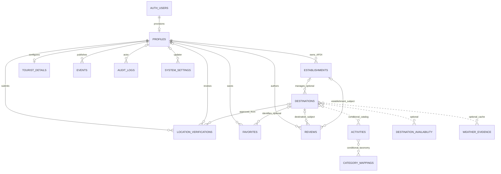

# Task 26 — SamalNav Canonical Database Schema Finalization and Owner Decision Closure

**Status:** Proposed specification and blank owner decision worksheet. No owner approval is inferred.
**Evidence scope:** Repository source, checked-in SQL/migrations, and Tasks 20–25. No Supabase project was accessed and no SQL was executed.
**Target mentioned in prior owner evidence:** SamalNav-NonProduction (`iwzyasdanesaaxxjujxr`, `ap-southeast-2`); the earlier absence summaries remain owner-supplied and their raw query outputs are not retained here.
**Authorization:** This document does not authorize schema implementation, non-production initialization, production deployment, or CARS activation.

## 1. Executive summary

The current Flutter code queries twelve public relations, but the owner responses change the approved initialization scope. The proposed core database now contains ten relations: `profiles`, `destinations`, `establishments`, `location_verifications`, `tourist_details`, `favorites`, `reviews`, `events`, `audit_logs`, and `system_settings`. `payments` is explicitly excluded. Pre-booked reservation information is itinerary-owned and remains local with Hive drafts under the selected no-server-itinerary decision; the existing dashboard `reservations` contract is not canonical for this purpose and requires application refactoring. Supabase Auth remains a managed identity dependency, not a table to recreate. The current code's queries are legacy compatibility work, not a reason to retain excluded payment processing or booking semantics.

“Canonical” in this document means the recommended target for owner review. It does not mean selected, approved, live, or safe to execute. Exact defaults, deletion actions, role vocabulary, workflow states, moderation, payment settlement, audit operation, and a few current service assumptions need decisions. Each table below gives a concrete candidate contract while marking decision-dependent fields and actions. In particular, this document does not silently resolve conflicts by copying one of the seven existing migration files.

The recommended architecture is:

- Auth identity is rooted in managed `auth.users`; a trusted, idempotent provisioning path creates a least-privileged profile. User-editable metadata never grants a role.
- `profiles.role` uses the current app’s values (`tourist`, `establishment`, `administrator`, `super_admin`) as a constrained compatibility vocabulary, with staff-role assignment restricted to a trusted administrative operation. The `owner` versus `establishment` mismatch requires approval and coordinated app/data treatment.
- Establishment ownership is one-to-many under AP-24. The present service’s `.maybeSingle()` assumption must change or explicitly select an active establishment.
- Public destinations are exposed through a narrow published projection/state predicate; unverified fallback records remain visibly local and are not evidence.
- Tourists own their profile/preferences/favorites. Preference confirmation is not implied by row existence.
- Reservations have participant-bound access and explicit state transitions. Payment settlement and audit creation are trusted operations, not client assertions.
- Scope B CARS remains optional. The six criteria and Task 06 survey weights stay unchanged but unverified against the original research source; current application score contract remains 0–100. No scoring rule, evidence value, or score is introduced here.

**Owner decision update:** The owner-supplied response selects approaches A-01 through A-12, including A-06’s pre-booked-information correction and A-07’s exclusion of payments. The response text is recorded as owner-supplied; no separate name, role, signature, approval date, or effective policy bundle version was provided for this document. Selections remain subject to technical/security validation where the response says so. They do not authorize coding, migration execution, database initialization, or production deployment. A-13 through A-16 remain unanswered unless separately completed.

**Readiness:** core scope is narrowed to ten proposed database relations; application contract reconciliation is incomplete; local-model work for pre-booked commitments is not implemented; owner decisions A-13/A-14 and independent security review remain open; migration design and initialization are not authorized; production deployment and CARS scoring activation are not authorized.

## 2. Decision status and evidence notation

| Label | Meaning |
|---|---|
| **Repository fact** | Directly supported by current code or a checked-in artifact; does not establish deployed state. |
| **Proposal** | A technical recommendation for owner/security review; not a decision. |
| **Owner decision required** | Choices or policy belong to the project owner/security/business authority. |
| **Unverified live** | No raw current catalog evidence independently inspected in this work. |

Prior Task 25 summaries say seventeen named relations were reported absent, but raw query results, complete target coverage, and independent inspection are unavailable. `location_verifications` was outside the seventeen-name evidence set. No table state in this document should be read as a live claim.

## 3. Scope A — Core runtime database specification

### 3.1 General design rules

1. Use UUID primary keys generated by the database (`gen_random_uuid()`) unless an Auth-owned UUID is the primary key. The choice of UUID generation extension must be confirmed against the selected project before migration design.
2. Use `timestamptz` for instants and store date-only availability/event dates as `date`; define the product timezone when turning local schedule values into instants.
3. Use `numeric`, not binary floating point, for money. A currency code is required anywhere an amount represents a monetary value. Do not assume PHP or infer a currency conversion.
4. Foreign keys and constraints below are proposals. `ON DELETE` behavior must be approved per relation; financial, audit, and review history should not disappear through a parent cascade.
5. Defaults are limited to system-owned identity/timestamps or safe workflow initialization. Do not add default ratings, prices, tourist preferences, or verification claims.
6. Primary/unique constraints create supporting indexes. Additional indexes below are candidates justified by current equality filters/orderings; verify query plans and volume before adding them.
7. Apply RLS to every exposed application table. Database grants, RLS, column exposure, PostgREST embeds, trusted functions and client field allowlists must be reviewed together.

### 3.2 Proposed relation-by-relation contract

The column lists identify proposed minimum contracts rather than a claim that every existing model field should be persisted. “Required” means non-null in the proposal. “Decision” marks a choice that blocks final DDL. Types use standard PostgreSQL names.

#### `profiles` — application identity and public-safe profile

- **Purpose / dependency:** app profile, username lookup, role checks, profile display/embeds; related to Auth and multiple features.
- **Columns:** `id uuid PRIMARY KEY` and FK to `auth.users(id)` (required); `role text NOT NULL` (trusted assignment; allowed values decision); `email text` (nullable, private, preferably sourced from Auth rather than duplicated); `display_name text`; `username text`; `phone text`; `created_at timestamptz NOT NULL DEFAULT now()`; `updated_at timestamptz NOT NULL DEFAULT now()`; `mfa_email_enabled boolean` is **excluded from the canonical minimum** until owner/security decide whether Auth is the source of truth.
- **Constraints/indexes:** role check against one approved vocabulary; unique `username` only if case/normalization and uniqueness are approved; index `role` only if admin filtering requires it. PK is the Auth identity key. Do not expose a directory-wide profile search by default.
- **Relationship/actions:** one Auth user to zero/one profile. Proposed Auth-user deletion removes the profile (`ON DELETE CASCADE`) only if account deletion policy accepts that behavior; otherwise use a controlled account-deletion process.
- **Defaults:** no database default for privileged role. Trusted provisioning may assign `tourist`; user metadata cannot select a role.
- **Owner decisions:** canonical role strings; email synchronization; username normalization; account deletion; whether MFA state belongs in Auth.

#### `destinations` — destination catalog and publication state

- **Purpose / dependency:** browsing, admin status updates, verification approval, favorite display and future CARS candidate identity.
- **Columns:** `id uuid PRIMARY KEY DEFAULT gen_random_uuid()`; `name text NOT NULL`; `location text NOT NULL` (existing wire field); `lat double precision`; `lng double precision`; `category text`; `description text`; `image_url text`; `image_urls text[]`; `publication_status text NOT NULL`; `verification_status text NOT NULL`; `establishment_id uuid`; `owner_id uuid` only if a distinct owner workflow is approved; `operating_hours jsonb`; `average_stay_minutes integer`; `rating_average numeric`; `rating_is_verified boolean`; `rating_source text`; `rating_retrieved_at/rating_fresh_until timestamptz`; `entrance_fee numeric`; `entrance_fee_currency text`; `entrance_fee_unit text`; `entrance_fee_source text`; `entrance_fee_is_verified boolean`; `entrance_fee_retrieved_at/entrance_fee_fresh_until timestamptz`; `created_at/updated_at timestamptz NOT NULL DEFAULT now()`.
- **Constraints/indexes:** coordinate pair must be both null or both present and within latitude/longitude bounds; visit duration positive when present; publication and verification are independent status fields with owner-approved allowed values; retirement is a publication lifecycle state, not a verification claim. If rating remains, enforce only the approved scale (current parser expects 0–5), and require source/verification/timestamp semantics before it is treated as evidence; never interpret default zero as evidence. Price amount/currency/unit/source/verification/freshness must be coherent; until an authoritative price contract exists, entrance fee is display-only and not CARS input. Candidate indexes: publication status, category only if used for filtering, `establishment_id`, and GIST geography only if a spatial extension/use is approved. Avoid speculative name uniqueness.
- **Relationships:** optional `establishment_id → establishments.id`; optional `owner_id → profiles.id` only if ownership remains distinct from establishment ownership. No category FK in Scope A because no authoritative taxonomy contract is established.
- **Defaults:** system ID/timestamps only. Publication booleans/status need a safe non-public initial state selected by owner; do not default verified/active.
- **Owner decisions:** canonical allowed publication/verification states; whether to retain legacy `status`/`is_active`/`is_verified` aliases during coordinated app migration; ownership fields; rating source/scale/freshness; coordinate optionality; operating-hours timezone; price semantics. Owner selected separate publication and verification, but has not yet supplied the state vocabularies.

#### `establishments` — businesses owned by app users

- **Purpose / dependency:** owner dashboard and admin verification; AP-24 requires one owner to be able to have multiple establishments.
- **Columns:** `id uuid PRIMARY KEY DEFAULT gen_random_uuid()`; `owner_id uuid NOT NULL`; `name text NOT NULL`; `description text`; `address text`; `lat/lng double precision`; `category text`; `contact_phone text`; `publication_status text NOT NULL`; `verification_status text NOT NULL`; `created_at/updated_at timestamptz NOT NULL DEFAULT now()`.
- **Constraints/indexes:** coordinate pair/bounds when present; `owner_id` FK to profiles; index on `owner_id`; status checks follow approved publication/verification lifecycle. **No unique constraint on `owner_id`** under AP-24. Any name uniqueness is out of scope absent a business rule.
- **Relationship/actions:** profile 1:N establishments. Proposed `owner_id → profiles.id ON DELETE RESTRICT` or account-deactivation workflow, not cascade deletion of business history.
- **Defaults:** verification false; no role-derived creation unless server checks the current authenticated owner.
- **Owner decisions:** whether owner may have multiple establishments (AP-24 is the approved baseline); establishment lifecycle/soft deletion; required address/location; verified-state transitions.
- **Separate application requirement:** `EstablishmentService` currently uses `.maybeSingle()` for owner lookup; change to list/active selection before using this contract.

#### `location_verifications` — user submissions and administrator review queue

- **Purpose / dependency:** current tourist-submitted location/admin review and destination approval flow.
- **Columns:** `id uuid PRIMARY KEY DEFAULT gen_random_uuid()`; `name text NOT NULL`; `address text`; `category text`; `lat/lng double precision NOT NULL`; `description text`; `submitted_by uuid NOT NULL`; `status text NOT NULL`; `reviewed_by uuid`; `reviewed_at timestamptz`; `created_at timestamptz NOT NULL DEFAULT now()`; optionally `destination_id uuid` after duplicate/approval lifecycle is designed.
- **Constraints/indexes:** coordinate range; approved status check; `reviewed_by` and `reviewed_at` consistency; index `(status, created_at)` for admin queue and `submitted_by` for user history if used.
- **Relationships/actions:** submitter/reviewer reference profiles. Proposed submitter delete `SET NULL` only if retaining submissions is compatible with privacy; otherwise controlled deletion/anonymization. Reviewer must not equal submitter unless policy explicitly allows. Destination approval is transactional and idempotent.
- **Defaults:** `status='pending'` is a proposal; no automatic approval.
- **Owner decisions:** statuses, rejection reason/retention, edit-after-submit behavior, whether a verification creates or updates a destination, and trusted atomic approval operation.

#### `tourist_details` — persisted tourist planning profile

- **Purpose / dependency:** authenticated profile service loads and upserts planning preferences.
- **Columns:** `id uuid PRIMARY KEY DEFAULT gen_random_uuid()`; `user_id uuid NOT NULL UNIQUE`; `budget_min numeric`; `budget_max numeric`; `budget_currency text`; `budget_basis text`; `available_hours_per_day integer`; `trip_duration_days integer`; `preferred_categories text[]`; `preferences_confirmed boolean`; `preferences_confirmed_at timestamptz`; `current_lat/current_lng double precision`; `travel_mode text`; `number_of_tourists integer`; `children_count integer`; `elders_count integer`; `created_at/updated_at timestamptz NOT NULL DEFAULT now()`.
- **Constraints/indexes:** unique user; user FK to profiles; nonnegative ordered budget bounds when present and currency/basis required for an available budget; hours/days positive and bounded by approved product limits; group counts nonnegative and internally consistent; origin both-null-or-both-present and coordinate bounds. `preferences_confirmed=true` requires an explicit confirmation action; timestamps are set by trusted service, not inferred from row existence.
- **Relationships/actions:** one profile to zero/one tourist detail row, FK to profiles with `ON DELETE CASCADE` only if profile/account deletion lifecycle approves.
- **Defaults:** no invented budget, category, origin, or mode default. Null means unspecified/unavailable; empty preferences mean no selected preferences. Existing model currently requires several scalar values and service create-if-missing defaults must be changed or explicitly approved.
- **Owner decisions:** whether this table is only for tourist profiles; per-person/total-group budget basis; currency; profile initialization; confirmation fields and UX; nullable origin/mode; group definitions.
- **Separate application requirement:** update `TouristPlanningProfile` parsing/validation and `TouristPlanningProfileService.createIfMissing` to match approved nullable fields and confirmation semantics.

#### `favorites` — tourist saved items

- **Purpose / dependency:** favorite screen currently reads, deletes, and supports undo insert; current shape contains a place-name snapshot.
- **Columns:** `id uuid PRIMARY KEY DEFAULT gen_random_uuid()`; `user_id uuid NOT NULL`; `destination_id uuid`; `place_name text NOT NULL`; `location text`; `category text`; `rating_snapshot numeric`; `created_at timestamptz NOT NULL DEFAULT now()`.
- **Constraints/indexes:** profile and optional destination FKs; unique `(user_id, destination_id)` when destination ID is present (partial unique index); index `(user_id, created_at DESC)`; snapshot rating constrained to display range only if its source/semantics are explicit. No CARS evidence may come from snapshot fields.
- **Relationships/actions:** profile 1:N favorites; destination optional because legacy or fallback favorites may lack stable server ID. Destination delete may `SET NULL` while preserving the user’s snapshot.
- **Defaults:** no rating default.
- **Owner decisions:** whether favorites must be tied to stable destination identity or retain name snapshots; duplicate behavior; deletion behavior.

#### Pre-booked reservation information — excluded from the database Scope A

- **Owner decision:** SAMAL NAV records information the tourist supplies about an arrangement made externally; it does not create, confirm, cancel, or verify the external reservation. The record belongs to the tourist's itinerary and changes only SAMAL NAV's local copy.
- **Storage boundary:** selected A-10 keeps itinerary drafts device-local in Hive and excludes server-side itinerary persistence. Therefore pre-booking details must be modeled within the local itinerary/draft aggregate; no `public.reservations` table or database FK to an itinerary is included in the initial core schema.
- **MO-GA boundary:** recorded pre-booked commitments are fixed itinerary constraints. The current repository search found no pre-booking/commitment field or model in the itinerary path, so this requirement is **not yet implemented**. A separate local-model/UI/MO-GA implementation is required; it must preserve commitment time/location and must not represent external confirmation as SAMAL NAV verification.
- **Not implied:** associating an item with the tourist and itinerary does not establish that a server-side tourist ID or itinerary ID is stored. If server synchronization is intended, it conflicts with A-10 and requires a new decision before any table design.
- **Current code conflict:** `EstablishmentService`, `AdministratorService`, and establishment dashboard still query/update a server `reservations` relation with pending/confirmed/completed semantics. Those screens/services must be retired or redesigned as separate application work; existing queries do not authorize retaining actual-booking behavior in the canonical schema.

#### Payments — explicitly excluded from initial core database

- **Owner decision A-07:** SAMAL NAV does not process, store, or verify payments. No `payments` table, payment provider integration, payment status, or settlement claim is included in canonical initialization. Payment arrangements remain external to the app.
- **Current code conflict:** `EstablishmentService`, `PaymentRecord`, and establishment dashboard query `payments`; these database dependencies/UI claims must be removed or redesigned in separate application work before the target schema supports a complete application release. Do not replace them with a local or server payment ledger.
#### `reviews` — authored destination or establishment reviews

- **Purpose / dependency:** current establishment review query filters by `establishment_id`; the service calculates an establishment average. It is not an approved public destination aggregate.
- **Columns:** `id uuid PRIMARY KEY DEFAULT gen_random_uuid()`; `tourist_id uuid NOT NULL`; `destination_id uuid`; `establishment_id uuid`; `stars smallint NOT NULL`; `review_text text`; `status text NOT NULL`; `created_at/updated_at timestamptz NOT NULL DEFAULT now()`; optional `published_at` after moderation policy.
- **Constraints/indexes:** `stars BETWEEN 1 AND 5` matches current review model; exactly one subject (`destination_id` XOR `establishment_id`) per owner decision; one review per tourist/subject only if separately approved; indexes by subject/status/date and tourist/date. FK to profile and optional destination/establishment.
- **Relationships/actions:** tourist 1:N; destination or establishment target. Preserve review history with controlled anonymization/deletion policy.
- **Defaults:** no default stars; initial status `pending` is a proposal only.
- **Owner decisions:** destination vs establishment review semantics, publication/moderation, edits, uniqueness, aggregation, author identity visibility. CARS must not aggregate from this table until a separate rating evidence and scoring policy is approved.

#### `events` — admin-published events

- **Purpose / dependency:** administrator list/count and publisher profile embed.
- **Columns:** `id uuid PRIMARY KEY DEFAULT gen_random_uuid()`; `title text NOT NULL`; `description text`; `event_date timestamptz NOT NULL` (or `date` plus local-time fields if the event is local-date based; owner decision); `category text`; `posted_by uuid NOT NULL`; `status text NOT NULL`; `created_at/updated_at timestamptz NOT NULL DEFAULT now()`.
- **Constraints/indexes:** non-empty title; approved status check; index `(status, event_date)` and `posted_by` if queried. FK to profiles.
- **Relationships/actions:** profile 1:N published events; publisher deletion should be restricted or attributed to a retained service account, not cascade.
- **Owner decisions:** local-time semantics, draft/published/archived lifecycle, anon publication scope and edit rights.

#### `audit_logs` — trusted security/business audit trail

- **Purpose / dependency:** admin/super-admin audit screen. Current client inserts generic audit payloads and super-admin reads logs; this is too permissive for a trustworthy security record.
- **Columns:** `id uuid PRIMARY KEY DEFAULT gen_random_uuid()`; `actor_id uuid`; `action_type text NOT NULL`; `target_type text`; `target_id text`; `description text`; `metadata jsonb NOT NULL DEFAULT '{}'::jsonb`; `created_at timestamptz NOT NULL DEFAULT now()`; optional `request_id text`. Exclude client-supplied role, IP/device fields unless an approved trusted source and retention purpose exist.
- **Constraints/indexes:** action type non-empty and optionally allowlisted; index `(created_at DESC)`, `(actor_id, created_at DESC)`, `(target_type,target_id)` as actual query needs dictate. No UPDATE/DELETE for application roles; retention/erasure via controlled security process.
- **Relationships/actions:** optional actor FK to profiles with `ON DELETE SET NULL` to preserve event history; no free-form client actor identity. Only trusted server function/service emits accepted event types; read is tightly limited.
- **Owner decisions:** event taxonomy, retention, metadata schema/PII rules, operator access and whether audit events are required for all privileged changes.
- **Separate application requirement:** refactor `AuditService` to call trusted audit operation or remove direct inserts; do not adopt policies permitting arbitrary client inserts.

#### `system_settings` — restricted operational controls

- **Purpose / dependency:** super-admin maintenance-mode read/write.
- **Columns:** `key text PRIMARY KEY`; `value jsonb NOT NULL`; `updated_by uuid`; `updated_at timestamptz NOT NULL DEFAULT now()`.
- **Constraints/indexes:** key allowlist/check for supported settings; JSON type/shape validated at trusted write boundary; FK updater to profiles with `ON DELETE SET NULL`. PK indexes key; no other index initially.
- **Relationships/actions:** optional profile updater; no public direct access. Maintenance setting may affect client behavior but cannot replace RLS or authorization.
- **Defaults:** seed only an approved value through a reviewed settings bootstrap step; do not copy an unreviewed maintenance row from old migrations.
- **Owner decisions:** allowed keys/schema, maintenance default, who can change it, audit/rollback behavior.
- **Separate application requirement:** validate settings keys and values and use a trusted admin operation; preserve safe behavior when setting is unavailable.

## 4. Cross-table foreign-key and index schedule

| Child → parent | Cardinality | Proposed delete behavior | Key/index requirement | Status |
|---|---|---|---|---|
| `profiles.id → auth.users.id` | 1:1 | Controlled account deletion or cascade after policy approval | PK/FK | Proposed |
| `establishments.owner_id → profiles.id` | 1:N | Restrict/deactivate owner; do not cascade business records | index owner_id; no uniqueness | AP-24 one-to-many baseline; deletion pending |
| `destinations.establishment_id → establishments.id` | 0/1:N | Restrict or set null after content lifecycle decision | index if owner/admin filters | Proposed |
| `destinations.owner_id → profiles.id` | 0/1:N | Remove this redundant FK unless an explicit separate destination owner workflow is approved | If retained, owner index | Unresolved whether needed |
| `location_verifications.submitted_by/reviewed_by → profiles.id` | 1:N optional reviewer | Preserve/anonymize submitter; reviewer restricted | `(status,created_at)`, submitter index if used | Proposed |
| `location_verifications.destination_id → destinations.id` | 0/1:1 or 1:N | Restrict; workflow-specific | unique only if one verification maps one destination | Requires lifecycle decision |
| `tourist_details.user_id → profiles.id` | 1:0/1 | Cascade only with approved profile deletion | unique user_id | Proposed |
| `favorites.user_id → profiles.id` | 1:N | Cascade user-owned favorite on account deletion if approved | `(user_id,created_at)` | Proposed |
| `favorites.destination_id → destinations.id` | 0/1:N | SET NULL to preserve snapshot | partial unique `(user_id,destination_id)` | Proposed |
| `reviews.tourist_id → profiles.id` | 1:N | Controlled anonymization | subject/status/date indexes | Proposed |
| `reviews.destination_id/establishment_id` | exactly one subject | RESTRICT or controlled subject retirement | subject indexes | Proposed |
| `events.posted_by → profiles.id` | 1:N | RESTRICT or transfer publisher | status/event_date | Proposed |
| `audit_logs.actor_id → profiles.id` | 0/1:N | SET NULL to preserve audit entry | actor/time | Proposed |
| `system_settings.updated_by → profiles.id` | 0/1 | SET NULL | PK on key | Proposed |

Check constraints should enforce coordinate bounds/pairs, nonnegative monetary amounts, positive group counts, bounded rating values only where the field is an actual rating, valid status vocabularies, explicit review subject cardinality, and profile budget/group consistency. Do not implement checks whose business semantics remain undecided.

## 5. Conditional Scope B — CARS data structures

Scope B is not part of core database initialization. Prefer an approved external provider or existing authoritative source when suitable; a database table is not required merely because the CARS assessment boundary exists.

| Evidence area | Minimum data contract | Storage recommendation | Gate before any table/source adapter |
|---|---|---|---|
| Activities | Stable activity ID, destination relationship, canonical category ID, active/completeness meaning, relevant duration/cost/weather requirements | Add `activities` only if an authoritative catalog and owner agree it is maintained in SamalNav | Activity authority, identifiers, completeness and CRUD/stewardship approved |
| Preference/activity mapping | Versioned exact-ID mapping from confirmed tourist preference IDs to activity categories | Separate mapping table only if mapping is maintained in database; otherwise versioned application/provider artifact | Taxonomy authority and mapping coverage approved; no name inference |
| Public destination rating | Actual rating, defined scale/aggregate, source, verification, retrieval/effective/freshness metadata | Reuse `destinations` only if source and semantics are approved; otherwise rating evidence relation/view | Rating authority, zero-vs-default semantics, publication and freshness rule approved |
| Weather | Forecast/observation, location, interval, units, provider, retrieval and coverage | External raw provider preferred; cache table optional, disposable and not a scoring policy | Provider terms/coverage and weather classifier approved separately |
| Verified pricing | Amount, currency, unit, applicability/group basis, component, source, verification/freshness, inclusions | Add cost-item relation only when an authoritative price steward and completeness semantics exist | Pricing units, group rates, package handling and candidate allocation approved |
| Availability | Destination ID, local date/timezone, availability state, source/update | Add `destination_availability` only if date-specific availability is authoritative and queried | Meaning of no row, timezone and freshness policy approved |
| Route / transport | Provider route ID, endpoints, selected mode, route type, distance/time, date, freshness; water legs separate | Keep external/provider-backed unless a durable route evidence requirement is demonstrated | Provider/mode/water source approved; CARS does not select mode or route order |

The six CARS criteria remain: tourist preference/activity match, public destination rating, weather suitability, budget compatibility, travel distance suitability, and available travel-time compatibility. Task 06 weights (0.1548, 0.1718, 0.1695, 0.1785, 0.1627, 0.1627) remain **unverified against the original research methodology**. Current engine/model/UI contract is 0–100. Preserve that contract; no migration to 0–1, score formula, threshold, normalization, or live recommendation is authorized by this document. Missing evidence remains unavailable/insufficient and weights are not redistributed.

## 6. Proposed entity relationship diagram

Solid lines are proposed core relationships; dashed lines are optional/conditional. Auth is managed by Supabase. Cardinality and delete behavior still require approval where marked in Section 4.

The diagram intentionally omits server itinerary and reservation tables: pre-booked information is part of Hive-local itineraries and MO-GA is local/in-memory. Payments are outside current scope. It also omits a category FK on core destinations until an authoritative taxonomy is approved. Reviews must target one subject, as selected by the owner.

## 7. Proposed security and RLS matrix

Legend: `—` deny; `Own` only rows owned by `auth.uid()`; `Participant` only own tourist/establishment side; `Published` narrow published projection; `Staff` trusted administrator/super-admin authorization; `Trusted op` server-side function/edge/backend with verified identity and allowlisted fields. These are requirements for design, not ready-to-run policies. RLS does not replace column-level exposure or trusted field validation.

| Table | anon SELECT / writes | Tourist SELECT / INSERT / UPDATE / DELETE | Establishment owner SELECT / INSERT / UPDATE / DELETE | Administrator SELECT / INSERT / UPDATE / DELETE | Super-admin SELECT / INSERT / UPDATE / DELETE |
|---|---|---|---|---|---|
| `profiles` | — / — | Own / Own limited profile fields / Own limited fields / — | Own / Own limited / Own limited / — | Staff limited display fields / Trusted op / Trusted op / — | Staff protected profile/role / Trusted role op / Trusted role op / — |
| `destinations` | Published / — | Published / — / — / — | Published plus owned / — / owned-field update / — | Staff / Staff / Staff / controlled retirement | Staff / Staff / Staff / controlled retirement |
| `establishments` | Published subset only if approved / — | — or public subset / — / — / — | Own / Trusted op or allowlisted create / Own fields excluding verification / — | Staff / Staff / Staff / controlled retirement | Staff / Staff / Staff / controlled retirement |
| `location_verifications` | — / — | Own submissions / Own submission / no direct approval fields / Own draft only if policy says | Own associated submissions / restricted create / restricted editable fields / — | Staff review / Trusted op / Trusted transition / — | Staff review / Trusted op / Trusted transition / controlled purge only |
| `tourist_details` | — / — | Own / Own / Own fields except server provenance / Own | — / — / — / — | No general access; support process only / — / — / — | Break-glass support only, audited / — / — / — |
| `favorites` | — / — | Own / Own / — / Own | — / — / — / — | No routine access / — / — / — | Audited support only / — / — / — |
| `reviews` | Published only / — | Own and published / Own review / own unmoderated content only / own before policy cutoff | Published reviews of own establishment / — / reply only if separately modeled / — | Staff / moderation op / moderation fields / controlled moderation | Staff / moderation op / moderation fields / controlled moderation |
| `events` | Published / — | Published / — / — / — | Published / — / — / — | Staff / Staff / Staff / archive/retire | Staff / Staff / Staff / archive/retire |
| `audit_logs` | — / — | — / — / — / — | — / — / — / — | Staff read if explicitly approved / Trusted op only / — / — | Restricted audited read / Trusted op only / — / — |
| `system_settings` | — / — | — / — / — / — | — / — / — / — | Approved settings read/write via trusted op only / — / — / — | Restricted read/write via trusted op / — / — / — |

Before policy SQL is drafted, security review must define role claim source, membership checks, column grants, PostgREST embed exposure, policy composition, `SECURITY DEFINER` owner and fixed `search_path`, function `EXECUTE` grants, secret/PII handling, audit invariants, and test identities. Do not use client-writable profile role as its own authorization proof. Super-admin status and assignment must be protected outside user-editable Auth metadata.

## 8. Critical architecture decision register

Rows A-01 through A-12 below incorporate the owner selections supplied after the original draft. They are recorded as selected owner decisions, not as authorization to implement or execute. A-13 through A-16 remain open. Where a selected decision conflicts with current code or another decision, the conflict is preserved as a blocker rather than silently resolved.

| ID / subject | Recommended option | Alternatives | Consequences / required owner approval |
|---|---|---|---|
| A-01 Auth/profile lifecycle | **Owner selected B: Auth database trigger.** Create one profile for email/OAuth, key it by Auth UUID, default `tourist`, ignore user metadata role, idempotent, restricted `SECURITY DEFINER` and controlled `search_path`; transactionally fail Auth creation if provisioning fails. | Client upsert; backend/edge provisioning | Selected by owner; trigger body/owner/grants, recovery and integration tests require independent technical/security review. A-11 controls account deletion. No implementation authorization. |
| A-02 Role vocabulary and escalation | **Owner selected A:** `tourist`, `establishment`, `administrator`, `super_admin`; trusted admin role assignment; separately controlled first super-admin bootstrap. | Rename `establishment` to `owner`; normalized role table | Selected by owner. No role changes via user metadata/self-update. Legacy `owner` values need explicit mapping; implementation and RLS review remain. |
| A-03 Establishment cardinality | **Owner selected A / AP-24:** one profile may own many establishments; no unique `owner_id`; owners cannot reassign ownership themselves. | One establishment per owner | Selected by owner. Existing `.maybeSingle()` application lookup must be revised; retain IDs/ownership and do not merge/delete records. |
| A-04 Tourist profile defaults/confirmation | **Owner selected A:** nullable until tourist supplies/confirms; no fabricated budget, currency/basis, origin, mode, group counts or preferences; field changes must preserve other unspecified fields. | Require planning setup at registration | Selected by owner. Age group definitions still need separate approved values; confirmation is explicit and not inferred from row existence. |
| A-05 Destination publication/rating/location/pricing | **Owner selected A:** publication and verification are independent; coordinates nullable as a valid pair; rating/price display-only absent authoritative provenance, scale, currency/unit/freshness. | One combined lifecycle; dedicated evidence relations | Selected by owner. Exact lifecycle vocabulary, field contract, source and constraints remain technical/data-owner decisions. |
| A-06 Pre-booked itinerary information | **Owner correction replaces prior reservation-lifecycle proposal:** tourist records their externally arranged details, associated with their itinerary; add/edit/remove affects only SAMAL NAV's record; MO-GA preserves them as fixed constraints. This is not an actual booking/confirmation workflow. | Server-side itinerary/commitment storage | Selected by owner. A-10 keeps itinerary drafts local, so the consistent target is a Hive-local itinerary component. Current repo lacks a pre-booking model/constraint adapter; implementation remains a separate blocker. If server storage is intended, A-10 must be revisited explicitly. |
| A-07 Payments | **Owner selected B: no payment persistence.** No payment processing, table, status, verification, or provider integration in current scope. | Add provider-specific payment persistence | Selected by owner. Current `payments` queries/dashboard must be removed or redesigned separately. No payment records or actual external arrangements are inferred. |
| A-08 Reviews/ratings | **Owner selected A:** one `reviews` table; exactly one subject (`destination_id` XOR `establishment_id`); moderation; separate rating aggregates; no automatic CARS aggregate. | Separate tables; view-based aggregate | Selected by owner. Existing establishment review path must remain compatible; moderation states, duplicate rule, publication, aggregation and privacy require specification. |
| A-09 Audit/settings | **Owner selected A:** trusted server-generated immutable audit events; restricted admin settings through trusted operation; no client forge/update/delete. | Constrained client ingestion; direct client upsert | Selected by owner. Event taxonomy, retention, privacy, settings keys/value schema and trusted-operation design remain; current services write directly and need separate change. |
| A-10 Scope B and itinerary persistence | **Owner selected A:** exclude CARS evidence tables and server-side itinerary persistence from initial core schema; drafts remain Hive-local; CARS/MO-GA roles remain separate and no fabricated scores. | Add selected CARS tables now; sync drafts server-side | Selected by owner. Must be reconciled with A-06 by storing pre-booking details inside the local itinerary aggregate. |
| A-11 Delete and retention | **Owner selected A:** soft-retire destinations/establishments; retain history as required; reviewed anonymization/account closure; no blanket cascades. | Cascading deletion | Selected direction; exact retention periods, anonymization and exceptional deletion authority remain open. |
| A-12 Migration/seed strategy | **Owner selected A:** new unique migration chain; preserve old migrations as historical; schema and synthetic seed separate; local clean-install first; per-environment approval, backups/recovery, hashes and validation. | Repair/reorder current files | Selected direction. Does not create or authorize migration files or execution; exact runner/manifest and environment approvals remain. |

## 9. Owner decision worksheet

Owner selections A-01 through A-12 supplied after the original draft are recorded in the decision register above. Complete A-13 through A-16 and any remaining technical details below. These selections do not authorize coding, SQL execution, non-production initialization, or production deployment. Attach evidence by safe document reference; never include credentials, tokens, or production personal data.

**Status choices:** Approved / Approved with conditions / Rejected / Deferred / Unanswered / Insufficient evidence.

| ID | Exact decision question | Recommendation (not approval) | Approver role | Owner response / conditions / evidence | Status, name, date, version |
|---|---|---|---|---|---|
| A-01 | Auth trigger; tourist default; ignore user role metadata; idempotent; controlled definer/search path | Project owner + security/backend | Owner selected B; failure rolls back signup; retries/recovery documented; account deletion follows A-11 | Owner selected; implementation pending review |
| A-02 | Preserve tourist/establishment/administrator/super_admin; no self-promotion; trusted assignment and first super-admin setup | Project owner + security | Owner selected A; legacy owner values mapped explicitly | Owner selected; implementation pending review |
| A-03 | AP-24 one profile to many establishments; no unique owner_id | Project owner + architect | Owner selected A; IDs and ownership retained; adapt app `.maybeSingle()` | Owner selected; app compatibility pending |
| A-04 | Nullable planning fields until tourist supplies/confirms; no inferred defaults | Project owner + product/methodology | Owner selected A; preserve field-level confirmation; age-group definitions remain separate | Owner selected; contract details pending |
| A-05 | Publication separate from verification; nullable coordinate pair; rating/pricing display-only without provenance | Project owner + data steward/security | Owner selected A; exact state/source contract remains to define | Owner selected; technical detail pending |
| A-06 | Tourist-recorded external pre-booking details belong to itinerary; app edits only local copy; MO-GA treats commitments as fixed constraints | Project owner + planner/MO-GA architect | Owner correction supplied; no actual booking or confirmation; local Hive is consistent with A-10 | Owner selected; feature not implemented; no DB table proposed |
| A-07 | No payment processing or persistence in current scope | Project owner + security/finance | Owner selected B; current payment service/dashboard must be separately removed or redesigned | Owner selected; app compatibility pending |
| A-08 | Unified reviews relation; exactly one destination or establishment subject; moderation; no automatic CARS aggregate | Project owner + data steward/moderation | Owner selected A; preserve review data; detailed moderation/aggregation rules remain | Owner selected; technical detail pending |
| A-09 | Trusted immutable audit; controlled settings through trusted admin operation | Project owner + security/privacy | Owner selected A; taxonomy/retention/settings allowlist still needed | Owner selected; security detail pending |
| A-10 | No CARS evidence tables or server itinerary persistence in core; drafts remain Hive-local | Project owner + architect | Owner selected A; A-06 commitment data is local itinerary data unless a new decision changes scope | Owner selected |
| A-11 | Soft-retire, controlled retention/anonymization; no blanket cascades | Project owner + privacy/security | Owner selected A; exact retention periods and deletion processes remain | Owner selected; policy detail pending |
| A-12 | New uniquely versioned migration chain; separate schema/seeds; local-first validation and per-environment authorization | Project owner + DBA/security | Owner selected A; no migration creation/execution authorization conveyed | Owner selected; technical plan pending |
| A-13 | Approve exact Scope A relation/column/type/nullability/constraint/index manifest after service mapping? | Use Section 3 as review baseline; resolve every “decision” field first | Project owner + system architect/DBA |  |  |
| A-14 | Approve RLS/grant invariants and require independent policy review/test evidence? | Section 7 least-privilege matrix; all exposed tables RLS-protected | Project owner + independent security reviewer |  |  |
| A-15 | Separately authorize controlled non-production initialization after implementation/testing? | Not in scope of this document; require exact reviewed migration hashes and target confirmation | Authorized project owner/operator |  |  |
| A-16 | Separately authorize production release after non-production acceptance/security review? | Separate deployment gate; not granted by development approval | Authorized production approver |  |  |

**Owner name/role:** ____________________  **Date:** __________  **Decision bundle version:** __________
**Controlled initialization authorization:** Not granted by this document.
**Production deployment authorization:** Not granted by this document.

## 10. Proposed migration dependency sequence (not executable)

This is an ordering of design work and object dependencies only. It is not a command to run existing SQL or an approved migration plan.

1. **Approve manifest and platform assumptions:** exact project/environment, Auth profile root, role vocabulary, UUID/default strategy, timezone/currency, retention, AP-24, and all relation contracts.
2. **Build clean local schema foundation:** profiles FK to managed Auth; trusted role/profile provisioning design; establish security helper contracts. Do not bootstrap staff from user metadata.
3. **Create catalog/ownership relations:** establishments and destinations, then location verification. Resolve publication/verification states and atomic approval path before policies.
4. **Create tourist-owned relations:** tourist_details and favorites with nullable/explicit planning semantics and user-scoped RLS.
5. **Create remaining core relations:** reviews after subject/moderation/privacy rules; events follow publisher/lifecycle contract. Do not create reservations or payments in this core schema. Tourist pre-booked details remain part of the local itinerary object.
6. **Implement trusted operations:** profile provisioning, review/verification transitions, audit append and settings update. Reservation-transition and payment-settlement operations are outside scope. Functions require fixed `search_path`, least privilege, validated caller, narrow grants, idempotency and independent review; alternatively use a reviewed backend service.
7. **Apply grants and RLS:** private tables first; public published projections last. Validate every command and embedded relationship against role-specific synthetic sessions.
8. **Seed only approved synthetic/reference data:** separate from schema, explicit manifest and environment guard. Never copy `backup/data.sql`, hard-coded destination samples, sample accounts, payments or ratings into verified operational evidence.
9. **Optional Scope B:** only after source/data contracts and CARS policy approval. Add minimal data structures individually; do not create all candidate tables as a bundle.
10. **Local validation then separate non-production authorization:** clean install, repeatability/upgrade, constraints, PostgREST embeds, RLS tests and app compatibility. Exact migration hashes/operator/window/rollback approval required before applying to the named non-production project. Production remains a distinct decision.

## 11. Application compatibility requirements

Required code work before a schema built to this proposal can satisfy the current app securely:

| Area | Existing repository contract | Required coordinated change before deployment |
|---|---|---|
| Auth/profile | `RoleService` upserts profile data; `AppRole` maps establishment owner to `establishment`; signup/profile code must not select privileged role | Server-owned role provisioning; role enum/data migration plan; no `user_metadata.role`; OAuth and email lifecycle tests |
| Establishments | Owner lookup uses `.maybeSingle()` | Query/list/select active record or explicitly approved cardinality; test AP-24 multi-establishment owner |
| Tourist planning profile | Model expects budget bounds, hours, days and travel mode; service create-if-missing inserts limited fields; no persisted confirmation | Approve nullability/default contract; revise model/service and tests; set confirmation only through explicit tourist action |
| Destinations | Broad select; parser tolerates several columns and has rating provenance gates; fallback records exist | Narrow selected columns; implement authoritative publication state; keep fallback provenance; price/rating untrusted absent contracts |
| Verification/admin | Client performs review update then destination insert in separate requests | Trusted atomic/idempotent approval operation, no submitter self-approval; authorization and retry tests |
| Pre-booked information | No local pre-booking/commitment model was found in current itinerary code; server dashboard `reservations` relation uses booking-like states | Add tourist-editable pre-booked detail to local Hive itinerary; preserve identity/time/location as fixed MO-GA constraints; avoid SAMAL NAV confirmation claims. Remove/rework establishment and administrator booking-like queries separately. |
| Payments | `PaymentRecord` and establishment dashboard query/update `payments` | Payments are excluded by owner decision; remove/rework payment UI/service queries separately. Do not add a substitute payment ledger or call an external payment arrangement verified. |
| Reviews | Establishment filter/average, empty average returns zero | Keep empty aggregate distinct from verified rating; define publication/subject semantics; no CARS coupling |
| Events | Admin query embeds publisher profile | Define publisher FK and event status, narrow public projection, embed/RLS test |
| Audit | Client can insert audit event and super-admin reads | Replace with trusted append operation; actor/time server-owned, immutable access, PII redaction tests |
| Settings | Super-admin reads/upserts generic key/value | Allowlisted validated setting operation; safe unavailable behavior; audited changes |
| CARS/planner | Current CARS provider unavailable; local drafts and MO-GA; score 0–100 | Keep unchanged until approved source contracts/policies. No server itinerary relation is required by current call sites. |

These are separate application changes, not authorized by this database specification.

## 12. Test and acceptance specification

Before any non-production initialization, implementation owner should supply automated evidence for:

- **Schema:** clean install; exact types/nullability/defaults; every PK/FK action/check/unique/index; transaction failure and recovery; repeatability/upgrade path; no duplicate migration version; schema diff against the approved manifest.
- **Auth/roles:** email and OAuth profile provisioning; retry/idempotency; no client role escalation via user metadata/profile update; staff assignment authorization; first super-admin bootstrap review.
- **RLS:** anon, tourist A/B, establishment owner A/B with multiple establishments, administrator and super-admin; deny cross-user/cross-business access; test SELECT/INSERT/UPDATE/DELETE separately; verify protected columns cannot be written; test PostgREST embedded relations.
- **Workflow:** verification submit/approve/reject atomicity; local pre-booked commitment persistence/edit/remove and MO-GA fixed-constraint behavior; ensure no SAMAL NAV booking/payment confirmation is emitted; review moderation; audit append-only; settings key validation.
- **Compatibility:** every current service parser/query, nullable tourist fields, destination fallback labeling, one-to-many establishment behavior, profile embeds, local Hive drafts/manual/circuit/MO-GA regression.
- **CARS:** safe unavailable state; no score from unverified/fallback/default rating, price, weather, taxonomy, or route data; existing 0–100 contract and all six criteria/weights unchanged.
- **Seed and privacy:** synthetic-only fixtures; no production records or credentials; logs exclude tokens, secrets, review text or unnecessary personal data.

## 13. Remaining implementation blockers

1. Owner-selected A-01 through A-12 are recorded. Complete A-13 (exact manifest) and A-14 (security matrix acceptance); keep A-15 (non-production initialization) and A-16 (production release) as separate explicit authorizations.
2. Raw, sanitized Task 18/24 schema outputs and independent review for the exact target project; `location_verifications` status also needs explicit evidence.
3. A signed Scope A manifest resolving every field marked optional/decision, status vocabulary, nullability/defaults, delete actions, indexes and exact Auth lifecycle.
4. Security design review of all grants, RLS, profile role assignment, trusted functions/backend, audit/payment/admin operations and PII retention.
5. AP-24 application compatibility for `.maybeSingle()` and owner UI/query semantics.
6. Service/workflow changes for profile nullability/confirmation, atomic verification, local itinerary-owned pre-booked details and MO-GA commitment constraints, removal/redesign of booking-like dashboard queries, removal/redesign of payment UI/service calls, audit append, and settings allowlist.
7. Locally validated new uniquely versioned schema/migration/seed package; existing migration sequence is not safe to apply unchanged.
8. For any CARS activation, approved mathematical policies and authoritative data/source contracts remain missing; Scope B must not block or be bundled into Scope A initialization.
9. Explicit non-production execution approval after exact migration review, followed by a separate production approval after acceptance/security/operations review.

## 14. Final readiness assessment

| Gate | Determination | Reason |
|---|---|---|
| Proposed Scope A specification available | **Yes, for review** | This document provides candidate columns, constraints, relations, security invariants and compatibility actions. |
| Canonical schema owner-approved | **Partially** | Owner selected A-01–A-12; exact manifest (A-13), RLS/grant approval (A-14), and remaining technical details require closure. |
| Live schema reconciled | **No** | Owner summaries are not raw retained outputs; no independent project access occurred. |
| Migration implementation ready | **No** | Existing files conflict; proposal requires service/security decisions and a newly reviewed manifest/chain. |
| Non-production initialization authorized | **No** | No explicit implementation/operator approval; this task is documentation only. |
| CARS numeric scoring ready/authorized | **No** | External evidence sources and scoring policy unresolved; preserve existing 0–100 safe-unavailable behavior. |
| Production deployment authorized | **No** | Separate security, acceptance, operational and release approval absent. |

### Recommended next step

Obtain owner closure for A-13 and A-14, attach the owner response evidence/version to the decision record, and resolve the local pre-booked commitment model plus removal/redesign of current payment and booking dashboard dependencies. Then obtain independent security/DBA review of the accepted ten-relation Scope A manifest and service changes. Only after those gates should a separate implementation task draft a new, uniquely versioned migration package for local validation. Do not begin non-production initialization or CARS activation from this document.

## 15. Closeout

- **Created:** `docs/TASK_26_SAMALNAV_CANONICAL_DATABASE_SCHEMA_FINALIZATION_AND_OWNER_DECISION_CLOSURE.md`.
- **Preserved:** Tasks 06–25, existing migration files, source changes, and working-tree state.
- **Supabase/SQL:** No project access and no SQL execution.
- **Code/migrations/config/database objects:** None modified or created.
- **Approval:** No schema, initialization, production, or CARS approval is granted.
