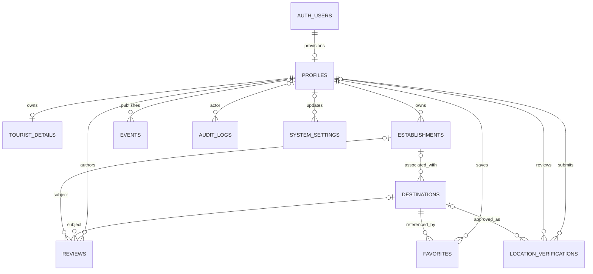

# Task 28 — SamalNav Canonical Schema Finalization and Application Compatibility Audit

**Status:** Technical target specification for review; not an executable schema or migration. A-13 approves the ten-relation scope subject to this field-level and application compatibility review. A-14 accepts the least-privilege matrix as a baseline subject to independent security review. A-15 and A-16 remain deferred; no database execution or deployment is authorized.

**Evidence boundary:** Repository source and Tasks 21–27 were inspected. No Supabase project was accessed and no SQL was executed. Task 23–27 deployed-schema absence summaries remain owner-supplied; this document does not assert current deployed state.

## 1. Executive summary

This audit translates the owner-selected architecture into a proposed contract for the ten Scope A relations: `profiles`, `destinations`, `establishments`, `location_verifications`, `tourist_details`, `favorites`, `reviews`, `events`, `audit_logs`, and `system_settings`. Each column below is traceable to a current app read/write or to an explicit approved architectural requirement. Fields whose semantics are not settled remain visibly conditional; they must not be treated as approved merely because they appear in this design.

Key owner decisions preserved:

- Supabase Auth remains platform-managed. A trusted, idempotent Auth trigger provisions a `profiles` row with `tourist`; no user metadata role is trusted.
- Canonical roles remain `tourist`, `establishment`, `administrator`, and `super_admin`. Privileged assignment is trusted and auditable.
- A profile may own many establishments; `establishments.owner_id` must not be unique.
- Tourist planning data is nullable until provided and confirmed; no budget, origin, mode, or group defaults are fabricated.
- Destination publication and verification are separate states; ratings and prices are display-only unless their evidence contracts are satisfied.
- A-06’s corrected decision controls: tourist-entered pre-booked itinerary details are local Hive draft data, not SAMAL NAV reservations or confirmations. MO-GA must preserve those details as fixed constraints. No `reservations` relation is in the ten-relation scope.
- Payments are excluded. No `payments` relation or payment settlement workflow is specified.
- Reviews use one relation with exactly one destination or establishment subject. No CARS rating aggregate is implied.
- Audit events are written by trusted server-side operations and ordinary clients cannot insert, update, or delete them.
- CARS evidence persistence and server-side itinerary persistence remain outside Scope A.
- Soft retirement and controlled retention are preferred over destructive cascades.
- Use a new uniquely versioned migration chain and separate schema from seeds. Existing migrations are not an executable chain.

**Readiness:** The architecture direction is established, but the field manifest still has owner/security-dependent details and the application is not compatible with it. Exact role/state vocabularies beyond the supplied role list, username behavior, lifecycle transitions, retention periods, sensitive settings allowlists, field-level update permissions, migration code, local validation, and independent security review remain open. This specification does not satisfy A-15 or A-16.

## 2. Owner decision compliance matrix

| Decision | Treatment in this specification | Status / remaining condition |
|---|---|---|
| A-01 Auth/profile | Auth UUID is `profiles.id`; trusted idempotent provisioning assigns `tourist`; no user metadata role | Direction preserved; trigger owner/search path/grants/failure tests require review |
| A-02 roles | Four approved role strings; trusted role changes only | Vocabulary preserved; bootstrap and exact authorization predicates require review |
| A-03 cardinality | `profiles 1:N establishments`; no unique owner index | Preserved; `.maybeSingle()` app assumption must change |
| A-04 tourist fields | Planning facts nullable; explicit confirmation is separate from mere presence | Preserved; app model/service currently requires several values and has no confirmation contract |
| A-05 destination states | Publication distinct from verification; coordinates nullable as a pair; ratings/prices require provenance | Preserved; state vocabularies and evidence rules remain open |
| A-06 pre-booked details | Local Hive itinerary-owned information; MO-GA fixed constraints; not actual app reservations | Corrected decision preserved; feature is absent/incomplete in current model path |
| A-07 payments | No payments table or payment processing | Preserved; current dashboard/service calls conflict and require app redesign |
| A-08 reviews | Unified review subject XOR and moderation state; no CARS aggregate | Preserved; moderation vocabulary, edits/uniqueness, public fields need approval |
| A-09 audit/settings | Trusted immutable audit writes; controlled settings operations | Preserved; event taxonomy, settings keys, retention and trusted writer are open |
| A-10 persistence scope | No CARS evidence tables or server itinerary drafts | Preserved; Hive remains device-local |
| A-11 retention | Soft retire public/business records; avoid blanket cascades | Preserved; account deletion/anonymization and retention schedule unresolved |
| A-12 migration/seed | New uniquely versioned chain; schema-only migrations; separate synthetic seed manifest | Preserved; no chain or seeds are created here |
| A-13 manifest | Ten relation scope accepted subject to exact field amendments and service mapping | Owner-approved with conditions; this proposed contract still needs review/closure |
| A-14 security | Task 26 least-privilege matrix baseline | Owner-approved with conditions; exact RLS/grants and independent tests required |
| A-15 non-production | Deferred | No SQL or initialization authorized |
| A-16 production | Deferred | No access, migration, or deployment authorized |

## 3. Proposed ten-relation field-level schema

### Contract notation

- **Proposal** means a technically motivated target for owner/DBA/security review, not an approved DDL instruction.
- **Required** means proposed `NOT NULL`; **nullable** means SQL `NULL` is meaningful.
- UUID defaults assume the selected PostgreSQL/Supabase environment supports `gen_random_uuid()`; availability must be checked in the isolated local test environment. No extension is created here.
- `created_at` and `updated_at` defaults are system timestamps, not user facts. State defaults and enumerated checks are omitted where the owner has not approved their vocabulary.
- Candidate indexes are based on current query filters/orderings. Query plans and expected volume must be checked before finalizing them.
- A-13 expressly requires exact keys and deletion behavior. The proposed actions below are conservative, but items marked **decision** must be closed before a migration manifest is final.

### 3.1 `profiles`

| Column | Proposed PostgreSQL type | Nullability / default | Justification and notes |
|---|---|---|---|
| `id` | `uuid` | PK, not null; no client default | Auth identity UUID; equals `auth.users.id` |
| `email` | `text` | nullable | Existing login/profile/admin reads; duplicate of Auth data requires synchronization contract |
| `display_name` | `text` | nullable | Profile display and PostgREST embeds |
| `username` | `text` | nullable | Username lookup path; uniqueness/normalization is conditional on retaining username login |
| `phone` | `text` | nullable | Existing profile form field; no validation format is inferred |
| `role` | `text` | not null; trusted trigger supplies `tourist`; no client default | Canonical values: `tourist`, `establishment`, `administrator`, `super_admin` |
| `created_at` | `timestamptz` | not null, `now()` | System creation instant |
| `updated_at` | `timestamptz` | not null, `now()` | System update instant; update mechanism must be selected |

**Keys/constraints/indexes:** PK `id`; FK `id → auth.users(id)`. Role check over the four approved literals. If username login remains, define normalized uniqueness first; then a unique index on the approved normalized key, allowing multiple NULLs. No broad profile-search index. `mfa_email_enabled` is excluded because its source of truth is unresolved and Task 21 identified a code/schema mismatch.

**Deletion:** Auth deletion must invoke the separately approved account closure/retention process. Proposed profile FK `ON DELETE CASCADE` would remove identity profile but is not sufficient for related retained history; use restrictive/history-preserving child relations and a reviewed anonymization procedure. Final cascade behavior requires owner/privacy approval under A-11.

**Ownership/RLS:** A user may read/update only approved own-profile fields. `id` and `role` are immutable to the user. Email and MFA fields must be sourced/changed through the approved Auth contract. Staff role assignment, directory reads, and super-admin bootstrap are trusted operations, not client writes.

**Application mapping:** `UserProfileRecord`, `RoleService`, `AuditService`, `SuperAdminService`, login/register screens, profile page, and embedded `profiles(display_name)` relationships. Current `role_service.dart` profile upsert and `super_admin_service.dart` role update conflict with trusted-role requirements.

### 3.2 `destinations`

| Column | Proposed PostgreSQL type | Nullability / default | Justification and notes |
|---|---|---|---|
| `id` | `uuid` | PK, not null, `gen_random_uuid()` | Stable destination identity |
| `name` | `text` | not null | Current destination/admin/favorite display |
| `location` | `text` | not null | Existing wire/model field; exact geographic meaning should be documented |
| `category` | `text` | nullable | Existing filtering/display; no canonical category relation approved |
| `lat`, `lng` | `double precision` each | nullable as a pair | Current model accepts numeric coordinates; both null or both valid; no placeholder location |
| `description` | `text` | nullable | Existing destination detail |
| `image_url` | `text` | nullable | Existing primary image |
| `image_urls` | `text[]` | nullable; no invented default | Existing gallery parser; use empty collection at UI boundary if desired |
| `publication_status` | `text` | not null; no default until safe initial status approved | Separate tourist visibility lifecycle |
| `verification_status` | `text` | not null; no default until vocabulary approved | Independent verification lifecycle |
| `establishment_id` | `uuid` | nullable | Optional association; only if destination ownership by establishment is a supported workflow |
| `operating_hours` | `jsonb` | nullable | Existing map parser; schema for timezone/day keys remains to be documented |
| `average_stay_minutes` | `integer` | nullable | Current parser consumes it; verified duration semantics are not established |
| `rating_average` | `numeric` | nullable | Display-only pending source/scale/aggregation contract; never default zero |
| `rating_is_verified` | `boolean` | nullable | Provenance state; nullable preserves unknown vs false |
| `rating_source` | `text` | nullable | Evidence provenance |
| `rating_retrieved_at`, `rating_fresh_until` | `timestamptz` | nullable | Evidence time/freshness; policy must define semantics |
| `entrance_fee` | `numeric` | nullable | Display-only amount; no default zero |
| `entrance_fee_currency` | `text` | nullable | Required before price can be interpreted |
| `entrance_fee_unit` | `text` | nullable | Amount basis; vocabulary/source unresolved |
| `entrance_fee_source` | `text` | nullable | Provenance |
| `entrance_fee_is_verified` | `boolean` | nullable | Distinguishes verified from unknown/unverified |
| `entrance_fee_retrieved_at`, `entrance_fee_fresh_until` | `timestamptz` | nullable | Evidence time/freshness |
| `created_at`, `updated_at` | `timestamptz` | not null, `now()` | System timestamps |

**Keys/constraints/indexes:** PK `id`; optional FK `establishment_id → establishments.id`, proposed `ON DELETE SET NULL` to preserve destination history. Coordinate-pair check and latitude/longitude range checks; positive duration only if zero-length stays are not a valid product value (owner decision needed). No category FK or unique name assumption. Index `publication_status` for catalog filtering; `category` only if used in an indexed query; `establishment_id` for ownership embeds. No spatial index until a supported extension/query is approved.

**Deletion/retirement:** A-11 calls for retirement rather than ordinary hard delete. A canonical lifecycle value and visibility predicate must be approved. Historical review/favorite references should not silently disappear.

**Ownership/RLS:** Anonymous/authenticated discovery receives only allowed public fields for published destinations. Owner/admin writes must follow trusted lifecycle rules; unverified status is not implied by publication. Raw price/rating fields stay display-only and cannot be CARS evidence absent complete provenance and separate policy approvals.

**Application mapping:** `DestinationRecord`, `DestinationService`, `AdministratorService`, destination pages, favorite display and CARS preparer boundary. Current model aliases `status`/`is_active`, defaults missing coordinates/category/name/location for display, and serializes legacy fields. Those UI fallbacks must not be written back as facts. Admin service currently toggles `is_active` and writes `status`; app adaptation to two explicit states is required.

### 3.3 `establishments`

| Column | Proposed PostgreSQL type | Nullability / default | Justification and notes |
|---|---|---|---|
| `id` | `uuid` | PK, not null, `gen_random_uuid()` | Establishment identity |
| `owner_id` | `uuid` | not null | Owner profile identity |
| `name` | `text` | not null | Current owner/admin screens |
| `description` | `text` | nullable | Existing business detail field where consumed |
| `address` | `text` | nullable | Current model allows nullable address |
| `lat`, `lng` | `double precision` each | nullable as a pair | Routing only when both valid |
| `category` | `text` | nullable | Existing model has display fallback; no category IDs invented |
| `contact_phone` | `text` | nullable | Proposed only where current owner/business UI uses it; confirm in service mapping |
| `publication_status` | `text` | not null; no default pending lifecycle decision | Public visibility |
| `verification_status` | `text` | not null; no default pending lifecycle decision | Verification separate from publication |
| `created_at`, `updated_at` | `timestamptz` | not null, `now()` | System timestamps |

**Keys/constraints/indexes:** PK `id`; FK `owner_id → profiles.id`, proposed `ON DELETE RESTRICT` pending A-11 account closure; coordinate pair/range checks. Index `owner_id`. No unique constraint/index on `owner_id` under AP-24. Status constraints wait for approved vocabularies.

**Ownership/RLS:** Establishment principals see/update only their own establishments and cannot change `owner_id`; trusted admin can verify/publish. Public listing only if explicitly approved by publication state.

**Application mapping:** `Establishment`, `EstablishmentService`, admin service and both establishment dashboard implementations. Current `getMyEstablishment().maybeSingle()` is incompatible with AP-24 and must become a list/selected-ID contract; preserve selected establishment ID across dashboard actions.

### 3.4 `location_verifications`

| Column | Proposed PostgreSQL type | Nullability / default | Justification and notes |
|---|---|---|---|
| `id` | `uuid` | PK, not null, `gen_random_uuid()` | Submission identity |
| `name` | `text` | not null | Current submission/review model |
| `address` | `text` | nullable | Current location verification input |
| `category` | `text` | nullable | Existing input; no taxonomy relationship inferred |
| `lat`, `lng` | `double precision` | not null as a valid pair | Current verification flow depends on coordinates; range checks required |
| `description` | `text` | nullable | Include only if existing form/model has this submitted content |
| `submitted_by` | `uuid` | not null | Authenticated submitter provenance |
| `status` | `text` | not null; initial state pending only after owner approves vocabulary | Admin queue and review status |
| `reviewed_by` | `uuid` | nullable | Authorized reviewer identity |
| `reviewed_at` | `timestamptz` | nullable | Review instant |
| `destination_id` | `uuid` | nullable | Link created destination only if approval workflow establishes it |
| `created_at` | `timestamptz` | not null, `now()` | Submission instant |

**Keys/constraints/indexes:** PK `id`; FKs `submitted_by`, `reviewed_by → profiles.id`; optional `destination_id → destinations.id`. `reviewed_by`/`reviewed_at` consistency check; coordinates range/pair check. Index `(status, created_at)` for pending queue and `(submitted_by, created_at)` only if submitter history is used. Status check and self-review prohibition belong in trusted operation/policy, not only client validation.

**Deletion:** Keep review/audit history; use restrictive/anonymization process rather than cascade. Exact submitter deletion and destination deletion behavior requires A-11 review.

**Ownership/RLS:** Submitters may create and view only their own pending submissions; they cannot set review fields/status or approve their own submission. Authorized reviewers use trusted atomic approval operation that updates verification and creates/links destination as one transaction.

**Application mapping:** `LocationVerification`, `AdministratorService`, verification queue. Existing implementation performs client-side review update and destination insert as separate requests; not atomic and must be replaced before schema security acceptance.

### 3.5 `tourist_details`

| Column | Proposed PostgreSQL type | Nullability / default | Justification and notes |
|---|---|---|---|
| `id` | `uuid` | PK, not null, `gen_random_uuid()` | Profile-detail row identity; keeping this matches current model |
| `user_id` | `uuid` | not null, unique | One details row per Auth profile |
| `budget_min`, `budget_max` | `numeric` | nullable | Budget is unspecified until confirmed; currency/basis are unresolved fields |
| `budget_currency` | `text` | nullable | Required whenever a budget amount is present, exact code standard/validation pending |
| `budget_basis` | `text` | nullable | Per-person vs total-group; must be explicitly supplied |
| `available_hours_per_day` | `integer` | nullable | Tourist input, no default |
| `trip_duration_days` | `integer` | nullable | Tourist input, no default |
| `preferred_categories` | `text[]` | nullable | Existing field stores strings; confirmation is a separate state |
| `preferences_confirmed` | `boolean` | nullable; no default | Explicit confirmation only; NULL distinguishes no confirmation contract/value |
| `preferences_confirmed_at` | `timestamptz` | nullable | Set through explicit confirmation action; consistency with flag required |
| `current_lat`, `current_lng` | `double precision` | nullable pair | Historical profile origin fields only; current-trip GPS/manual origin provenance is not represented here |
| `travel_mode` | `text` | nullable | No default; valid mode vocabulary/whole-trip vs per-leg behavior unresolved |
| `number_of_tourists`, `children_count`, `elders_count` | `integer` | nullable | No default; adult/child/elder definitions and consistency rule need owner policy |
| `created_at`, `updated_at` | `timestamptz` | not null, `now()` | System timestamps |

**Keys/constraints/indexes:** PK `id`; unique `user_id`; FK `user_id → profiles.id`, proposed `ON DELETE CASCADE` only if account deletion can remove this non-historical profile row under A-11. Check nonnegative finite budgets; when either budget amount exists require its currency and basis; if both bounds exist require min ≤ max. Coordinates both-null or both-valid. Group counts nonnegative and only enforce subgroup ≤ total when the owner confirms the groups are exhaustive/compatible. Index on unique `user_id` is sufficient.

**Ownership/RLS:** Authenticated tourist can select/update only own row by `user_id = auth.uid()`; protected identity and confirmation metadata are controlled. Reads of preferences may not count as confirmation. No public profile access.

**Application mapping:** `TouristPlanningProfile`, `TouristPlanningProfileService`, trip adapter/planning preferences. Current model requires non-null budget/time/mode and its `createIfMissing` path relies on omitted-field behavior. A-04 requires model/service/validation changes before this schema is compatible. Confirmation fields are not currently consumed.

### 3.6 `favorites`

| Column | Proposed PostgreSQL type | Nullability / default | Justification and notes |
|---|---|---|---|
| `id` | `uuid` | PK, not null, `gen_random_uuid()` | Current favorite item identity used for deletion |
| `user_id` | `uuid` | not null | Authenticated owner |
| `destination_id` | `uuid` | nullable | Stable catalog link if the UI has one; legacy/fallback favorites may not |
| `place_name` | `text` | not null | Current UI snapshot field |
| `location` | `text` | nullable | Current favorite display |
| `category` | `text` | nullable | Current favorite display |
| `rating` | `numeric` | nullable | Display snapshot only; never CARS evidence |
| `rating_is_verified` | `boolean` | nullable | Existing optional read, absent in local backup; retain only if owner approves provenance semantics |
| `created_at` | `timestamptz` | not null, `now()` | Current ordering and undo insert |

**Keys/constraints/indexes:** PK `id`; FK `user_id → profiles.id`, `destination_id → destinations.id`. Proposed partial unique `(user_id,destination_id) WHERE destination_id IS NOT NULL`; duplicate behavior for snapshot-only rows remains an owner choice. Index `(user_id, created_at DESC)`. Rating snapshot range constraint only if it represents the same documented scale; no default zero.

**Deletion:** `destination_id ON DELETE SET NULL` preserves the user's saved snapshot; profile/account delete follows controlled privacy process. Do not cascade unrelated user history by default.

**Ownership/RLS:** Owner can list, insert, delete own favorites; cannot set `user_id` to another account. Public roles have no favorite access.

**Application mapping:** tourist `favorite_page.dart`. Current code selects all fields, inserts undo snapshots and deletes by `id`; narrow selected fields and validate ownership at DB layer. A favorite display rating is never authoritative destination evidence.

### 3.7 `reviews`

| Column | Proposed PostgreSQL type | Nullability / default | Justification and notes |
|---|---|---|---|
| `id` | `uuid` | PK, not null, `gen_random_uuid()` | Review identity |
| `tourist_id` | `uuid` | not null | Authenticated author |
| `destination_id` | `uuid` | nullable | Destination subject branch |
| `establishment_id` | `uuid` | nullable | Establishment subject branch |
| `stars` | `integer` | not null | Existing review parser; proposed check 1–5 only after owner confirms write contract and scale |
| `review_text` | `text` | nullable | Current review display |
| `moderation_status` | `text` | not null; no default until status vocabulary is approved | A-08 requires moderation; public exposure depends on it |
| `created_at`, `updated_at` | `timestamptz` | not null, `now()` | Submission/edit instants |

**Keys/constraints/indexes:** PK; FKs to `profiles`, `destinations`, `establishments`. Required XOR check: exactly one subject FK is non-NULL. Rating range must align with confirmed UI contract (current destination parser expects 0–5, while review UI may use integer stars; settle before DDL). Candidate indexes `(destination_id, moderation_status, created_at DESC)`, `(establishment_id, moderation_status, created_at DESC)`, `(tourist_id, created_at DESC)`. Duplicate-review uniqueness is not inferred; owner must decide whether one review per author/subject is enforced.

**Deletion:** Subject deletion should not silently erase review/audit history. Prefer retirement and `RESTRICT` or a reviewed anonymization/archive approach. Author account closure requires privacy/retention policy.

**Ownership/RLS:** Author can create/read own review and make only approved edits. Published reads expose only approved public fields and only moderated/published rows. Moderation is a trusted admin operation; author cannot set moderation state. No aggregate rating is included as a CARS source.

**Application mapping:** `ReviewRecord`, `EstablishmentReviewRecord`, `EstablishmentService`. Current establishment query filters reviews by establishment and uses an establishment-only average; model currently requires `destination_id`, incompatible with the XOR case for establishment-only reviews. Public destination rating aggregation remains out of scope.

### 3.8 `events`

| Column | Proposed PostgreSQL type | Nullability / default | Justification and notes |
|---|---|---|---|
| `id` | `uuid` | PK, not null, `gen_random_uuid()` | Event identity |
| `title` | `text` | not null | Current admin event listing |
| `category` | `text` | not null | Current listing; vocabulary remains product-owned |
| `description` | `text` | nullable | Current event model |
| `event_date` | `timestamptz` | not null | Current code treats event time as timestamp-like; timezone/display rules need approval |
| `posted_by` | `uuid` | not null | Profile embed/publisher identity |
| `publication_status` | `text` | not null; no initial status default until approved | Only approved events are public |
| `created_at`, `updated_at` | `timestamptz` | not null, `now()` | System timestamps |

**Keys/constraints/indexes:** PK; FK `posted_by → profiles.id`, `ON DELETE RESTRICT` pending retention rules. Index `(publication_status,event_date)` for public listing. No category/status enum until vocabularies are approved.

**Ownership/RLS:** Public read only published event columns; authorized administrators create/update/publish through reviewed operation. App currently reads/lists/counts events and no write flow was found.

**Application mapping:** `AdministratorService` event query and profile display embed. Confirm whether events are truly part of accepted Scope A even though current use is admin listing only; A-13 scope includes the relation.

### 3.9 `audit_logs`

| Column | Proposed PostgreSQL type | Nullability / default | Justification and notes |
|---|---|---|---|
| `id` | `uuid` | PK, not null, `gen_random_uuid()` | Audit identity |
| `actor_id` | `uuid` | nullable | Trusted identity when attributable; NULL for system actor |
| `actor_role` | `text` | nullable | Snapshot written by trusted operation; not used as current authorization |
| `action` | `text` | not null | Canonical event action; taxonomy must be approved |
| `resource_type` | `text` | nullable | Affected entity class |
| `resource_id` | `text` | nullable | String accommodates UUID/non-UUID resource identifiers without introducing a polymorphic FK |
| `description` | `text` | nullable | Safe operator-readable summary; never include secrets or unnecessary PII |
| `metadata` | `jsonb` | nullable | Allowlisted structured context; schema/redaction policy required |
| `outcome` | `text` | nullable | Operation result only if taxonomy is approved |
| `created_at` | `timestamptz` | not null, `now()` | Server-generated event time |

**Keys/constraints/indexes:** PK; optional FK `actor_id → profiles.id`, proposed `ON DELETE SET NULL` to preserve event history. Index `(created_at DESC)`, `(actor_id,created_at DESC)`, and `(resource_type,resource_id,created_at DESC)` only for approved operational queries. Do not duplicate `actor_id/user_id`, `action/action_type`, or other legacy aliases.

**Deletion/RLS:** Append-only for ordinary client roles: no client INSERT/UPDATE/DELETE grants. Trusted backend/database operation writes server-derived actor/time; super-admin/operational read only if independently approved. Retention/archival and metadata minimization are unresolved under A-11/A-09.

**Application mapping:** `AuditLogRecord`, `AuditService`, `SuperAdminService`. Existing client insert of aliases and user-supplied actor/action conflicts with A-09 and must be replaced by trusted writer. Admin and service reads require narrow fields and audited access.

### 3.10 `system_settings`

| Column | Proposed PostgreSQL type | Nullability / default | Justification and notes |
|---|---|---|---|
| `key` | `text` | PK, not null | Existing maintenance lookup key |
| `value` | `jsonb` | not null | Existing map/JSON setting; per-key type/allowlist required |
| `updated_by` | `uuid` | nullable | Trusted administrative actor |
| `updated_at` | `timestamptz` | not null, `now()` | Server-owned update time |

**Keys/constraints/indexes:** PK `key` supplies lookup index; FK `updated_by → profiles.id`, `ON DELETE SET NULL` to retain settings provenance. No secrets in this relation. Additional type checks are key-specific and should be in the trusted operation contract rather than a generic unbounded client upsert.

**Ownership/RLS:** Clients cannot write. Public clients may read only a narrowly defined non-sensitive operational projection (if maintenance UX needs it); unrestricted table reads are not granted. Sensitive keys require trusted super-admin operation and independent review.

**Application mapping:** `SuperAdminService` maintenance read/upsert and dashboard status label. Existing generic client upsert is incompatible with A-09; settings require allowlisted trusted operation.

## 4. Relationship and ER design

All relations shown are proposed contracts, not deployed facts. Auth is managed by Supabase and is not one of the ten application relations.

Relationship invariants:

- A profile owns zero or one `tourist_details` row and zero or many establishments.
- A destination may have zero or many favorites/reviews. A favorite’s destination link may be NULL for legacy snapshot rows.
- Each review has exactly one subject (destination XOR establishment).
- A verification submission has one submitter and may have one reviewer and one resulting destination; approval must be atomic and trusted.
- Retirement changes visibility and does not cascade-delete history.
- Hive itinerary drafts and their pre-booked detail records are outside this ERD; MO-GA consumes their fixed constraints locally.
- No relation exists here for `reservations`, `payments`, activities, CARS evidence, itinerary drafts, or MO-GA results.

## 5. Flutter model/service compatibility matrix

| Relation / feature | Repository contract inspected | Compatibility finding against proposed contract | Required application work (separate task) |
|---|---|---|---|
| `profiles` | `UserProfileRecord`, `RoleService`, `AuditService`, `SuperAdminService`, login/register/profile pages | Client profile upsert and role update can set fields restricted by A-01/A-02; nullable profile values and trusted provisioning must align | Restrict self-update allowlist; remove user role writes; handle trigger-created row idempotently; preserve Auth as email source; add controlled role operations |
| `destinations` | `DestinationRecord`, `DestinationService`, `AdministratorService` | Parser supports legacy aliases and UI fallbacks; admin writes `status`/`is_active` rather than separate publication/verification states | Design explicit state mapping; use narrow projections; never serialize fallback coordinates/category/rating as evidence; move approval to trusted atomic operation |
| `establishments` | `Establishment`, `EstablishmentService`, dashboard screens | Current model maps `is_verified`; owner lookup uses `.maybeSingle()`; AP-24 allows many | Add establishment list/selected-ID workflow; preserve ID in all dashboard methods; align lifecycle fields; scope by owner |
| `location_verifications` | `LocationVerification`, `AdministratorService` | Client updates review then inserts destination in separate calls; submitter/reviewer/status trust boundary absent | Add atomic trusted approval RPC/backend operation; prevent self-approval; split submitter fields from reviewer-controlled fields |
| `tourist_details` | `TouristPlanningProfile`, service, trip adapter, planning preferences UI | Current model requires budget bounds, available hours, duration, mode; create-if-missing expects fields; owner chose nullable and confirmed values | Redesign model/service to nullable contract, partial update, explicit confirmation/provenance, and absent-state UX |
| `favorites` | `favorite_page.dart` | Uses snapshot fields, list/delete/undo insert; optional `destination_id` currently not essential | Restrict columns and own-row RLS; decide duplicate snapshot behavior; preserve snapshot on destination retirement |
| `reviews` | `ReviewRecord`, `EstablishmentReviewRecord`, `EstablishmentService` | Current `ReviewRecord.destinationId` required, so cannot parse establishment-only XOR rows; query is establishment-only and average is not destination rating | Make subject a typed exclusive union; add moderation-safe projections and trusted moderation; remove unsupported rating aggregate claims |
| `events` | `AdministratorService` | Read/list/count with publisher profile embed; no write flow found | Add published-state projection; confirm event date/timezone contract; narrow publisher embed |
| `audit_logs` | `AuditLogRecord`, `AuditService`, `SuperAdminService` | Client writes actor/action aliases, directly conflicts with immutable server-generated events | Replace with trusted writer; remove client insert; restrict read; define event/redaction/retention schema |
| `system_settings` | `SuperAdminService`, super-admin dashboard | Generic client read/upsert conflicts with A-09 sensitive settings boundary | Replace with allowlisted trusted operations and public-safe maintenance projection; never store secrets |
| Pre-booked details | `ItineraryDraft`, `LocalItineraryDraftStore`, `MogaEngine`/adapter | Hive draft storage exists, but no complete pre-booked commitment model / fixed constraint integration was found | Add local itinerary-owned commitment data and MO-GA invariant-preservation tests; do not add server table or claim external verification |
| Reservations/payments | `ReservationRecord`, `PaymentRecord`, `EstablishmentService`, `AdministratorService`, both dashboard implementations | Server queries/UI imply actual booking/payment lifecycle outside approved scope | Remove or redesign affected navigation, metrics, model/service calls. Do not substitute a `reservations` table for local pre-booked details |

### Detailed call-site risks

- `EstablishmentService.getMyEstablishment()` calls `.maybeSingle()` and cannot represent AP-24.
- `EstablishmentService` and dashboards query and update `reservations` and `payments`; these relations are excluded from Scope A. `AdministratorService` counts reservations as visits. All references need explicit product redesign/removal.
- `AuditService.log()` writes audit rows from the client; A-09 requires server-generated immutable events.
- `SuperAdminService` directly changes roles and upserts `system_settings`; trusted operations are required.
- `AdministratorService` separately updates `location_verifications` and inserts a destination; partial failure can create inconsistent review state.
- `ReviewRecord` requires a destination ID even though A-08 permits an establishment-only subject.
- Current profile service and model assume non-null planning fields; A-04 requires unspecified fields to remain NULL.
- Local Hive drafts are already isolated from Supabase; preserve this boundary. The owner-approved pre-booked requirement remains a feature gap until a local commitment type and MO-GA preservation behavior are implemented.

## 6. Security and RLS specification

This is a policy invariant matrix for independent security review, not SQL. Apply least-privilege schema usage and table/column grants together with RLS. Do not treat client navigation or a role string returned to Flutter as authorization.

| Principal / surface | Allowed behavior (target invariant) | Prohibited behavior / required control |
|---|---|---|
| Anonymous visitor | Read only the public projection of published destinations, published events, and moderated public reviews if product requires it | No profile, tourist detail, favorite, verification queue, audit or sensitive setting access; no writes |
| Authenticated tourist | Read/update own allowlisted profile and tourist details; CRUD own favorites; submit and read own verification request/review under lifecycle rules | Cannot set role, reviewer/moderation/publication state, ownership IDs, another user's records, audit, or global settings |
| Establishment role | Read/manage records for establishments whose `owner_id` equals `auth.uid()`; access only approved public/business and review projections | Cannot reassign owner, access another owner's records, moderate own review, or write audit/settings arbitrarily. AP-24 ownership is one-to-many |
| Administrator | Perform approved destination/establishment verification, event publication, review moderation, and relevant queue actions through trusted operations | Cannot obtain arbitrary profile/private data without role-and-field authorization; cannot bypass audit trail or lifecycle constraints |
| Super-administrator | Manage trusted role assignments and allowlisted operational settings; read approved audit projection | No client-supplied actor/time audit writes, no secrets in settings, no self-service elevation, no unlogged privileged action |
| Trusted backend / database operation | Idempotent Auth profile provisioning; atomic verification approval; role/settings changes; audit event emission | `SECURITY DEFINER` routines must pin controlled `search_path`, validate `auth.uid()`/trusted caller, have narrow EXECUTE grants and owner review |

Required review/test cases under A-14: anon; two unrelated tourists; two establishment owners with multiple establishments; administrator; super-admin; unauthenticated and authenticated callers for every exposed command; protected columns; PostgREST embeds; FK visibility; rejected self-approval; forged role and actor values; no audit mutation; setting allowlist; Auth signup via email/OAuth; trigger retry/idempotence. Use synthetic identities only. Exact grant statements, policy predicates, function owners/search paths, JWT claims, and column allowlists remain **independent security review blockers**.

## 7. Migration dependency plan (design only)

The current `supabase/` files are historical and conflicting; do not execute or reorder them. Task 25 documents seven migration files, duplicate `002` prefixes, partial prerequisites, divergent booking/payment schemas, broad policy replacement, role metadata trust, and sample data mixed with schema. `supabase/config.toml` is absent and the checked-in remote baseline is empty per prior repository inspection. These are repository findings, not live database evidence.

Proposed future dependency sequence, after separate implementation authorization:

1. **Preflight/spec lock:** close the field manifest, status vocabularies, deletion actions, role bootstrap, auth trigger behavior, event taxonomy, profile confirmation, retention, exact RLS/grants, and service mapping. Record A-13 closure evidence and independent A-14 review.
2. **Isolated runner baseline:** create a new uniquely versioned migration history strategy and local Supabase/PostgreSQL-compatible clean environment; validate platform dependencies without copying managed `auth` schema or production settings.
3. **Identity/core foundations:** create `profiles` contract and trusted profile provisioning only after trigger/function ownership, failure semantics, controlled search path, role checks, and synthetic tests pass.
4. **Business/catalog entities:** create `establishments` and `destinations` with AP-24; add destination lifecycle states and any approved optional relationship; no speculative taxonomy/source tables.
5. **Profile and user-owned records:** create `tourist_details`, then `favorites`; verify nullable behavior and Auth ownership RLS.
6. **Review and verification workflow:** create `reviews` with XOR subject and moderation contract, and `location_verifications` with trusted atomic approval. Order may be adjusted only to satisfy reviewed FK dependencies; no client-side split transaction.
7. **Events, audit, settings:** create `events`, `audit_logs`, and `system_settings` with exact public projections, trusted write operations, grants, and retention controls.
8. **Security pass:** enable RLS, define reviewed policies/grants/functions, inspect schema and function privileges, and run synthetic role matrix tests in isolated local environment.
9. **Separate seed package:** only approved synthetic/reference data, separate from schema migrations; no imported backup data, real tourist data, credentials, financial examples, or fabricated destination rating/price evidence.
10. **Local acceptance:** clean install, repeated migration determinism, schema catalog comparison, PostgREST relation/embed tests, application service contract tests, RLS adversarial tests, backup/restore rehearsal, and rollback/recovery evidence.
11. **Authorization gates:** after implementation and tests, seek explicit A-15 authorization for the exact non-production project/change set/operator/hash/window. A successful non-production run is required before any separate A-16 production go/no-go.

No step above is authorized to run now. The sequence must not recreate `payments`, server `reservations`, CARS evidence, activities, categories, itinerary drafts, or MO-GA persistence in the initial core schema.

## 8. Outstanding technical blockers

1. **A-13 field manifest:** confirm/approve exact fields, nullability, defaults, checks, indexes, FKs and deletion actions; resolve conditional `contact_phone`, `destination_id` verification linkage, optional destination-establishment ownership, favorite snapshot uniqueness, profile username normalization, rating/price metadata and confirmation representation.
2. **A-14 exact authorization:** define per-column grants, RLS predicates, PostgREST exposure, trusted operation APIs, function owners/search paths/EXECUTE grants, privileged role source and independent reviewer/test evidence.
3. **Lifecycle vocabularies:** destination/establishment publication and verification states, verification workflow transitions, review moderation states, event publication states, audit action/outcome taxonomy, and setting key/value allowlist.
4. **Retention/privacy:** account closure, profile and review anonymization, verification history, audit retention, metadata redaction, backup deletion and exceptional hard-delete authority.
5. **Application compatibility:** AP-24 establishment selection/listing; nullable tourist detail models/services; separate destination states; unified review subject; trusted audit/settings and atomic verification; removal/redesign of server reservations/payments UI, calls and dashboard metrics.
6. **Pre-booked feature:** local Hive record format, relationship to itinerary draft, time/location/visit semantics, edit/removal behavior, serialization compatibility, and proof MO-GA preserves fixed commitments. This is not a database table requirement.
7. **Operational build:** new migration chain, local compatible runner, clean install/repeatability, schema and RLS tests, backup/recovery rehearsal, seed manifest, and hash-based review are not prepared.
8. **Deployment gates:** A-15 and A-16 remain explicitly deferred; no remote operation is authorized. Live schema details remain unverified independently.

## 9. Readiness assessment

| Area | Status | Basis |
|---|---|---|
| Owner architecture direction | **Established with conditions** | A-01–A-12 selections preserved; A-13 scope and A-14 baseline accepted subject to technical work |
| Field-level canonical specification | **Proposed; not closed** | This document supplies a reviewable contract, but conditional fields, lifecycle vocabularies, delete actions, and A-13 acceptance evidence remain open |
| Application compatibility | **Not ready** | AP-24, nullable profiles, review XOR, trusted operations, server reservations/payments conflicts, and local MO-GA commitments require code changes and regression tests |
| Security readiness | **Not ready** | A-14 requires independent exact policy/grant review and synthetic tests |
| Migration readiness | **Not ready** | New chain does not exist; legacy migration files conflict; local clean install and recovery tests are not complete |
| Non-production initialization | **Not authorized / deferred** | A-15 selected C; required prerequisites and separate execution approval outstanding |
| Production deployment | **Not authorized / deferred** | A-16 selected C; successful non-production acceptance and distinct production go/no-go required |
| CARS readiness | **Not ready** | A-10 excludes CARS evidence persistence and scoring inputs/policies remain unresolved; safe unavailable behavior remains |

## 10. Recommended implementation sequence

This is a recommended order for future separately authorized work, not an authorization:

1. Owner/architect/DBA close the field-level contract in Section 3, including all decision-marked behavior; reconcile the exact current-service call sites and document A-13 closure.
2. Security reviewer produces exact grants/RLS/trusted-operation contracts and independently reviews them; close A-14 only after synthetic adversarial tests are specified and pass.
3. Complete an application contract migration plan, especially establishment multi-select, nullable tourist details, unified review subjects, and removal of unsupported reservation/payment/audit/settings client paths.
4. Specify and separately implement local Hive pre-booked itinerary constraints with MO-GA preservation tests; keep it outside database scope.
5. Prepare a new uniquely versioned schema-only migration proposal plus separate synthetic seed manifest; do not modify historical migrations in place.
6. Run local clean-install/repeatability/schema-diff/RLS/PostgREST/application tests and backup/restore rehearsal; retain exact artifacts and hashes.
7. Obtain independent acceptance and only then request the separate A-15 non-production authorization for a named project, operator, migration hashes, execution window and stop criteria.
8. After successful non-production validation, full regression, security sign-off, recovery evidence and monitoring plan, request a separate A-16 production go/no-go.

## 11. Closeout

- **Created:** `docs/TASK_28_SAMALNAV_CANONICAL_SCHEMA_FINALIZATION_AND_APPLICATION_COMPATIBILITY_AUDIT.md`.
- **Files changed:** this design/audit document only.
- **Application code, tests, configuration, migrations, SQL and database objects:** unchanged; no SQL executed.
- **Supabase:** neither project accessed.
- **Unresolved blockers:** A-13 exact manifest closure; A-14 independent security review; app incompatibilities; local pre-booked/MO-GA constraint feature; legacy migration conflicts; local validation/recovery; A-15/A-16 separate authorizations.
- **Authorization:** no implementation, non-production initialization, production deployment, or CARS activation is granted.
