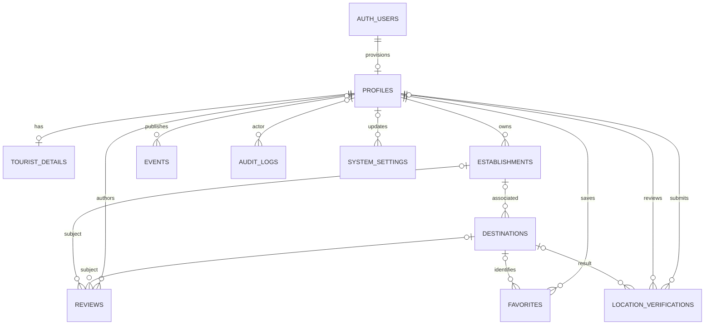

# Task 29 — SamalNav Field-Level Canonical Schema Owner Decision Closure

**Status:** Owner recommendations received for D29-01–D29-17. The recommendations are not approvals. Specific response text records conditional owner-selected directions for D29-12 rating (Option A, exact range pending UI verification), D29-14 event representation (Option C, pending application verification), and D29-17 retention architecture (Option A, details pending A-11 review). Other D29 decisions remain unanswered.

**Authority/evidence boundary:** A-01–A-16 selections are preserved as summarized in Tasks 26–28. A-13 approved the ten-relation scope subject to exact field amendments and service compatibility review; it did not approve every proposed column. A-14 accepted least-privilege invariants subject to independent security review. A-15/A-16 remain deferred. Repository contracts were reviewed; no Supabase project was accessed and no SQL was executed.

## 1. Executive summary

This document converts the outstanding schema choices in Task 28 into decision-ready worksheets and a complete proposed contract for the ten Scope A relations. Each field has a proposed PostgreSQL type, nullability/default, relationship/constraint/index and ownership treatment. The latest owner message supplied recommendations for every decision, plus specific conditional selections for D29-12, D29-14 and D29-17. Those three directions are recorded as conditional selections, not complete technical closure. Where only a recommendation was supplied, the manifest labels the proposal as **not owner-approved** and the decision stays open.

The decisions are grouped by approval authority:

- **A-13 schema-contract decisions:** username semantics, contact fields, destination links, favorite uniqueness, provenance columns, state vocabularies, preference confirmation representation, group constraints, travel mode vocabulary, review scale/uniqueness/moderation, event time, audit taxonomy and settings allowlist.
- **A-09/A-11 policy dependencies:** audit taxonomy/access and settings authorization; profile/account deletion, review/verification retention, anonymization, and deletion actions. A-13 cannot settle these policy decisions by itself.
- **A-14 security gate:** exact grants, RLS predicates, trusted operation contracts, and independent tests remain a separate security review.

The owner-approved invariants remain: one-to-many establishment ownership; separate publication and verification; nullable tourist planning fields; unified reviews with exactly one subject; local Hive pre-booked itinerary details preserved as MO-GA fixed constraints; no payment persistence; no server-side reservations or itinerary persistence; and no CARS evidence tables in core Scope A.

**Readiness:** the ten-relation target is reviewable but not fully closed. Recommendation-only responses remain open; conditional owner-selected directions are recorded for D29-12 rating, D29-14 event representation, and D29-17 retention architecture. No recommendation was automatically converted to approval. Application compatibility, independent A-14 security review, local migration validation, and the separate A-15/A-16 execution gates remain outstanding.

## 2. Existing decisions preserved

| Decision | Owner-approved direction carried forward | Not implied by this document |
|---|---|---|
| A-01/A-02 | Auth trigger provisions profile with least-privilege `tourist`; approved roles are `tourist`, `establishment`, `administrator`, `super_admin`; no user metadata role | Trigger implementation, grants, role operation or bootstrap is approved |
| A-03 | One profile may own many establishments; `owner_id` is not unique | Existing `.maybeSingle()` app query is compatible; it is not |
| A-04 | Tourist planning values remain nullable until explicitly supplied/confirmed | A database default or row presence confirms a preference |
| A-05 | Publication and verification are distinct; coordinates may be absent as a pair; rating and price are not scoring evidence without provenance | Any state vocabulary, rating aggregate or price source is finalized |
| A-06/A-10 | Pre-booked details are tourist-entered local Hive itinerary data; not SAMAL NAV reservations/confirmation; MO-GA preserves them as fixed constraints; no server itinerary persistence | The feature is fully implemented; current models need compatibility work |
| A-07 | Payments and payment persistence are excluded | Existing payment queries/UI can remain against the target schema |
| A-08 | One reviews relation, destination XOR establishment subject, moderation required, no CARS aggregate implied | Scale, duplicate policy or moderation vocabulary is settled |
| A-09 | Server-generated immutable audit events; allowlisted settings through trusted operations | Current client audit insert/settings upsert is acceptable |
| A-11/A-12 | Controlled retention/soft retirement; new unique migration chain; schema and seed separated | Exact retention schedule, migration creation/execution, or seed contents are approved |
| A-13/A-14 | Scope A and least-privilege matrix accepted conditionally | Field manifest closure, deployable RLS/grants, or implementation authorization |
| A-15/A-16 | Deferred | Non-production initialization or production release is authorized |

## 3. Decision worksheet instructions

The owner supplied a recommended-option table for all 17 decisions. That table is recorded in Section 3.18 as **recommendations only**. The specific D29-12, D29-14 and D29-17 response text is recorded as a conditional owner-selected direction, with evidence and formal approval fields still outstanding. Other decisions remain unanswered. If a decision affects A-09 or A-11, the relevant policy approver must also sign it. Blank fields do not mean approval.

### D29-01 — Profile username uniqueness and normalization (**A-13**)

**Question:** Is username still a supported login identifier, and if so, what comparison/normalization and uniqueness rule applies?

| Option | Advantages | Costs / implications |
|---|---|---|
| A. Retain username login; case-insensitive normalized unique key | Supports current username lookup and avoids collisions differing only by case | Requires agreed normalization, reserved-name policy, migration of existing values, and unique-index behavior |
| B. Username is display-only and not unique; login uses Auth email/identifier | Avoids adding identity rules not needed by product | Requires removing username-based lookup and updating register/login/profile flows |
| C. Defer username until identity flow is finalized | Avoids freezing a partially used contract | Blocks final `profiles` manifest and login compatibility |

**Technical note:** Current login queries `profiles` by username to find email; profile page edits username. A unique constraint is necessary for single-row lookup if this remains a login path.

- Recommendation: **A only if username login is retained**, with canonical normalization specified before the index is designed.
- Evidence: current login/register UX and duplicate/normalization behavior; current account data inventory if available.
- Responsible approver: Project owner/product owner; identity/security reviewer supports.
- Owner response/selected option: ____  Revised rule: ____  Rationale: ____
- Approver name/role: ____  Date/version: ____  Evidence: ____  **Status: UNANSWERED**

### D29-02 — Establishment contact fields (**A-13**)

**Question:** Which business contact fields are stored and visible, and are they distinct from the owner profile's personal contact data?

| Option | Advantages | Costs / implications |
|---|---|---|
| A. Keep only currently consumed business contact fields (`contact_phone`, if verified in UI/service) | Minimal manifest | Must verify actual service use and decide public visibility/format |
| B. Add specific business email/phone/website fields | Supports public business contact workflow | Each field needs validation, privacy/publication rules, update ownership and evidence of app use |
| C. Defer unused contacts; retain only `name`, `address`, `category` and approved lifecycle | Prevents speculative fields | May require later schema change when public listing requirements are approved |

- Recommendation: **C unless a current screen/service demonstrably consumes another contact field;** business phone should not be conflated with `profiles.phone`.
- Evidence: establishment registration/edit/detail UI and service payloads.
- Responsible approver: Product owner; system architect/data steward review.
- Owner response/selected option: ____  Exact fields: ____  Visibility: ____
- Approver name/role: ____  Date/version: ____  Evidence: ____  **Status: UNANSWERED**

### D29-03 — Destination-to-establishment relationship (**A-13**, A-05 lifecycle dependency)

**Question:** Can a destination be operated by/associated with an establishment, and may a destination exist without one?

| Option | Advantages | Costs / implications |
|---|---|---|
| A. Nullable `destinations.establishment_id` FK | Supports a destination catalog entry associated with a business while allowing independent destinations | Needs ownership/publication rules and delete/retirement handling |
| B. No relationship in Scope A | Avoids implying destination ownership where product does not establish it | Removes direct relationship needed by future business/destination workflows |
| C. Required establishment FK | Strong ownership link | Excludes independent/community destinations and changes current candidate catalog semantics |

- Recommendation: **A, nullable**, only if the owner confirms that the association is an actual current product relationship; no `owner_id` duplicate should be added without a separate owner workflow.
- Evidence: destination creation forms, owner workflows, current IDs/embeds, and A-05 lifecycle.
- Responsible approver: Project owner; data architect and establishment product owner review.
- Owner response/selected option: ____  Delete behavior: ____  Rationale: ____
- Approver name/role: ____  Date/version: ____  Evidence: ____  **Status: UNANSWERED**

### D29-04 — Location-verification destination linkage (**A-13**, A-05/A-11 dependency)

**Question:** Does an approved verification submission create a new destination, link to an existing one, or either?

| Option | Advantages | Costs / implications |
|---|---|---|
| A. Nullable `destination_id` set only by trusted approval operation | Retains a trace from approved submission to catalog record | Requires idempotent atomic operation and duplicate detection rules |
| B. No destination FK; verification is a standalone submission | Simple and avoids premature linkage | Loses durable traceability from review decision to resulting catalog record |
| C. Require a destination FK for every submission | Useful only for corrections/verification of existing destinations | Incompatible with submissions proposing new destinations unless a separate workflow exists |

- Recommendation: **A** if both proposed-new and correction submissions are supported; otherwise define the narrower workflow first. Never implement current two-request approval as atomic.
- Evidence: submission UI, approval flow, correction-vs-new semantics, retention needs.
- Responsible approver: Project owner and administrator workflow owner; DBA reviews transaction design.
- Owner response/selected option: ____  New/correction flow: ____  Delete/retention rule: ____
- Approver name/role: ____  Date/version: ____  Evidence: ____  **Status: UNANSWERED**

### D29-05 — Favorite snapshot duplicate handling (**A-13**)

**Question:** What identifies a duplicate favorite when `destination_id` is absent or when the same destination is saved more than once?

| Option | Advantages | Costs / implications |
|---|---|---|
| A. Unique `(user_id,destination_id)` for non-NULL destination IDs; allow multiple NULL-ID snapshots | Stable identity deduplication without unreliable name matching | Snapshot-only duplicates remain possible; UI can show duplicates |
| B. Unique normalized `(user_id, place_name)` for snapshots too | Prevents obvious repeated snapshots | Names can change, collide, or differ in punctuation/local spelling; requires normalization contract |
| C. No uniqueness constraint | Preserves current undo/reinsert behavior and avoids false merges | Duplicate rows must be tolerated or resolved in UI |

- Recommendation: **A** for stable catalog IDs; no name-based unique rule without owner-approved identity semantics.
- Evidence: favorite serialization/source ID availability and expected undo behavior.
- Responsible approver: Product owner; app/data architect review.
- Owner response/selected option: ____  NULL-ID behavior: ____  Evidence: ____
- Approver name/role: ____  Date/version: ____  **Status: UNANSWERED**

### D29-06 — Destination rating and price provenance (**A-13**, rating/CARS policy separate)

**Question:** Which rating and price metadata are persisted, and when may the app display them or treat them as evidence?

| Option | Advantages | Costs / implications |
|---|---|---|
| A. Keep nullable value plus source, verification state, retrieved/fresh-until times; price also currency and unit | Makes unknown/stale/unverified distinguishable; supports safe display gates | Requires an identified source/steward, verification workflow, unit definitions and freshness policy |
| B. Keep raw values only, display clearly as unverified | Fewer columns | Cannot substantiate verified rating/price; never eligible for CARS evidence |
| C. Omit rating/price from core destination row pending source decision | Avoids misleading zero/default values | Requires separate later integration and possibly schema change |

- Recommendation: **A only if source and stewardship are approved; otherwise C.** Never default numeric rating/price to zero, and do not derive a CARS score here.
- Proposed fields for owner review: `rating_average numeric`, `rating_is_verified boolean`, `rating_source text`, `rating_retrieved_at timestamptz`, `rating_fresh_until timestamptz`; `entrance_fee numeric`, `entrance_fee_currency text`, `entrance_fee_unit text`, `entrance_fee_source text`, `entrance_fee_is_verified boolean`, `entrance_fee_retrieved_at timestamptz`, `entrance_fee_fresh_until timestamptz`.
- Evidence: named rating/price source, scale and zero semantics, units/currency, steward, update/freshness and verification procedure. Public rating aggregation/CARS usage requires separate policy decisions.
- Responsible approver: Project owner and destination data steward; CARS methodology owner/security review for evidence use.
- Owner response/selected option: ____  Exact retained fields: ____  Source/visibility: ____
- Approver name/role: ____  Date/version: ____  Evidence: ____  **Status: UNANSWERED**

### D29-07 — Publication state vocabulary (**A-13**, A-05)

**Question:** What exact lifecycle states determine whether destinations and establishments are visible, discoverable, or retired?

| Option | Advantages | Costs / implications |
|---|---|---|
| A. One approved text status per entity with documented allowed transitions | Avoids contradictory booleans; supports soft retirement | Requires exact vocabulary and transition/actor matrix |
| B. Boolean published plus retired timestamp | Simple predicates | Less expressive for drafts/suspension; requires rule for contradictory state combinations |
| C. Preserve legacy `status`/`is_active` aliases | Short-term compatibility | Duplicated state can conflict; dual writes and migration mapping required |

- Recommendation: **A**; publish and retirement should be lifecycle concepts, not inferred from verification. Choose statuses explicitly; none are prefilled.
- Evidence: public listing/admin workflows and allowed transition actors.
- Responsible approver: Project owner/product owner; admin workflow owner.
- Owner response: ____  Exact states/transitions: ____  Public predicate: ____
- Approver name/role: ____  Date/version: ____  **Status: UNANSWERED**

### D29-08 — Verification state vocabulary (**A-13**, A-05/A-09)

**Question:** What exact verification states and actors apply independently to destinations and establishments?

Options: (A) one documented text lifecycle per entity; (B) boolean verified plus verification metadata; (C) retain legacy `is_verified` only with explicit unknown semantics. Each can work technically; A best supports pending/rejected/reverification, while B is simpler but cannot represent intermediate states. No state list is assumed.

- Recommendation: **A** if workflows require more than two states; otherwise B with a documented unknown/missing distinction. Publication must remain independent.
- Evidence: verification workflow, reviewer authority, rejection/revision behavior, audit events.
- Responsible approver: Project owner and verification workflow owner; security reviewer for privileged transition.
- Owner response: ____  State list: ____  Transitions/actors: ____
- Approver name/role: ____  Date/version: ____  **Status: UNANSWERED**

### D29-09 — Tourist preference confirmation (**A-13**, A-04)

**Question:** How does a tourist explicitly confirm preference data, and how are subsequent edits represented?

Options: (A) `preferences_confirmed boolean` plus `preferences_confirmed_at timestamptz`; (B) confirmation/version record at application layer; (C) no persistence confirmation field, so stored preferences remain unconfirmed for CARS. A supports a simple profile; B captures history; C avoids inventing schema but blocks confirmed-preference use.

- Recommendation: **A** for a single current preference set, with the rule that any preference edit clears confirmation and its timestamp until reconfirmed. Do not infer confirmation from non-NULL or non-empty values.
- Evidence: planning-preferences UX and explicit confirmation action/version semantics.
- Responsible approver: Product owner/methodology owner; application architect.
- Owner response: ____  Option/rule: ____  Empty preference behavior: ____
- Approver name/role: ____  Date/version: ____  **Status: UNANSWERED**

### D29-10 — Tourist group composition validation (**A-13**, A-04/privacy)

**Question:** Which count fields are collected and which arithmetic constraints are valid without assuming age categories or pricing policy?

Options: (A) nullable total/children/elders, nonnegative when supplied, require total if subgroup counts supplied, and subgroup sum ≤ total; (B) store only total until definitions are approved; (C) keep all nullable with only nonnegative checks. A offers stronger validation but assumes subgroup categories are exhaustive/non-overlapping; B is conservative; C leaves inconsistent counts possible.

- Recommendation: **B until adult/child/elder definitions and overlap semantics are approved;** then consider A. Do not infer age cutoffs, discounts or eligibility.
- Evidence: input UX, age-category definition, whether counts are disjoint/exhaustive and use in supported price units.
- Responsible approver: Project owner; pricing/data steward and privacy reviewer.
- Owner response: ____  Counts/definitions: ____  Constraints: ____
- Approver name/role: ____  Date/version: ____  **Status: UNANSWERED**

### D29-11 — Travel-mode vocabulary (**A-13**, transport policy)

**Question:** Which exact strings are persisted, and does this field describe profile preference, trip-wide selection, or a per-leg choice?

Options: (A) profile preference only, nullable, values from a separately versioned supported-mode catalog; (B) whole-trip selected mode on trip configuration only; (C) per-leg mode records. Because server itinerary persistence is excluded, C does not belong in Scope A. A current `tourist_details.travel_mode` exists in the app contract but must not be misread as a route-leg contract.

- Recommendation: **A only as an optional profile preference with owner-supplied vocabulary; actual trip origin/mode decisions belong to local trip configuration.** No mode strings are invented here.
- Evidence: current preference dropdown values, product definition, routing provider support, whole-trip/per-leg user flow.
- Responsible approver: Project owner/product owner; routing specialist.
- Owner response: ____  Exact values/version: ____  Semantics: ____
- Approver name/role: ____  Date/version: ____  **Status: UNANSWERED**

### D29-12 — Review rating scale and duplicate restrictions (**A-13**, A-08)

**Question:** What rating domain applies to reviews, and may one tourist review the same subject more than once?

Options: (A) integer stars on the already presented UI scale with a matching range check; (B) numeric scale with explicit increments and UI changes; (C) no numeric rating until scale is approved. For duplicates: (i) one current review per author/subject with updates; (ii) multiple dated reviews; (iii) no DB uniqueness pending product rule.

- Owner-selected direction: **Rating Option A — integer stars matching the existing UI scale.** This is conditional; the exact minimum/maximum must be verified against the UI before defining the database check. Duplicate policy remains unanswered; the owner specifically identifies alternative 3 (no database uniqueness constraint pending product policy) as pending, not selected.
- Recommendation: Use one-review-per-author/subject only if edit/update semantics are intended. No numeric range is finalized by this document.
- Evidence: review submission UI, display/parser contract, review policy and moderation/edit workflow.
- Responsible approver: Project owner/product owner; methodology/data steward reviews any public aggregation.
- Owner response: Rating Option A selected conditionally; duplicate policy not selected. Scale/range: pending UI verification. Duplicate option: ____
- Approver name/role: ____  Date/version: ____  Evidence: UI scale inspection and duplicate-review policy required. **Status: CONDITIONAL OWNER DIRECTION; TECHNICAL CLOSURE OPEN**

### D29-13 — Review moderation states (**A-13**, A-08/A-14)

**Question:** What states govern submitted, published, rejected, hidden, or removed reviews, and who can transition them?

Options: (A) owner-approved text state machine with trusted moderator changes; (B) boolean `is_published` plus separate removal semantics; (C) no public review exposure until a moderation contract is approved. A is expressive; B is simpler but has less auditability; C is safest interim behavior.

- Recommendation: **A**, provided exact states/transitions and author visibility are approved; until then do not expose unmoderated public reviews.
- Evidence: moderation policy, appeal/edit rules, authorized moderators, audit requirements.
- Responsible approver: Project owner and moderation policy owner; security reviewer.
- Owner response: ____  State list/transitions: ____  Public visibility: ____
- Approver name/role: ____  Date/version: ____  **Status: UNANSWERED**

### D29-14 — Event date and timezone (**A-13**)

**Question:** Are events all-day local dates or timed instants, and what timezone governs display and filtering?

Options: (A) `date` for all-day event; (B) `timestamptz` for exact instant, with event timezone/display rule; (C) support all-day and timed events using `event_date date NOT NULL`, `is_all_day boolean NOT NULL DEFAULT FALSE`, nullable `starts_at`/`ends_at timestamptz`, and `event_timezone text NOT NULL`. Current admin query orders by `event_date`, but does not establish event creation/edit/display semantics.

- Owner-selected direction: **Option C — support all-day and timed events**, with the proposed fields and rules below. This is conditional on inspection of event create/edit/display/filter workflows and application compatibility review.
- Recommended constraints for the selected direction: all-day events have no start/end instants; timed events have both; `ends_at > starts_at`; `event_timezone` is an explicit IANA timezone identifier. Do not infer server timezone. Constraint implementation and timezone validation remain technical work.
- Evidence: event creation/display UI, locality and timezone policy, end-time/recurrence needs.
- Responsible approver: Project owner/event product owner; system architect.
- Owner response: Option C selected as architectural direction. Event timezone: stored per event as an IANA identifier; application behavior still to verify.
- Approver name/role: ____  Date/version: ____  Evidence: event workflow review required. **Status: CONDITIONAL OWNER DIRECTION; APPLICATION VERIFICATION OPEN**

### D29-15 — Audit action and outcome vocabulary (**A-13 schema**, A-09 policy)

**Question:** What event and outcome vocabulary is captured, and which operation classes must emit audit records?

Options: (A) versioned action/outcome catalog with trusted server writer and structured resource metadata; (B) free-text action plus allowlisted outcome; (C) minimal immutable actor/action/time only. A is more searchable but requires governance; B is flexible but can fragment; C minimizes data but reduces investigations. A-09 additionally requires audit coverage, access, privacy and retention approval.

- Recommendation: **A** with a versioned allowlist and metadata schema; never accept actor/time/action as authoritative from the client. Keep personal data and secrets out.
- Evidence: security threat model, event inventory, incident/audit use cases, retention/privacy rules.
- Responsible approver: Security/privacy owner for A-09 policy; system architect/DBA for A-13 field contract.
- Owner response: ____  Action/outcome list/version: ____  Retention reference: ____
- Approver name/role: ____  Date/version: ____  **Status: UNANSWERED**

### D29-16 — System-settings key/value allowlist (**A-13 schema**, A-09 policy)

**Question:** Which settings exist, their value types/ranges, read visibility, and authorized writer are allowed?

Options: (A) versioned key registry with typed JSON schemas and trusted operations; (B) fixed typed columns for each approved setting; (C) exclude settings until maintenance-mode use is fully specified. A supports extension but requires runtime validation; B is strongly typed but schema changes for new keys; C blocks current maintenance banner integration.

- Recommendation: **A with a small owner-approved allowlist and per-key validator; no credentials/secrets in this relation.** A-09 security owner must approve read/write roles and emergency access.
- Evidence: current `SuperAdminService` keys, maintenance UX, setting data types, threat model and audit behavior.
- Responsible approver: Project owner and security owner (A-09); DBA reviews storage contract.
- Owner response: ____  Keys/types/visibility/writer: ____  Emergency path: ____
- Approver name/role: ____  Date/version: ____  **Status: UNANSWERED**

### D29-17 — Account deletion and data retention (**A-11 policy**, also FK actions under A-13)

**Question:** What is the account closure, anonymization, retention, backup deletion, and exceptional hard-delete policy for each relation?

Options: (A) soft-close profile and retain required history, anonymizing identity under approved schedule; (B) hard-delete profile with per-relation restrict/set-null/cascade rules and no retained personal references; (C) defer account deletion until legal/privacy review defines periods and actors. A aligns with A-11 but needs exact periods and process; B risks destroying history or retaining unintended identity; C blocks final delete actions.

- Owner-selected direction: **Option A — soft-close profile and retain required historical records**, consistent with A-11. Exact retention periods, anonymization rules, legal requirements, backup deletion procedures, and authorized actors remain subject to formal privacy/security approval.
- Recommendation: use restrictive or set-null FK actions where they preserve approved history, but do not finalize any relation-specific action until the retention schedule is approved.
- Evidence: applicable privacy/legal requirements, record-category retention schedule, backup lifecycle, account closure and anonymization procedure.
- Responsible approver: Project owner plus privacy/legal authority; DBA/security reviewer for FK effects.
- Owner response: Option A selected as architectural direction. Periods/actions by relation: pending. Anonymization process: pending A-11 review.
- Approver name/role: ____  Date/version: ____  Evidence: privacy/legal retention schedule and backup lifecycle required. **Status: CONDITIONAL OWNER DIRECTION; A-11 CLOSURE OPEN**

### 3.18 Owner-supplied recommendation register (not approval)

The latest owner message supplies recommended options for all decisions. Recommendations are not approvals. The detailed conditional selections are recorded above only for D29-12 rating, D29-14 event representation, and D29-17 retention architecture. No separate approver name/role, date, or effective policy version accompanied those responses.

| Decision | Owner recommendation received | Recorded status |
|---|---|---|
| D29-01 | Option A | Recommendation only; unanswered |
| D29-02 | Option C | Recommendation only; unanswered |
| D29-03 | Option A, subject to actual product relationship confirmation | Recommendation only; unanswered |
| D29-04 | Option A, subject to new-destination/correction workflow confirmation | Recommendation only; unanswered |
| D29-05 | Option A | Recommendation only; unanswered |
| D29-06 | Option C pending authoritative source and stewardship | Recommendation only; unanswered |
| D29-07 | Option A | Recommendation only; unanswered |
| D29-08 | Option A subject to required-state confirmation | Recommendation only; unanswered |
| D29-09 | Option A | Recommendation only; unanswered |
| D29-10 | Option B | Recommendation only; unanswered |
| D29-11 | Option A with owner-approved vocabulary | Recommendation only; unanswered |
| D29-12 | Rating Option A after UI scale verification; duplicate alternative 3 pending product policy | Conditional owner-selected rating direction in D29-12; duplicate policy unanswered |
| D29-13 | Option A subject to moderation-state approval | Recommendation only; unanswered |
| D29-14 | Pending workflow confirmation; specific response selects Option C for all-day and timed events | Conditional owner-selected direction in D29-14; workflow verification open |
| D29-15 | Option A subject to A-09 policy approval | Recommendation only; unanswered |
| D29-16 | Option A subject to A-09 security approval | Recommendation only; unanswered |
| D29-17 | Option A architecture; exact retention and deletion actions pending A-11 | Conditional owner-selected direction in D29-17; A-11 details open |

## 4. Proposed final ten-relation manifest

The manifest below is the concrete technical proposal to be accepted, revised, or rejected through the worksheets. It is not owner-approved DDL. Fields listed with unresolved decisions must be removed or revised if the owner does not approve them. No inferred app fallback is a database default.

### 4.1 Field catalog

`NN` = proposed NOT NULL; `NULL` = nullable; `sys` = database/server generated. All UUID primary-key defaults using `gen_random_uuid()` require local environment validation. `updated_at` maintenance mechanism is not chosen.

| Relation | Proposed columns (type; nullability; default) |
|---|---|
| **profiles** | `id uuid NN PK → auth.users(id)` (Auth supplied); `email text NULL`; `display_name text NULL`; `username text NULL`; `phone text NULL`; `role text NN` (trusted trigger supplies `tourist`, no client default); `created_at timestamptz NN DEFAULT now()`; `updated_at timestamptz NN DEFAULT now()`. Exclude `mfa_email_enabled` until source/ownership decision. |
| **destinations** | `id uuid NN PK DEFAULT gen_random_uuid()`; `name text NN`; `location text NN`; `category text NULL`; `lat double precision NULL`; `lng double precision NULL`; `description text NULL`; `image_url text NULL`; `image_urls text[] NULL`; `publication_status text NN` (no default pending D29-07); `verification_status text NN` (no default pending D29-08); `establishment_id uuid NULL FK` (pending D29-03); `operating_hours jsonb NULL`; `average_stay_minutes integer NULL`; optional rating fields `rating_average numeric`, `rating_is_verified boolean`, `rating_source text`, `rating_retrieved_at timestamptz`, `rating_fresh_until timestamptz` (pending D29-06); optional price fields `entrance_fee numeric`, `entrance_fee_currency text`, `entrance_fee_unit text`, `entrance_fee_source text`, `entrance_fee_is_verified boolean`, `entrance_fee_retrieved_at timestamptz`, `entrance_fee_fresh_until timestamptz` (pending D29-06); `created_at timestamptz NN DEFAULT now()`; `updated_at timestamptz NN DEFAULT now()`. |
| **establishments** | `id uuid NN PK DEFAULT gen_random_uuid()`; `owner_id uuid NN FK profiles.id`; `name text NN`; `description text NULL`; `address text NULL`; `lat double precision NULL`; `lng double precision NULL`; `category text NULL`; optional `contact_phone text NULL` (D29-02); `publication_status text NN` (D29-07); `verification_status text NN` (D29-08); `created_at timestamptz NN DEFAULT now()`; `updated_at timestamptz NN DEFAULT now()`. No unique owner constraint. |
| **location_verifications** | `id uuid NN PK DEFAULT gen_random_uuid()`; `name text NN`; `address text NULL`; `category text NULL`; `lat double precision NN`; `lng double precision NN`; `description text NULL` only if current submission form uses it; `submitted_by uuid NN FK profiles.id`; `status text NN` (no default until vocabulary approval); `reviewed_by uuid NULL FK profiles.id`; `reviewed_at timestamptz NULL`; `destination_id uuid NULL FK destinations.id` (D29-04); `created_at timestamptz NN DEFAULT now()`. |
| **tourist_details** | `id uuid NN PK DEFAULT gen_random_uuid()`; `user_id uuid NN UNIQUE FK profiles.id`; `budget_min numeric NULL`; `budget_max numeric NULL`; `budget_currency text NULL`; `budget_basis text NULL`; `available_hours_per_day integer NULL`; `trip_duration_days integer NULL`; `preferred_categories text[] NULL`; `preferences_confirmed boolean NULL` and `preferences_confirmed_at timestamptz NULL` (D29-09); `current_lat double precision NULL`; `current_lng double precision NULL`; `travel_mode text NULL` (D29-11; profile preference only); `number_of_tourists integer NULL`; `children_count integer NULL`; `elders_count integer NULL`; `created_at timestamptz NN DEFAULT now()`; `updated_at timestamptz NN DEFAULT now()`. No defaults for tourist facts. |
| **favorites** | `id uuid NN PK DEFAULT gen_random_uuid()`; `user_id uuid NN FK profiles.id`; `destination_id uuid NULL FK destinations.id`; `place_name text NN`; `location text NULL`; `category text NULL`; `rating numeric NULL` (snapshot only); `rating_is_verified boolean NULL` (only if D29-06 provenance meaning approved); `created_at timestamptz NN DEFAULT now()`. |
| **reviews** | `id uuid NN PK DEFAULT gen_random_uuid()`; `tourist_id uuid NN FK profiles.id`; `destination_id uuid NULL FK destinations.id`; `establishment_id uuid NULL FK establishments.id`; `stars integer NN` (domain D29-12); `review_text text NULL`; `moderation_status text NN` (D29-13); `created_at timestamptz NN DEFAULT now()`; `updated_at timestamptz NN DEFAULT now()`. Exactly one subject required. |
| **events** | `id uuid NN PK DEFAULT gen_random_uuid()`; `title text NN`; `category text NN`; `description text NULL`; `event_date date NN`; `is_all_day boolean NN DEFAULT FALSE`; `starts_at timestamptz NULL`; `ends_at timestamptz NULL`; `event_timezone text NN` (IANA identifier); `posted_by uuid NN FK profiles.id`; `publication_status text NN` (state vocabulary required); `created_at timestamptz NN DEFAULT now()`; `updated_at timestamptz NN DEFAULT now()`. This reflects the conditional Option C direction; verify app workflows before schema closure. |
| **audit_logs** | `id uuid NN PK DEFAULT gen_random_uuid()`; `actor_id uuid NULL FK profiles.id`; `actor_role text NULL`; `action text NN`; `resource_type text NULL`; `resource_id text NULL`; `description text NULL`; `metadata jsonb NULL`; `outcome text NULL`; `created_at timestamptz NN DEFAULT now()` (trusted writer); exact taxonomy D29-15/A-09. No duplicate alias columns. |
| **system_settings** | `key text NN PK`; `value jsonb NN`; `updated_by uuid NULL FK profiles.id`; `updated_at timestamptz NN DEFAULT now()`; keys/value schemas and read/write allowlist D29-16/A-09. No secrets. |

### 4.2 Keys, checks, indexes and deletion matrix

| Relation | Keys / proposed checks | Candidate indexes | Proposed deletion behavior (must be approved under A-11 where historical/personal data is involved) |
|---|---|---|---|
| profiles | PK `id`; FK to managed Auth user; role CHECK exact four approved roles; optional normalized username UNIQUE only if D29-01=A | PK; optional unique normalized username; role index only if query plan requires | Auth/profile closure via controlled procedure; do not assume cascade across retained history |
| destinations | PK `id`; optional FK `establishment_id`; coordinate both-null-or-both-valid; optional price/rating coherence checks only after D29-06 | publication state; optional `establishment_id`; category only if queried | Soft retire; linked establishment deletion restricted/retired, not destructive; FK action pending D29-03/A-11 |
| establishments | PK `id`; FK `owner_id`; coordinate pair/range checks; explicitly no UNIQUE(owner_id) | `owner_id`; publication state if queried | Restrict hard deletion; soft retire; preserve history |
| location_verifications | PK; FKs submitter/reviewer/destination; coordinate ranges; reviewed fields consistency; status checks after approval | `(status,created_at)`; `(submitted_by,created_at)` if history UI exists; `destination_id` if used | Preserve for audit/retention; anonymize or restrict per A-11; do not cascade review history |
| tourist_details | PK; UNIQUE `user_id`; FK profile; budget nonnegative and currency/basis consistency; coordinate pair/range; counts nonnegative | Unique `user_id` index | Profile detail may be deleted on account closure only via reviewed operation; personal-data retention policy applies |
| favorites | PK; FK user/destination; uniqueness policy pending D29-05 | `(user_id,created_at DESC)`; optional partial unique `(user_id,destination_id)` | Destination `ON DELETE SET NULL` proposed to preserve snapshot; account removal by reviewed privacy process |
| reviews | PK; FKs tourist/destination/establishment; XOR subject; rating-domain check after D29-12; unique author/subject only if selected | `(destination_id,moderation_status,created_at DESC)`, `(establishment_id,moderation_status,created_at DESC)`, `(tourist_id,created_at DESC)` | Retire subjects; avoid cascade; author anonymization/retention by A-11 policy |
| events | PK; FK publisher; all-day/timed date consistency; timed events require both instants and end > start; explicit timezone validation; status check after state approval | `(publication_status,event_date)` | Retain history or soft retire; publisher deletion behavior requires A-11 policy |
| audit_logs | PK; optional actor FK; taxonomy check only after D29-15 | `(created_at DESC)`; `(actor_id,created_at DESC)`; resource index only if approved use | Append-only; preserve retention; actor FK may `SET NULL` only if anonymization policy permits |
| system_settings | PK `key`; optional updater FK; per-key type/validation through trusted operation | PK key; no extra index expected | Settings history/audit policy under A-09/A-11; never cascade-delete audit history |

### 4.3 Ownership map

| Data | Logical owner | Database enforcement target |
|---|---|---|
| Profile | One Auth identity | `profiles.id = auth.uid()` for self-service; role fields trusted-only |
| Tourist details | One tourist profile | `user_id = auth.uid()` for all self-service operations |
| Establishment | One owner profile; owner can own many | `owner_id = auth.uid()`; immutable owner ID for client; reviewed admin reassignment only |
| Favorite | One tourist | `user_id = auth.uid()`; no cross-user access |
| Review | Author plus exactly one subject | Author owns submission; moderators alone change moderation state |
| Verification request | Submitter; reviewer is trusted staff | Submitter cannot alter review decision; atomic trusted reviewer operation |
| Destination/event | Platform catalog/publisher lifecycle | Public read limited to approved published projection; writes by trusted authorized actors |
| Audit/settings | Platform operation/security | No client audit writes; settings writes through allowlisted trusted operation |

## 5. Relationship and constraint review

This diagram is a target design only. It explicitly preserves AP-24 and A-08. A destination-to-establishment link and verification-result link remain pending D29-03/D29-04. No relationship is created to `reservations`, `payments`, activities, CARS evidence, or server itinerary tables.

## 6. Application compatibility findings

| Feature / inspected code | Current expectation | Proposed schema/policy mismatch | Required future change |
|---|---|---|---|
| Profiles: `UserProfileRecord`, `RoleService`, login/register/profile screens | Profile reads/upserts; login may look up username; role service writes profile | Auth trigger owns profile creation; role is trusted-only; username uniqueness unresolved | Make trigger and client creation idempotent; remove self-role writes; close D29-01; narrow profile projections |
| Destinations: `DestinationRecord`, `DestinationService`, `AdministratorService` | Legacy `status`, `is_active`, `is_verified`; parser fallback values for missing data | New separate publication/verification lifecycle; nullable coordinates and provenance | Map explicit states; do not write fallback values back; trusted atomic approval; narrow queries |
| Establishments: `Establishment`, `EstablishmentService`, dashboards | One row via `.maybeSingle()`, `is_verified` boolean | AP-24 one-to-many; separate publication/verification | List/selected-establishment-ID UX and APIs; owner-scoped queries; no unique `owner_id` |
| Location verification | Client status update followed by separate destination insert | Partial transaction risk and reviewer-field trust | Trusted atomic approval; permission and state transition tests |
| Tourist profile | Budget bounds, hours, days, travel mode required by model; service creates missing row | A-04 says nullable/no fabricated defaults; preference confirmation explicit | Nullable model/service and partial updates; no fallback persistence; confirmation UI/contract |
| Favorites | Snapshot fields, rating optional, undo reinsert | Destination identity can be absent; duplicate behavior unresolved | Close D29-05; ensure snapshot rating never becomes CARS evidence; owner RLS |
| Reviews | Review model requires `destination_id`; establishment query/average | A-08 XOR allows establishment-only review; moderation absent from current model | Typed destination-or-establishment subject; approved rating range/moderation; no implied CARS aggregate |
| Events | `event_date` ordered by service; profile publisher embed | Owner selected Option C direction with local date, all-day flag, optional instants and explicit timezone; current service/UI compatibility still unverified | Inspect create/edit/display/filter behavior; implement agreed timezone handling and publication state |
| Audit | Client inserts actor/action aliases | A-09 requires server-generated immutable event | Replace client writes with trusted writer; single canonical vocabulary and redaction |
| Settings | Super-admin client reads and generic upserts | A-09 requires allowlisted trusted operation | Typed key registry/operation; restrict table access |
| Pre-booked itinerary information | Hive draft storage; MO-GA local workflow | Commitment entity/fixed-constraint behavior not complete | Separate local-only feature implementation with serialization and invariant tests |
| Reservations/payments | Services/screens/models query/update both tables | Both are excluded by owner decisions A-06/A-07 | Remove or redesign flows/metrics; do not create substitute database booking/payment tables |

## 7. Security and retention dependencies

### A-14 security review remains separate

Exact policies must be designed against the closed manifest and independently reviewed. At minimum:

- RLS enabled for exposed application relations; grants limited by schema/table/column/operation.
- Anonymous reads only approved public projections of published destinations/events and moderated public reviews, if those surfaces are approved.
- Tourists limited to their own profile, tourist details, favorites, review-author actions, and verification submissions.
- Establishment role limited to all and only rows owned through `owner_id`; owners cannot reassign ownership.
- Administrators/moderators use trusted predicates and cannot self-approve submissions or reviews.
- Super-admin role changes and settings writes occur through trusted, audited operations; no self-elevation.
- Audit records have no ordinary client insert/update/delete privilege. Reads are restricted and audited as required.
- Auth trigger and any `SECURITY DEFINER` operation use a controlled `search_path`, reviewed owner, explicit caller validation and narrow EXECUTE grants.
- Test anon, unrelated tourists, multiple owners/establishments, administrator and super-admin with synthetic identities; test every exposed command and protected column.

### A-09/A-11 policy items not solved by A-13

- Audit access, event coverage, metadata redaction, retention and exceptional deletion require A-09/A-11 approval.
- System-settings keys, value schemas, public visibility, emergency access and authorized writers require A-09 security approval.
- Auth/account closure, profile anonymization, review/verification retention, soft retirement, backup deletion and exception process require A-11 privacy/legal approval.
- Foreign-key deletion actions in the manifest cannot be final until those retention decisions are resolved.

## 8. Final unresolved blocker register

| Blocker | Owner worksheet(s) | Needed closure evidence | Blocks |
|---|---|---|---|
| Username login and normalized uniqueness | D29-01 | Product login decision; normalization/collision plan | `profiles` exact unique index and login compatibility |
| Business contact contract | D29-02 | Form/service field map and public visibility decision | Exact `establishments` columns |
| Destination/verification relationships | D29-03/D29-04 | Workflow ownership and atomic approval semantics | FKs, delete behavior, PostgREST relation design |
| Favorite duplicate policy | D29-05 | Stable identity availability and UX behavior | Unique constraints |
| Rating/pricing provenance | D29-06 | Provider/steward, scale/units, verification/freshness contract | Destination columns and any evidence use |
| Publication/verification vocabularies | D29-07/D29-08 | State/transition/actor matrices | Checks, RLS predicates and app state mapping |
| Preference confirmation | D29-09 | Explicit confirmation UX and reset/reconfirm semantics | `tourist_details` fields and CARS preference eligibility |
| Group validation | D29-10 | Count/age category semantics | Tourist checks and pricing compatibility |
| Travel-mode vocabulary/scope | D29-11 | Supported values and profile-vs-trip semantics | `tourist_details.travel_mode` validation |
| Review scale, uniqueness and moderation | D29-12/D29-13 | Verify UI scale; select duplicate policy; approve moderation lifecycle | Rating check, unique index decision, public RLS |
| Event time semantics | D29-14 | Inspect event workflows and validate selected all-day/timed contract and timezone handling | Application compatibility and event constraints |
| Audit taxonomy/settings allowlist | D29-15/D29-16 + A-09 | Threat model, keys/action catalog and data minimization | Audit/settings schema and trusted APIs |
| Retention/deletion | D29-17 + A-11 | Approved per-record retention, anonymization and backup policy | FK actions and account closure |
| Application compatibility | Section 6 | Approved code work and automated regression evidence | Usable canonical target |
| Migration/security acceptance | A-12/A-14 | New migration chain, local clean install, independent review, recovery rehearsal | Any A-15 request |
| Deployment | A-15/A-16 | Separate target-specific approvals and acceptance evidence | Non-production/production execution |

## 9. Recommended next implementation phase

The immediate next phase is **owner decision completion and contract closure**, not migration authoring:

1. Owner confirms or revises recommendation-only options D29-01–D29-11, D29-13, D29-15 and D29-16; supplies formal approver/date/version and evidence for the conditional directions D29-12, D29-14 and D29-17; resolves D29-12 duplicate policy and exact UI rating range.
2. Application architect maps every retained field and each state transition to exact Dart models, service payloads, screens, and PostgREST embeds. Resolve contradictions in a compatibility plan.
3. DBA converts approved choices into a versioned field/key/index/deletion manifest and checks the design against supported local PostgreSQL/Supabase behavior; no remote inspection is implied.
4. A-09/A-11 policy owners close the security, settings, audit, retention and deletion details; A-14 independent reviewer produces and tests exact grants/RLS/trusted operation contracts.
5. Only after owner review of the complete manifest should a separately authorized implementation task prepare migration files and application changes. Keep schema and synthetic seeds separate.
6. Run local clean-install, repeatability, schema-diff, application contract, RLS adversarial, PostgREST embed, and backup/restore tests. Preserve exact hashes and results.
7. Request A-15 authorization separately for a specific non-production change set. A-16 remains a later, independent production go/no-go after non-production acceptance.

## 10. Owner closeout record

| Decision | Owner response | Approver/role | Date/version | Evidence | Status |
|---|---|---|---|---|---|
| D29-01–D29-11, D29-13, D29-15, D29-16 | Recommendations supplied only | Not supplied | Not supplied | No approval evidence | **UNANSWERED** |
| D29-12 rating range | Option A direction supplied; exact UI min/max not verified | Not supplied | Pending | UI scale evidence not supplied | **CONDITIONAL; TECHNICAL CLOSURE OPEN** |
| D29-12 duplicate policy | No option selected; alternative 3 remains pending | Not supplied | Not supplied | Product policy not supplied | **UNANSWERED** |
| D29-14 event representation | Option C selected as architectural direction | Not supplied | Pending | Workflow compatibility not verified | **CONDITIONAL; APPLICATION VERIFICATION OPEN** |
| D29-17 retention architecture | Option A selected | Not supplied | Pending | A-11 periods and procedures not supplied | **CONDITIONAL; A-11 CLOSURE OPEN** |
| A-09 policy closure | Not supplied by this task | Not supplied | Not supplied | Not supplied | **OPEN** |
| A-11 retention closure | Direction preserved; details not supplied | Not supplied | Not supplied | Not supplied | **OPEN** |
| A-14 independent security review | Not supplied by this task | Independent reviewer not named | Not supplied | No test evidence | **OPEN** |
| A-15 non-production authorization | Deferred under Task 27 | — | — | Prerequisites incomplete | **NOT AUTHORIZED** |
| A-16 production authorization | Deferred under Task 27 | — | — | Acceptance/release evidence incomplete | **NOT AUTHORIZED** |

**Final determination:** The ten-relation Scope A boundary is owner-approved, but the exact field-level schema is **not closed**. Recommendations remain recommendations. D29-12 rating, D29-14 event representation, and D29-17 retention architecture have conditional owner-selected directions, but evidence/policy conditions and formal approver/date/version records remain open. Application compatibility and security validation remain incomplete. No implementation, migration creation/execution, database initialization, or production deployment is authorized.

## 11. Closeout

- **Created:** `docs/TASK_29_SAMALNAV_FIELD_LEVEL_CANONICAL_SCHEMA_OWNER_DECISION_CLOSURE.md`.
- **Code/tests/configuration/SQL/migrations/database:** unchanged; no SQL executed.
- **Supabase:** neither project accessed.
- **Prior documents:** Tasks 06–28 preserved.
- **Owner input recorded:** recommendation options D29-01–D29-17 are distinguished from approvals; conditional directions are recorded for D29-12 rating, D29-14 event representation, and D29-17 retention architecture. No other recommendation is treated as approved.
